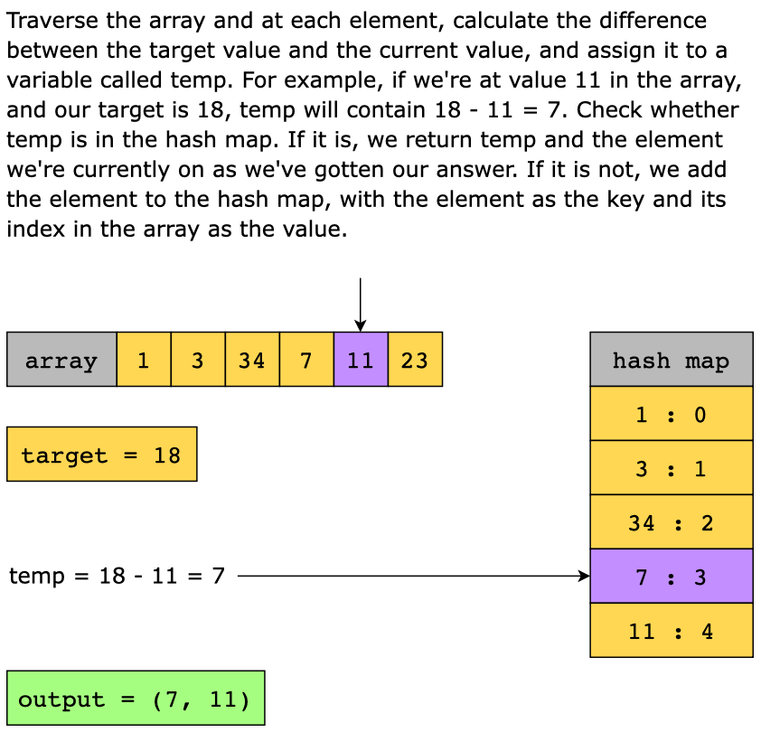

# ✅ Easiest Detailed Explanation With Image and Commented Code.

**Author:** Kunal_Tajne
**Votes:** 431
**Link:** [https://leetcode.com/problems/two-sum/solutions/5679696/](https://leetcode.com/problems/two-sum/solutions/5679696/)

---

# Intuition
The problem requires finding two numbers in an array that sum up to a given target. My first thought was to use a brute force approach, where I would check each pair of numbers to see if they add up to the target. However, this would have a time complexity of O(n^2), which is inefficient for large arrays.

To optimize this, I realized that we can use a hash map to store numbers and their indices as we iterate through the array. By checking if the difference between the target and the current number exists in the map, we can find the solution in a single pass.

# Approach


- Initialize an empty hash map (numToIndexMap) to store the numbers we've seen so far and their corresponding indices.
- Iterate over the array using a for loop.
- For each number nums[i], calculate the difference diff between the target and the current number (diff = target - nums[i]).
- Check if diff exists in numToIndexMap. If it does, it means we've found the two numbers that add up to the target. Return their indices [i, numToIndexMap.get(diff)].
- If diff does not exist in the map, store the current number and its index in numToIndexMap.
- If no such pair is found by the end of the loop, return null. (Though according to the problem constraints, a solution is guaranteed, so this case won't occur.)

# Dry Run Of a Example
Input Array (nums): [2, 7, 11, 15] | Target: 9

---
## Initial Setup:
- The method initializes an empty HashMap called numToIndexMap to keep track of numbers and their indices.
- It then iterates through the array to find two numbers that add up to the target value.

### Iteration 1:
- Index (i): 0
- Current Number (nums[i]): 2
- Difference (diff): 9 - 2 = 7
- The numToIndexMap is empty at this point.
- The method checks if 7 (the difference) is present in numToIndexMap. Since it is not, the check fails.
- The method then adds the current number 2 and its index 0 to numToIndexMap: numToIndexMap = {2: 0}

## Iteration 2:
- Index (i): 1
- Current Number (nums[i]): 7
- Difference (diff): 9 - 7 = 2
- The method checks if 2 (the difference) is present in numToIndexMap. This time, it finds that 2 is indeed in numToIndexMap, with an index of 0.
- Since the difference is found in numToIndexMap, the method returns the indices of the two numbers that add up to the target: [1, 0].

The method successfully finds that the numbers at indices 0 and 1 (i.e., 2 and 7) add up to 9, which is the target value. Therefore, it returns [1, 0] as the result.


# Complexity
## Time complexity:
The time complexity of this approach is O(n), where n is the length of the array. This is because we are iterating through the array once, and each lookup or insertion in the hash map takes O(1) time on average.

## Space complexity:
The space complexity is O(n) because, in the worst case, we might store all the numbers in the hash map if no two numbers add up to the target until the last element.

# Code
```java []
class Solution {

    // Method to find two numbers in the array that add up to the target value
    public int[] twoSum(int[] nums, int target) {

        // Create a HashMap to store numbers and their corresponding indices
        Map<Integer, Integer> numToIndexMap = new HashMap<>();
        
        // Get the size of the input array
        int sizeOfArray = nums.length;

        // Loop through the array
        for(int i = 0; i < sizeOfArray; i++) {
            // Calculate the difference between the target and the current number
            int diff = target - nums[i];

            // Check if the difference already exists in the map
            if(numToIndexMap.containsKey(diff)) {
                // If it exists, return the indices of the current number and the number that adds up to the target
                return new int[]{i, numToIndexMap.get(diff)};
            }

            // If it doesn't exist, add the current number and its index to the map
            numToIndexMap.put(nums[i], i);
        }

        // If no two numbers add up to the target, return null
        return null;
    }
}

```
```C++ []

class Solution {
public:
    std::vector<int> twoSum(std::vector<int>& nums, int target) {
        // Create an unordered_map to store numbers and their corresponding indices
        std::unordered_map<int, int> numToIndexMap;

        // Loop through the array
        for (int i = 0; i < nums.size(); i++) {
            // Calculate the difference between the target and the current number
            int diff = target - nums[i];

            // Check if the difference already exists in the map
            if (numToIndexMap.find(diff) != numToIndexMap.end()) {
                // If it exists, return the indices of the current number and the number that adds up to the target
                return {i, numToIndexMap[diff]};
            }

            // If it doesn't exist, add the current number and its index to the map
            numToIndexMap[nums[i]] = i;
        }

        // If no two numbers add up to the target, return an empty vector
        return {};
    }
};

```
```javascript []
var twoSum = function(nums, target) {
    // Create an object to store numbers and their corresponding indices
    let numToIndexMap = {};

    // Loop through the array
    for (let i = 0; i < nums.length; i++) {
        // Calculate the difference between the target and the current number
        let diff = target - nums[i];

        // Check if the difference already exists in the object
        if (numToIndexMap.hasOwnProperty(diff)) {
            // If it exists, return the indices of the current number and the number that adds up to the target
            return [i, numToIndexMap[diff]];
        }

        // If it doesn't exist, add the current number and its index to the object
        numToIndexMap[nums[i]] = i;
    }

    // If no two numbers add up to the target, return null
    return null;
};

```
```python []
class Solution:
    def twoSum(self, nums, target):
        # Create a dictionary to store numbers and their corresponding indices
        number_map = {}

        # Loop through the array
        for i, num in enumerate(nums):
            # Calculate the difference between the target and the current number
            diff = target - num

            # Check if the difference already exists in the dictionary
            if diff in number_map:
                # If it exists, return the indices of the current number and the number that adds up to the target
                return [i, number_map[diff]]

            # If it doesn't exist, add the current number and its index to the dictionary
            number_map[num] = i
        
        # If no two numbers add up to the target, return None
        return None

```
```Go []
func twoSum(nums []int, target int) []int {
    // Create a map to store numbers and their corresponding indices
    numToIndexMap := make(map[int]int)

    // Loop through the array
    for i, num := range nums {
        // Calculate the difference between the target and the current number
        diff := target - num

        // Check if the difference already exists in the map
        if idx, found := numToIndexMap[diff]; found {
            // If it exists, return the indices of the current number and the number that adds up to the target
            return []int{i, idx}
        }

        // If it doesn't exist, add the current number and its index to the map
        numToIndexMap[num] = i
    }

    // If no two numbers add up to the target, return nil
    return nil
}
```

# A single upvote is all it takes : )

If found helpful, give a upvote. Keeps me motivated to post more solutions. Thanks!
