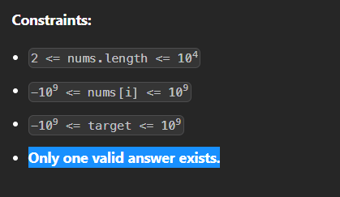
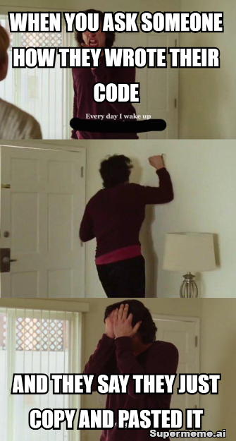

# Solution  - C++/Java/Python  (Both Brute force & Optimized Code)

**Author:** arajAnkit
**Votes:** 1520
**Link:** [https://leetcode.com/problems/two-sum/solutions/2990807/](https://leetcode.com/problems/two-sum/solutions/2990807/)

---

# Beginner Doubt's - 
- Lets Connect on LinkedIn (Leave a note) - https://www.linkedin.com/in/arajankit/
- Join my Telegram Chyannel for Exclusive Internships & Jobs - @letsgocareer (https://t.me/letsgocareer)
- I am goint to solve all Leetcode Problems. If you are intrested to contribute. Please visit my github repo to contribute - https://github.com/arajAnkit/Leetcode-OpenSource
# 2. Time complexity of second solution is O(N ^ 2) OR O(N logN) Instead of O(N)?
- I have explained well how the time complexity of the second solution is O(N). Its explanation is written below the solution.

# Problem Constraints
- Test cases written like more than one solution cannot exist. Either solution exist or not.
# Brute Force Approach
- Run two nested loops to check every possible pair of numbers in the given array to see if they add up to the target sum.
- If they add up to the target sum return the indexes.

# Brute Force Code

```C++ []
class Solution {
public:
    vector<int> twoSum(vector<int>& nums, int target) {
        for (int i = 0; i < nums.size(); i++) {
            for (int j = i + 1; j < nums.size(); j++) {
                if (nums[i] + nums[j] == target) {
                    return {i, j};
                }
            }
        }
        return {};
    }
};

```
```Java []
class Solution {
    public int[] twoSum(int[] nums, int target) {
        for (int i = 0; i < nums.length; i++) {
            for (int j = i + 1; j < nums.length; j++) {
                if (nums[i] + nums[j] == target) {
                    return new int[] {i, j};
                }
            }
        }
        return new int[] {};
    }
}

```
```Python []
class Solution:
    def twoSum(self, nums: List[int], target: int) -> List[int]:
        for i in range(len(nums)):
            for j in range(i + 1, len(nums)):
                if (i != j and nums[i] + nums[j] == target):
                    return [i, j]
        return []

```
# Complexity
-   Time complexity: O(N^2);
-   Space Complexity: O(1);

---

# Optimized Code - TWO PASS HASH TABLE SOLUTION

```C++ []
#include <unordered_map>
 
class Solution {
public:
    vector<int> twoSum(vector<int>& nums, int target) {
        // Declare an unordered map to store the numbers and their indices
        unordered_map<int, int> mp;
       
        // Loop through the array
        for(int i = 0; i < nums.size(); i++){
            // Check if the complement of the current number exists in the map
            if(mp.find(target - nums[i]) == mp.end())
                // If not, add the current number and its index to the map
                mp[nums[i]] = i;
            else
                // If yes, return the indices of the current number and its complement
                return {mp[target - nums[i]], i};
        }
 
        // If no pair is found, return {-1, -1} as a default value
        return {-1, -1};
    }
};


```
```Java []
import java.util.HashMap;
import java.util.Map;
 
class Solution {
    public int[] twoSum(int[] nums, int target) {
        Map<Integer, Integer> numToIndex = new HashMap<>();
        for (int i = 0; i < nums.length; i++) {
            if (numToIndex.containsKey(target - nums[i])) {
                return new int[] {numToIndex.get(target - nums[i]), i};
            }
            numToIndex.put(nums[i], i);
        }
        return new int[] {};
    }
}


```
```Python []
class Solution:
    def twoSum(self, nums: List[int], target: int) -> List[int]:
        numToIndex = {}
        for i in range(len(nums)):
            if target - nums[i] in numToIndex:
                return [numToIndex[target - nums[i]], i]
            numToIndex[nums[i]] = i
        return []

```
# Complexity
-   Time complexity: O(N);
-   Space Complexity: O(N);

# DRY Run
Suppose we have an array nums = [2, 7, 11, 15] and a target of target = 9. We want to find two numbers in nums that add up to target.

Initially, the unordered_map mp is empty. We start iterating through the array from left to right.

For the first element nums[0] = 2, we check if its complement target - nums[0] = 7 exists in the map by using the find() method. Since it does not exist in the map, we add the key-value pair (2, 0) to the map. The map now looks like this: {2: 0}.

For the second element nums[1] = 7, we check if its complement target - nums[1] = 2 exists in the map. Since it does exist in the map, we return the indices mp[2] = 0 and i = 1 as a vector {0, 1}.

Therefore, the code returns the expected output of [0, 1], indicating that the indices of the two elements that add up to the target are 0 and 1.

---
# Optimized Code - ONE PASS HASH TABLE SOLUTION

```
class Solution {
public:
    Solution() {
        ios_base ::sync_with_stdio(false);
        cin.tie(NULL);
        cout.tie(NULL);
    }
    vector<int> twoSum(vector<int>& nums, int target) {
        // Declare a hash map to store the numbers and their indices
        unordered_map<int, int> mp;
        // Loop through the array
        for (int i = 0; i < nums.size(); i++) {
            // Calculate the complement of the current number
            int complement = target - nums[i];
            // Check if the complement exists in the hash map
            if (mp.count(complement)) {
                // If yes, return the indices of the current number and its
                // complement
                return {mp[complement], i};
            }
            // If not, add the current number and its index to the hash map
            mp[nums[i]] = i;
        }
        // If no pair is found, return an empty vector as a default value
        return {-1, -1};
    }
};

```
# Complexity
-   Time complexity: O(N);
-   Space Complexity: O(N);

---
# QN - How the time complexity of above solution is O(N)?
- First understand about unordered_map implementation - 
    1. unordered_map uses a hash table to store the key-value pairs, while map uses a self-balancing binary search tree to store the key-value pairs.
    2. unordered_map does not maintain any order among the elements, while map stores the elements in sorted order by their keys.
    3. unordered_map has an average constant-time complexity for search, insertion & deletion of elements, while map has a logarithmic-time complexity for these operations.

- Now we will know what FIND & COUNT function does in unordered_map -
    1. find(key) method: Searches for an element with the specified key in the unordered_map. And return the iterator pointing to the found element if the key exists.
    2. count(key) method: Counts the number of elements with the specified key in the unordered_map. And return 1 if the key exists &
0 if the key is not found.

- Now we understand when the average case of time complexity arises in unordered_map -
    1. The average case time complexity of O(1) for find and count operations in unordered_map arises when these conditions are met: Good Hash Functon, Reasonable Load Factor, Effective Collision Resolution.
    2. According to the problem statement & Constraints of Two sum problem - Always average case of time complexity arise. Because constraints & There are no collision in the testcases.
    


So the time complexity of find() & count() is O(1) for this question. And Over All time complexity of tthe solution is O(N).

## Be Happy Now ????????????? or Ek upvote to banta hai ???????

---


# Upvote Me If You Like It 


