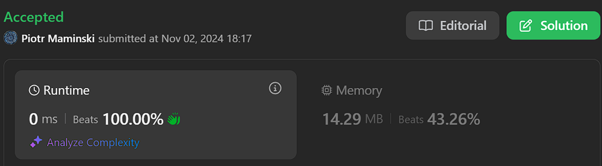

# ✅List Most Common Array Interview | Beats 100%| Explained step by step

**Author:** Piotr_Maminski
**Votes:** 19
**Link:** [https://leetcode.com/problems/two-sum/solutions/5999466/](https://leetcode.com/problems/two-sum/solutions/5999466/)

---


# Most common Array Interview Problems
List based on my research (interviews, reddit, github) Probably not 100% accurate but very close to my recruitments. Leetcode Premium is probably more accurate [I don't have]


**Easy:** [[1. Two Sum]](https://leetcode.com/problems/two-sum/solutions/5999466/beats-100-explained-step-by-step-list-most-common-array-inverview) **(common warm-up)** [[121. Best Time to Buy and Sell Stock]](https://leetcode.com/discuss/topic/6027720/solution/) [[88. Merge Sorted Array]](https://leetcode.com/problems/merge-sorted-array/solutions/6031394/beats-100-explained-step-by-step-list-most-common-string-interview-problems) [[27. Remove Element]](https://leetcode.com/problems/remove-element/solutions/6031528/beats-100-explained-step-by-step-list-most-common-array-interview-problems) [[929. Unique Email Addresses]](https://leetcode.com/problems/unique-email-addresses/solutions/6031687/explained-step-by-step-video-list-most-common-array-interview-problems) 

**Medium/Hard:** [[15. 3Sum]](https://leetcode.com/problems/3sum/description/) [[42. Trapping Rain Water]](https://leetcode.com/problems/trapping-rain-water/?envType=problem-list-v2&envId=atbyk0mj) [[56. Merge Intervals]](https://leetcode.com/problems/merge-intervals/description/) [[57. Insert Interval]](https://leetcode.com/problems/insert-interval/description/) [[46. Permutations]](https://leetcode.com/problems/permutations/description/) [[53. Maximum Subarray]](https://leetcode.com/problems/maximum-subarray/description/) [[73. Set Matrix Zeroes]](https://leetcode.com/problems/set-matrix-zeroes/description/) [[284. Peeking Iterator]](https://leetcode.com/problems/peeking-iterator/description/)

# Video

https://www.youtube.com/watch?v=KLlXCFG5TnA

```python3 []
class Solution:
    def twoSum(self, nums: List[int], target: int) -> List[int]:
        # Hash table to store number->index mapping
        ht = {}
        
        # Iterate through the array
        for i, num in enumerate(nums):
            # Check if complement (target - current number) exists in hash table
            if target - num in ht:
                # If found, return indices of both numbers
                return [ht[target - num], i]
                
            # Store current number and its index in hash table
            ht[num] = i
            
        # Return empty list if no solution found
        return []
```
```cpp []
class Solution {
public:
    // Function to find two numbers in array that add up to target
    vector<int> twoSum(vector<int>& nums, int target) {
        // Hash table to store number->index mapping
        unordered_map<int, int> ht;
        
        // Variable to store current number
        int tmp;

        // Iterate through the array
        for (int i = 0; i < nums.size(); ++i) {
            tmp = nums[i];
            
            // Check if complement (target - current number) exists in hash table
            if (ht.find(target-tmp) != ht.end()) {
                // If found, return indices of both numbers
                return {ht[target-tmp], i};
            }
            
            // Store current number and its index in hash table
            ht[tmp] = i;
        }
        
        // Return empty vector if no solution found
        return {};
    }
};
```
```java []
class Solution {
    public int[] twoSum(int[] nums, int target) {
        // Hash table to store number->index mapping
        Map<Integer, Integer> ht = new HashMap<>();
        
        // Iterate through the array
        for (int i = 0; i < nums.length; i++) {
            int tmp = nums[i];
            
            // Check if complement (target - current number) exists in hash table
            if (ht.containsKey(target - tmp)) {
                // If found, return indices of both numbers
                return new int[] {ht.get(target - tmp), i};
            }
            
            // Store current number and its index in hash table
            ht.put(tmp, i);
        }
        
        // Return empty array if no solution found
        return new int[0];
    }
}
```
```csharp []
public class Solution {
    public int[] TwoSum(int[] nums, int target) {
        // Hash table to store number->index mapping
        Dictionary<int, int> ht = new Dictionary<int, int>();
        
        // Iterate through the array
        for (int i = 0; i < nums.Length; i++) {
            int tmp = nums[i];
            
            // Check if complement (target - current number) exists in hash table
            if (ht.ContainsKey(target - tmp)) {
                // If found, return indices of both numbers
                return new int[] {ht[target - tmp], i};
            }
            
            // Store current number and its index in hash table
            ht[tmp] = i;
        }
        
        // Return empty array if no solution found
        return new int[0];
    }
}
```
```golang []
func twoSum(nums []int, target int) []int {
    // Hash table to store number->index mapping
    ht := make(map[int]int)
    
    // Iterate through the array
    for i, num := range nums {
        // Check if complement exists in hash table
        if j, exists := ht[target-num]; exists {
            // If found, return indices of both numbers
            return []int{j, i}
        }
        
        // Store current number and its index in hash table
        ht[num] = i
    }
    
    // Return empty slice if no solution found
    return []int{}
}
```
```swift []
class Solution {
    func twoSum(_ nums: [Int], _ target: Int) -> [Int] {
        // Hash table to store number->index mapping
        var ht = [Int: Int]()
        
        // Iterate through the array
        for (i, num) in nums.enumerated() {
            // Check if complement exists in hash table
            if let j = ht[target - num] {
                // If found, return indices of both numbers
                return [j, i]
            }
            
            // Store current number and its index in hash table
            ht[num] = i
        }
        
        // Return empty array if no solution found
        return []
    }
}
```
```javascript [JS]
// JavaScript

/**
 * @param {number[]} nums
 * @param {number} target
 * @return {number[]}
 */
var twoSum = function(nums, target) {
    // Hash table to store number->index mapping
    const ht = new Map();
    
    // Iterate through the array
    for (let i = 0; i < nums.length; i++) {
        const num = nums[i];
        
        // Check if complement exists in hash table
        if (ht.has(target - num)) {
            // If found, return indices of both numbers
            return [ht.get(target - num), i];
        }
        
        // Store current number and its index in hash table
        ht.set(num, i);
    }
    
    // Return empty array if no solution found
    return [];
};
```
```typescript [TS]
// TypeScript

function twoSum(nums: number[], target: number): number[] {
    // Hash table to store number->index mapping
    const ht = new Map<number, number>();
    
    // Iterate through the array
    for (let i = 0; i < nums.length; i++) {
        const num = nums[i];
        
        // Check if complement exists in hash table
        if (ht.has(target - num)) {
            // If found, return indices of both numbers
            return [ht.get(target - num)!, i];
        }
        
        // Store current number and its index in hash table
        ht.set(num, i);
    }
    
    // Return empty array if no solution found
    return [];
}
```
```rust []
use std::collections::HashMap;

impl Solution {
    pub fn two_sum(nums: Vec<i32>, target: i32) -> Vec<i32> {
        // Hash table to store number->index mapping
        let mut ht = HashMap::new();
        
        // Iterate through the array
        for (i, &num) in nums.iter().enumerate() {
            // Check if complement exists in hash table
            if let Some(&j) = ht.get(&(target - num)) {
                // If found, return indices of both numbers
                return vec![j as i32, i as i32];
            }
            
            // Store current number and its index in hash table
            ht.insert(num, i);
        }
        
        // Return empty vector if no solution found
        vec![]
    }
}
```
```ruby []
# @param {Integer[]} nums
# @param {Integer} target
# @return {Integer[]}
def two_sum(nums, target)
    # Hash table to store number->index mapping
    ht = {}
    
    # Iterate through the array
    nums.each_with_index do |num, i|
        # Check if complement exists in hash table
        if ht.key?(target - num)
            # If found, return indices of both numbers
            return [ht[target - num], i]
        end
        
        # Store current number and its index in hash table
        ht[num] = i
    end
    
    # Return empty array if no solution found
    []
end
```

## without comments
```python3 []
class Solution:
    def twoSum(self, nums: List[int], target: int) -> List[int]:
        ht = {}

        for i, num in enumerate(nums):
            if target - num in ht:
                return [ht[target - num], i]
                
            ht[num] = i
            
        return []
```
```cpp []
class Solution {
public:
    vector<int> twoSum(vector<int>& nums, int target) {
        unordered_map<int, int> ht;
        int tmp;
        for (int i = 0; i < nums.size(); ++i) {
            tmp = nums[i];
            if (ht.find(target-tmp) != ht.end()) {
                return {ht[target-tmp],i};
            }
            ht[tmp] = i;
        }
        return {};
    }
};
```
```java []
class Solution {
    public int[] twoSum(int[] nums, int target) {
        Map<Integer, Integer> ht = new HashMap<>();

        for (int i = 0; i < nums.length; i++) {
            int tmp = nums[i];

            if (ht.containsKey(target - tmp)) {
                return new int[] {ht.get(target - tmp), i};
            }

            ht.put(tmp, i);
        }
        
        return new int[0];
    }
}
```
```csharp []
public class Solution {
    public int[] TwoSum(int[] nums, int target) {
        Dictionary<int, int> ht = new Dictionary<int, int>();
        
        for (int i = 0; i < nums.Length; i++) {
            int tmp = nums[i];
            
            if (ht.ContainsKey(target - tmp)) {
                return new int[] {ht[target - tmp], i};
            }
            
            ht[tmp] = i;
        }
        
        return new int[0];
    }
}
```
```golang []
func twoSum(nums []int, target int) []int {
    ht := make(map[int]int)
    
    for i, num := range nums {
        if j, exists := ht[target-num]; exists {
            return []int{j, i}
        }
        
        ht[num] = i
    }
    
    return []int{}
}
```
```swift []
class Solution {
    func twoSum(_ nums: [Int], _ target: Int) -> [Int] {
        var ht = [Int: Int]()
        
        for (i, num) in nums.enumerated() {
            if let j = ht[target - num] {
                return [j, i]
            }
            
            ht[num] = i
        }
        
        return []
    }
}
```
```javascript [JS]
// JavaScript


var twoSum = function(nums, target) {
    const ht = new Map();
    
    for (let i = 0; i < nums.length; i++) {
        const num = nums[i];
        
        if (ht.has(target - num)) {
            return [ht.get(target - num), i];
        }
        
        ht.set(num, i);
    }
    
    return [];
};
```
```typescript [TS]
// TypeScript

function twoSum(nums: number[], target: number): number[] {
    const ht = new Map<number, number>();
    
    for (let i = 0; i < nums.length; i++) {
        const num = nums[i];
        
        if (ht.has(target - num)) {
            return [ht.get(target - num)!, i];
        }
        
        ht.set(num, i);
    }
    
    return [];
}
```
```rust []
use std::collections::HashMap;

impl Solution {
    pub fn two_sum(nums: Vec<i32>, target: i32) -> Vec<i32> {
        let mut ht = HashMap::new();
        
        for (i, &num) in nums.iter().enumerate() {
            if let Some(&j) = ht.get(&(target - num)) {
                return vec![j as i32, i as i32];
            }
            
            ht.insert(num, i);
        }
        
        vec![]
    }
}
```
```ruby []
def two_sum(nums, target)
    ht = {}
    
    nums.each_with_index do |num, i|
        if ht.key?(target - num)
            return [ht[target - num], i]
        end
        
        ht[num] = i
    end
    
    []
end
```




### Complexity 
- Time complexity: O(n)

- Space complexity: O(n)

## Intuition 
The key insight is that for any number **X** in the array, we're looking for another number **Y** where **X** + **Y** = **target**. In other words, when we're at number **X**, we're searching for (**target** - **X**), which we call the complement.

## Approach 
We use a hash table (dictionary) to achieve O(n) time complexity with a one-pass strategy:

- As we iterate through the array, for each number **X** we:
- Check if its complement (target - **X**) already exists in our hash table
- If **yes**, we've found our pair
- If **no**, we store **X** and its index for future lookups

Done.


Do you like my translation style? I have more solutions, most common problems. List is UP.

If you want you can give UpVote, then more people will see this solution and help them too. 

The button is in the bottom left corner of the screen, I didn't see it at first either :)


---


# Still dont understand string/array/pointers

**Video with IMO best explained:** 

https://www.youtube.com/watch?v=zuegQmMdy8M


####  [Interview Questions and Answers Repository](https://github.com/RooTinfinite/Interview-questions-and-answers)


# Interview Priorities


| Patterns                | Difficulty | Interview Frequently           |
|----------------------|---------------------|----------------------|
| **Basic [Array](https://leetcode.com/problems/two-sum/solutions/5999466/beats-100-explained-step-by-step-list-most-common-array-inverview) / [String](https://leetcode.com/problems/valid-parentheses/solutions/6013115/solution)**                 | **Easy**              | **Very High**               |
| **Two Pointers**         | **Easy**                | **High**                 |
| **Sliding Window**       | **Easy**                | **High**                 |
| **Breadth-First Search** | **Easy**                | **High**                 |
| **Depth-First Search**   | **Medium**              | **High**                 |
| **[Backtracking](https://leetcode.com/problems/letter-combinations-of-a-phone-number/solutions/5976064/complex-backtracking-interview-prepare-list-of-backtracking-questions-beats-100)**         | **High**                | **High**                 |
| Heap                 | Medium              | Medium               |
| Binary Search        | Easy                | Medium               |
| [Dynamic Programming](https://leetcode.com/problem-list/atwflvk7/)  | High                | Medium               |
| Divide and Conquer   | Medium              | Low                  |
| Trie                 | Medium              | Low                  |
| Union Find           | Medium              | Low                  |
| Greedy               | High                | Low                  |


