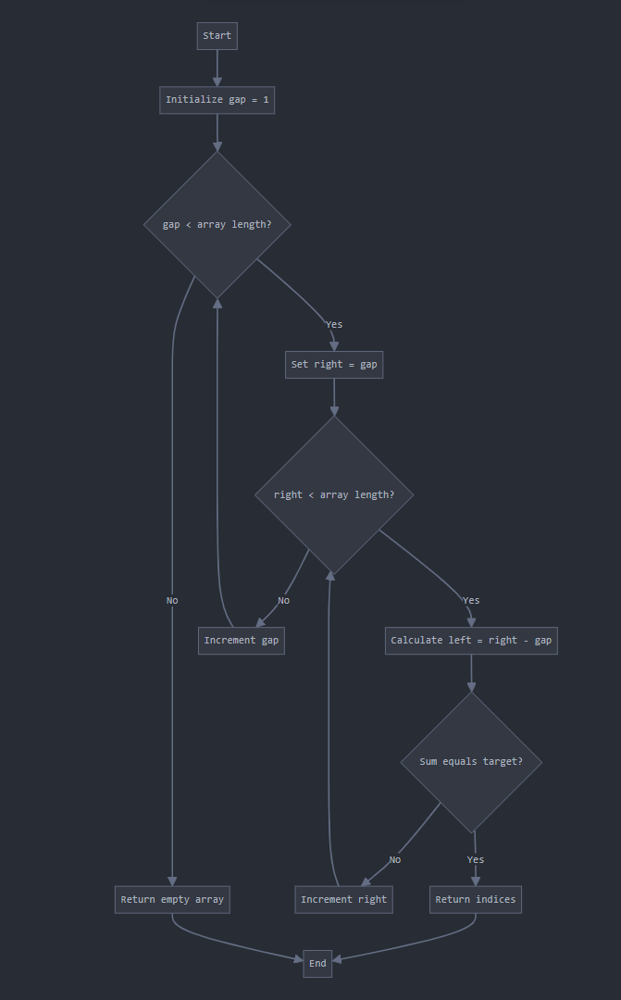
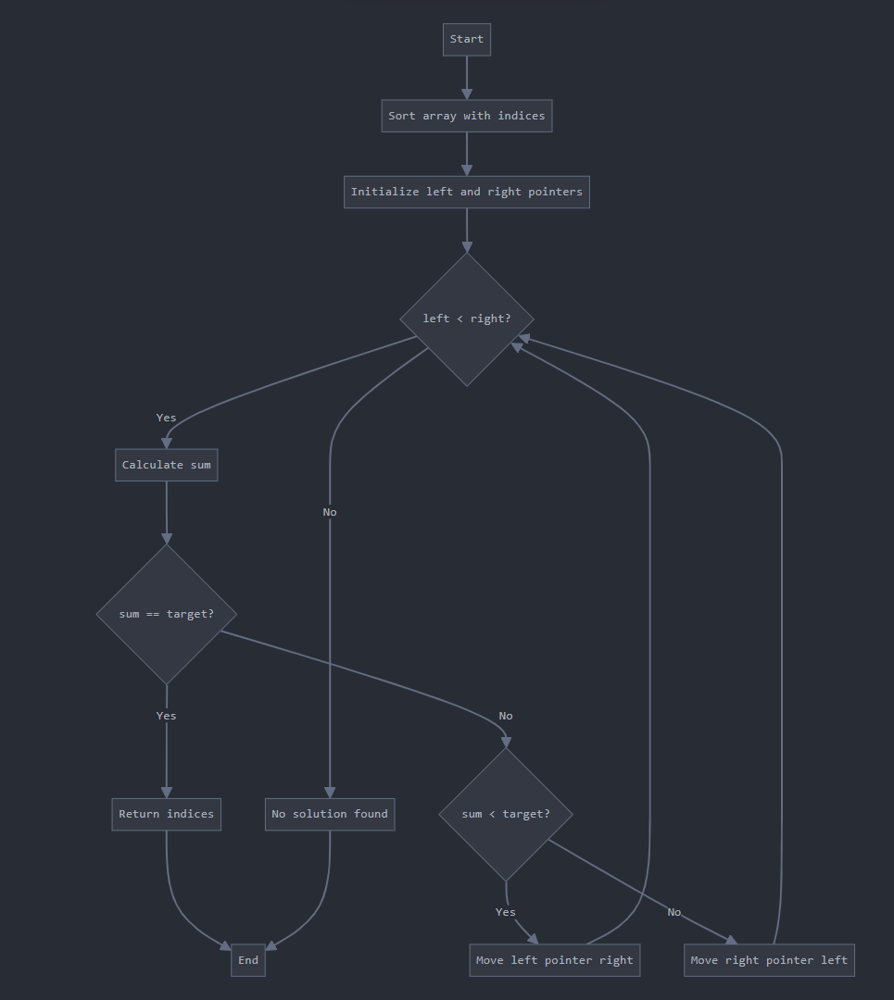
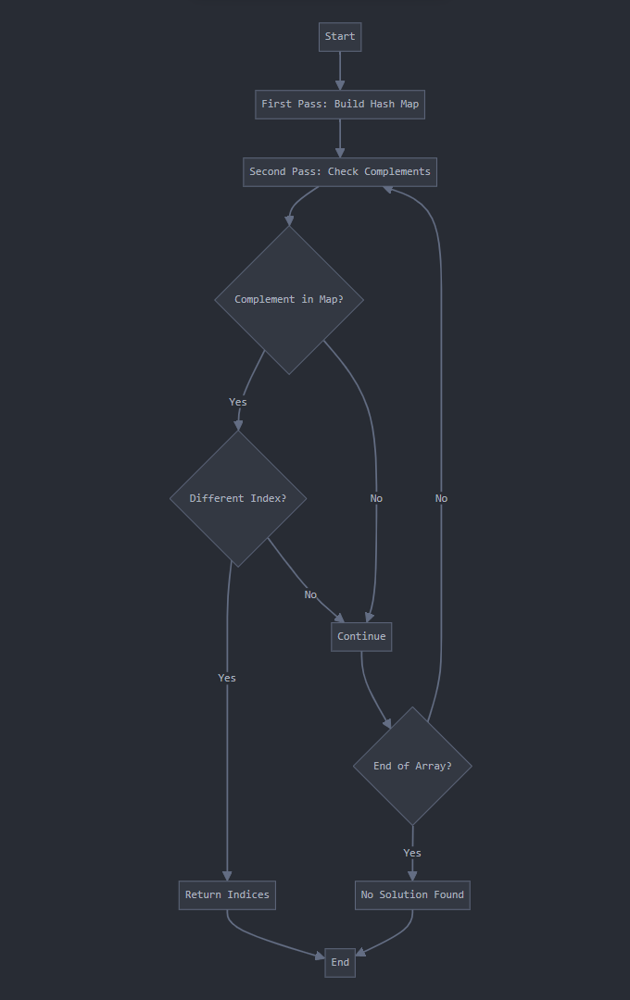
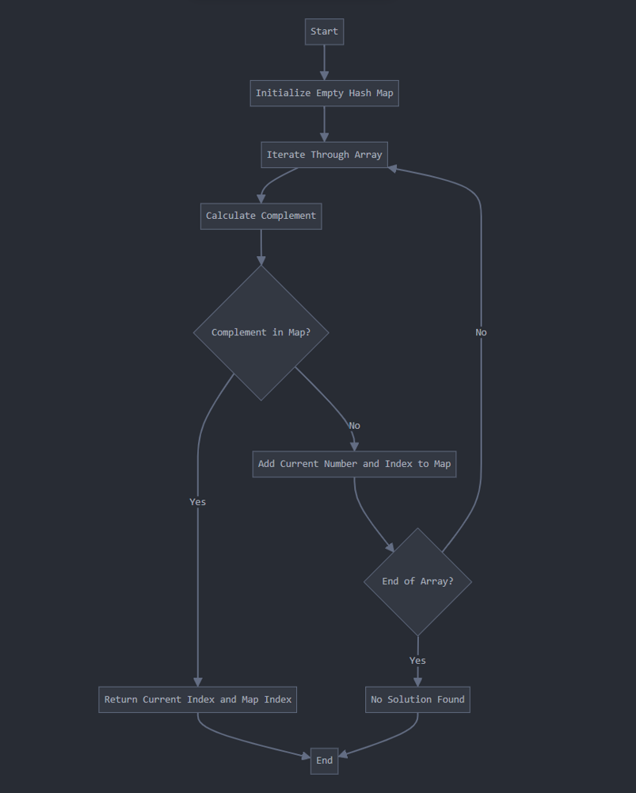

# O(n^2) -> O(n log n) -> O(n) || Beats 100 % || Java | Python | C++ | JavaScript | Go || Rust

**Author:** kartikdevsharma_
**Votes:** 69
**Link:** [https://leetcode.com/problems/two-sum/solutions/5486440/](https://leetcode.com/problems/two-sum/solutions/5486440/)

---


### Approach 1 Brute Force

**Intuition:**

The brute force approach is most of the time our first choice when solving a new problem. It's the simplest and most straightforward way even to solve this Two Sum problem, but it's not always the most efficient.

I'll try to explain this with an exmaple try to Imagine you're at a party and you're trying to find two people whose ages add up to a specific number. The brute force method would be like going to each person one by one and then for each of them checking their age against every other person's age in the room. It's thorough, but time-consuming.

In programming terms this translates to using nested loops. We check every possible pair of numbers in the array, calculating their sum and comparing it to our target. It's like casting a wide net - we're guaranteed to find the solution if it exists, but we might have to check every single possibility before we do. There's no complex logic, no additional data structures - just pure, straightforward checking. It's the kind of solution you might come up with if you're solving this problem for the first time, without worrying about optimization.

However, this simplicity comes at a cost. As our input size grows, the number of comparisons we need to make grows quadratically. With small arrays, this might not be noticeable, but as we approach the upper limit of $10^4$ elements, the time taken could become significant.

One interesting aspect of the brute force approach is how it handles the constraint of not using the same element twice. By structuring our loops to only check pairs where the second index is greater than the first, we naturally avoid this pitfall. It's a subtle but important detail that shows how even in a straightforward approach, careful implementation is key.

The brute force method also has the advantage of being space-efficient. We're not using any additional data structures, just working with the input array itself. In scenarios where memory is a constraint, this could be a point in its favor.

**Approach**

Let's start by breaking down the problem and understanding what we're trying to achieve. The Two Sum problem asks us to find two numbers in an array that add up to a given target sum. We need to return the indices of these two numbers.

The brute force approach is the most straightforward way to solve this problem. It involves checking every possible pair of numbers in the array to see if they sum up to the target. Here's how we can think about it:


1. For each number in the array:
   a. Look at every other number in the array
   b. Check if the current pair sums to the target
   c. If it does, we've found our solution

Let's express this in pseudo-code:

```
function twoSum(numbers, target):
    for i from 0 to length(numbers) - 1:
        for j from i + 1 to length(numbers) - 1:
            if numbers[i] + numbers[j] == target:
                return [i, j]
    
    // If no solution is found
    return []
```

This approach works because it exhaustively checks all possible pairs. It's guaranteed to find a solution if one exists because it considers every combination.

The key insight here is that we don't need to check pairs where both numbers are the same (i.e., where i == j), because we're told we can't use the same element twice. That's why our inner loop starts from i + 1.

Let's break down the logic further:

1. The outer loop (i) selects the first number of our pair.
2. The inner loop (j) selects the second number, starting from the element right after i.
3. We check if these two numbers sum to our target.
4. If they do, we've found our solution and can return their indices.
5. If we've gone through all possible pairs without finding a solution, we return an empty array (or null, depending on the implementation).


This approach is intuitive and easy to understand, but it's not the most efficient. For each element, we're checking it against every other element that comes after it in the array. This leads to a time complexity of O(n^2), where n is the length of the input array.

**Time Complexity Analysis:**
- Worst case and Average case: $O(n^2)$
  - The outer loop runs n times
  - For each iteration of the outer loop, the inner loop runs n-1 times in the first iteration, n-2 times in the second iteration, and so on.
  - This sums up to $(n-1) + (n-2) + ... + 2 + 1 = n(n-1)/2$, which is $O(n^2)$
- Best case: $O(1)$
  - If the first two elements we check are the solution, we'll find it immediately.

**Space Complexity Analysis:**
- $O(1)$ or constant space
  - We're not using any extra space that scales with the input size
  - We only need a couple of integer variables for our loop counters and to store the result

While this approach works and is easy to implement, it becomes inefficient for large input sizes.

### Code
```java []
class Solution {
    public int[] twoSum(int[] numbers, int sum) {
        int length = numbers.length;
        
        for (int gap = 1; gap < length; gap++) {
            for (int right = gap; right < length; right++) {
                int left = right - gap;
                if (numbers[left] + numbers[right] == sum) {
                    return new int[] {left, right};
                }
            }
        }
        
        return new int[0]; // Return empty array if no solution found
    }
}
```
```python []
class Solution:
    def twoSum(self, nums: List[int], target: int) -> List[int]:
        numMap = {}
        n = len(nums)

        for i in range(n):
            complement = target - nums[i]
            if complement in numMap:
                return [numMap[complement], i]
            numMap[nums[i]] = i

        return []  
```
``` cpp []
class Solution {
public:
    vector<int> twoSum(vector<int>& nums, int target) {
        for (int i = 1; i < nums.size(); i++) {
            for (int j = i; j < nums.size(); j++) {
                if (nums[j] + nums[j - i] == target) {
                    return {j - i, j};
                }
            }
        }
        return {}; // Empty vector if no solution found
    }
};
```
```js []
/**
 * @param {number[]} nums
 * @param {number} target
 * @return {number[]}
 */
var twoSum = function(nums, target) {
    for (let i = 1; i < nums.length; i++) {
        for (let j = i; j < nums.length; j++) {
            if (nums[j] + nums[j - i] === target) {
                return [j - i, j];
            }
        }
    }
    return []; // Empty array if no solution found
};
```
```go []
func twoSum(nums []int, target int) []int {
    for i := 1; i < len(nums); i++ {
        for j := i; j < len(nums); j++ {
            if nums[j] + nums[j-i] == target {
                return []int{j-i, j}
            }
        }
    }
    return nil // Return nil if no solution found
}
```
```Rust []
impl Solution {
    pub fn two_sum(nums: Vec<i32>, target: i32) -> Vec<i32> {
        let length = nums.len();

        for gap in 1..length {
            for right in gap..length {
                let left = right - gap;
                if nums[left] + nums[right] == target {
                    return vec![left as i32, right as i32];
                }
            }
        }

        vec![] // Return an empty vector if no solution found
    }
}

```

---
### Approach 2: Two-pointer

**Intuition:**

Imagine you're arranging a group of people in a line, ordered by age. Now, if you're looking for two people whose ages sum to a specific number, you could start with the youngest and oldest person. If their sum is too small, you know you need to move towards older people, so you shift the "young" pointer. If the sum is too large, you move the "old" pointer towards younger people. This systematic approach allows you to narrow down the possibilities much more quickly than checking every pair.

The key insight here is that by sorting the array, we gain information that we can leverage to make our search more efficient. Once the array is sorted, we know that as we move right, the values increase, and as we move left, they decrease. This property allows us to make informed decisions about which direction to move based on whether our current sum is too high or too low.

However, sorting introduces a new challenge - we need to keep track of the original indices, as the problem asks us to return these. This is why we create a copy of the array with indices before sorting. It's a trade-off: we use more memory to store this information, but it allows us to maintain the connection to the original array while benefiting from the sorted order.

Instead of checking every possible pair, we're making intelligent moves, eliminating large portions of the search space with each step. It's like we're zeroing in on the solution from both ends.

One might wonder: doesn't sorting the array take time? Indeed it does, typically O(n log n) for efficient sorting algorithms. But even with this upfront cost, the overall time complexity is better than the brute force approach for larger inputs. 

This approach also handles the constraint of not using the same element twice. By moving our pointers in opposite directions, we ensure that we're always looking at distinct elements.

### Approach 
The two-pointer approach is a more efficient solution to the Two Sum problem, but it requires a slight modification to the original problem. This approach works when the input array is sorted. If the array isn't already sorted, we need to sort it first, which adds some complexity to the solution.




Here's how we can think about this approach:

1. Sort the array (if it's not already sorted)
2. Place two pointers: one at the start of the array and one at the end
3. Calculate the sum of the elements at these two pointers
4. If the sum is equal to the target, we've found our solution
5. If the sum is less than the target, move the left pointer to the right
6. If the sum is greater than the target, move the right pointer to the left
7. Repeat steps 3-6 until we find the solution or the pointers meet

pseudo-code:

```
function twoSum(numbers, target):
    // If the array isn't sorted, sort it and keep track of original indices
    sortedNumbers = sortWithIndices(numbers)
    
    left = 0
    right = length(sortedNumbers) - 1
    
    while left < right:
        currentSum = sortedNumbers[left].value + sortedNumbers[right].value
        
        if currentSum == target:
            return [sortedNumbers[left].originalIndex, sortedNumbers[right].originalIndex]
        else if currentSum < target:
            left = left + 1
        else:
            right = right - 1
    
    // If no solution is found
    return []

function sortWithIndices(numbers):
    // Create a list of pairs: (value, original index)
    numbersWithIndices = [(numbers[i], i) for i in range(length(numbers))]
    
    // Sort based on the value
    sort(numbersWithIndices) based on first element of each pair
    
    return numbersWithIndices
```

The key insight in this approach is that in a sorted array, we can make intelligent decisions about which direction to move based on the current sum:

- If the current sum is less than the target, we need a larger sum. Since the array is sorted, moving the left pointer to the right will give us a larger number.
- If the current sum is greater than the target, we need a smaller sum. Moving the right pointer to the left will give us a smaller number.

This approach is more efficient than the brute force method because we're making an informed decision at each step, effectively eliminating a large portion of the search space.

However, there's a catch: the original problem asks for the indices in the unsorted array. To handle this, we need to keep track of the original indices when we sort the array. This is what the `sortWithIndices` function does in our pseudo-code.

**Time Complexity Analysis:**
- Sorting the array: $O(n log n)$ where n is the length of the array
- Two-pointer traversal: O(n) in the worst case, where we might need to traverse the entire array once
- Overall time complexity: $O(n log n)$, dominated by the sorting step

**Space Complexity Analysis:**
- $O(n)$ to store the sorted array with original indices
- $O(1)$ for the two pointers and other variables

While this approach is more efficient than the brute force method, especially for larger arrays, it does require additional space to keep track of the original indices. This leads us to consider if we can do better, which we will discuss in our next approach.


### Code
```Java []
class Solution {
    public int[] twoSum(int[] numbers, int target) {
        // Create a copy of the array with indices
        int[][] numbersWithIndices = new int[numbers.length][2];
        for (int i = 0; i < numbers.length; i++) {
            numbersWithIndices[i] = new int[]{numbers[i], i};
        }
        
        // Sort the array based on values
        Arrays.sort(numbersWithIndices, (a, b) -> Integer.compare(a[0], b[0]));
        
        int left = 0;
        int right = numbers.length - 1;
        
        while (left < right) {
            int sum = numbersWithIndices[left][0] + numbersWithIndices[right][0];
            if (sum == target) {
                return new int[]{numbersWithIndices[left][1], numbersWithIndices[right][1]};
            } else if (sum < target) {
                left++;
            } else {
                right--;
            }
        }
        
        return new int[0]; // Return empty array if no solution found
    }
}

```


```C++ []
class Solution {
public:
    vector<int> twoSum(vector<int>& numbers, int target) {
        // Create a copy of the array with indices
        vector<pair<int, int>> numbersWithIndices;
        for (int i = 0; i < numbers.size(); i++) {
            numbersWithIndices.push_back({numbers[i], i});
        }
        
        // Sort the array based on values
        sort(numbersWithIndices.begin(), numbersWithIndices.end());
        
        int left = 0;
        int right = numbers.size() - 1;
        
        while (left < right) {
            int sum = numbersWithIndices[left].first + numbersWithIndices[right].first;
            if (sum == target) {
                return {numbersWithIndices[left].second, numbersWithIndices[right].second};
            } else if (sum < target) {
                left++;
            } else {
                right--;
            }
        }
        
        return {}; // Return empty vector if no solution found
    }
};
```
```Python []
class Solution:
    def twoSum(self, numbers: List[int], target: int) -> List[int]:
        # Create a copy of the array with indices
        numbersWithIndices = [(num, i) for i, num in enumerate(numbers)]
        
        # Sort the array based on values
        numbersWithIndices.sort(key=lambda x: x[0])
        
        left, right = 0, len(numbers) - 1
        
        while left < right:
            sum = numbersWithIndices[left][0] + numbersWithIndices[right][0]
            if sum == target:
                return [numbersWithIndices[left][1], numbersWithIndices[right][1]]
            elif sum < target:
                left += 1
            else:
                right -= 1
        
        return []  # Return empty list if no solution found
```
```Go []
func twoSum(numbers []int, target int) []int {
    // Create a copy of the array with indices
    numbersWithIndices := make([][2]int, len(numbers))
    for i, num := range numbers {
        numbersWithIndices[i] = [2]int{num, i}
    }
    
    // Sort the array based on values
    sort.Slice(numbersWithIndices, func(i, j int) bool {
        return numbersWithIndices[i][0] < numbersWithIndices[j][0]
    })
    
    left, right := 0, len(numbers)-1
    
    for left < right {
        sum := numbersWithIndices[left][0] + numbersWithIndices[right][0]
        if sum == target {
            return []int{numbersWithIndices[left][1], numbersWithIndices[right][1]}
        } else if sum < target {
            left++
        } else {
            right--
        }
    }
    
    return []int{} // Return empty slice if no solution found
}
```
```JavaScript []
/**
 * @param {number[]} numbers
 * @param {number} target
 * @return {number[]}
 */
var twoSum = function(numbers, target) {
    // Create a copy of the array with indices
    let numbersWithIndices = numbers.map((num, index) => [num, index]);
    
    // Sort the array based on values
    numbersWithIndices.sort((a, b) => a[0] - b[0]);
    
    let left = 0;
    let right = numbers.length - 1;
    
    while (left < right) {
        let sum = numbersWithIndices[left][0] + numbersWithIndices[right][0];
        if (sum === target) {
            return [numbersWithIndices[left][1], numbersWithIndices[right][1]];
        } else if (sum < target) {
            left++;
        } else {
            right--;
        }
    }
    
    return []; // Return empty array if no solution found
};
```
```Rust []
impl Solution {
    pub fn two_sum(nums: Vec<i32>, target: i32) -> Vec<i32> {
        // Create a vector of tuples containing the value and original index
        let mut nums_with_indices: Vec<(i32, usize)> = nums.iter().copied().enumerate().map(|(i, num)| (num, i)).collect();

        // Sort the vector based on values
        nums_with_indices.sort_by_key(|&(value, _)| value);

        let mut left = 0;
        let mut right = nums_with_indices.len() - 1;

        while left < right {
            let sum = nums_with_indices[left].0 + nums_with_indices[right].0;
            if sum == target {
                return vec![nums_with_indices[left].1 as i32, nums_with_indices[right].1 as i32];
            } else if sum < target {
                left += 1;
            } else {
                right -= 1;
            }
        }

        vec![] // Return an empty vector if no solution found
    }
}

```

### Approach 3: Two-pass Hash Table

**Intuition:**

Imagine you're at a large conference, and everyone has a name tag with a unique number. You're trying to find two people whose numbers add up to a specific sum. Instead of comparing everyone to everyone else, or even lining everyone up in order, you could create a quick reference guide. You'd go through once, writing down each person's number and where they're standing. Then, for each person, you could quickly check if their "complement" (the number that would sum to your target) is in your guide.

This is essentially what the two-pass hash table approach does. In programming terms, we're using a hash map to store each number as a key and its index as the value. This allows us to achieve O(1) lookup time for any number we're interested in.

The "two-pass" part of this approach is important. In the first pass, we're building our "reference guide" (the hash map). In the second pass, we're using this guide to find our solution. This separation allows us to handle an edge case that might not be immediately obvious: what if the complement we're looking for is the number itself?

For example, if our target sum is 6 and we encounter the number 3, we need to be careful. We're looking for another 3, but not the same 3 we're currently on. By building our hash map first, and then doing a separate pass to check for complements, we ensure that we're always looking at a different index, even if the numbers are the same.

This approach handles the constraint of not using the same element twice, while also providing a very efficient solution. We've traded space for time - using extra memory to store our hash map, but gaining the ability to find our answer with just two passes through the array.

The two-pass hash table method is particularly powerful because it maintains the original order of the array. Unlike the two-pointer approach, we don't need to sort or create a copy of the array with indices. This can be advantageous in scenarios where preserving the original order is important.


**Appraoch** 
The core idea is to use a hash map to store the numbers we've seen so far, along with their indices. This allows us to quickly check if the complement of any given number exists in our collection. By doing this in two passes through the array, we ensure that we don't accidentally use the same element twice, even if the array contains duplicate values.




Implementation:

1. First Pass:
   In this pass, we iterate through the entire array and build our hash map. The key in this map is the number from the array, and the value is its index.

   ```
   map = empty hash map
   for i from 0 to length(numbers) - 1:
       map[numbers[i]] = i
   ```

   This step allows us to create a "lookup table" where we can quickly check if a number exists in our array and find its index.

2. Second Pass:
   In this pass, we again iterate through the array. For each number, we calculate its complement (the number that, when added to the current number, would equal the target sum). We then check if this complement exists in our hash map.

   ```
   for i from 0 to length(numbers) - 1:
       complement = target - numbers[i]
       if map contains key(complement) AND map[complement] != i:
           return [i, map[complement]]
   ```

   The condition `map[complement] != i` is crucial here. It ensures that we're not using the same element twice. For example, if our target is 6 and we're currently looking at a 3, we want to make sure we find a different 3 in the array, not the same one we're currently on.

3. Return Result:
   If we find a valid pair, we return their indices. If we complete both passes without finding a solution, we return an empty array (or whatever indicates "no solution found" in our implementation).

Mathematical and Logical Concepts:
The key mathematical concept here is the idea of complements. If we're looking for two numbers that sum to a target T, and we have one number A, then we know the other number must be (T - A). This is the foundation of our search strategy.

We can use a hash map to store all the numbers we've seen, allowing us to quickly check if a complement exists. This transforms our problem from potentially checking every pair of numbers (O(n^2) time complexity) to being able to check in constant time whether any given number's complement exists in our collection.
 By building the entire hash map first, and then doing our complement checks in a separate pass, we ensure that for any given number, we're able to see all possible complements in the array, not just the ones that came before it.

**Time Complexity Analysis:**
- First pass: O(n) - we iterate through the array once to build the hash map.
- Second pass: O(n) - we iterate through the array again to check for complements.
- Hash map operations (insertion and lookup) are generally O(1) on average.

Therefore, the overall time complexity is $O(n) + O(n)$ = $O(n)$.

**Space Complexity Analysis:**
We use a hash map to store all elements of the array. In the worst case (where all elements are unique), this will use O(n) extra space.

Therefore, the space complexity is $O(n)$.

This approach trades some space complexity for improved time complexity compared to the brute force method. It's particularly effective when we expect to have a solution and when the array is large, as it allows us to find the answer in a single pass through the data after building our hash map.

It's easier to implement than the two-pointer approach (which requires sorting), and it's more intuitive than the one-pass hash table method. However, it does require slightly more memory than the two-pointer approach and makes one more pass through the array than the one-pass hash table method.


### Code

```java []
class Solution {
    public int[] twoSum(int[] nums, int target) {
        Map<Integer, Integer> map = new HashMap<>();
        for (int i = 0; i < nums.length; i++) {
            map.put(nums[i], i);
        }
        for (int i = 0; i < nums.length; i++) {
            int complement = target - nums[i];
            if (map.containsKey(complement) && map.get(complement) != i) {
                return new int[] { i, map.get(complement) };
            }
        }
        // In case there is no solution, we'll just return null
        return null;
    }
}
```

```c++ []
class Solution {
public:
    vector<int> twoSum(vector<int> &nums, int target) {
        unordered_map<int, int> hash;
        for (int i = 0; i < nums.size(); i++) {
            hash[nums[i]] = i;
        }
        for (int i = 0; i < nums.size(); i++) {
            int complement = target - nums[i];
            if (hash.find(complement) != hash.end() && hash[complement] != i) {
                return {i, hash[complement]};
            }
        }
        return {};
    }
};
```

```python []
class Solution(object):
    def twoSum(self, nums, target):
        """
        :type nums: List[int]
        :type target: int
        :rtype: List[int]
        """
        # First pass: store all numbers in hashmap
        hashmap = {}
        for i in range(len(nums)):
            hashmap[nums[i]] = i
            
        # Second pass: check for complements
        for i in range(len(nums)):
            complement = target - nums[i]
            if complement in hashmap and hashmap[complement] != i:
                return [i, hashmap[complement]]
                
        # In case there is no solution
        return None
```

```js []
var twoSum = function (nums, target) {
    const map = new Map();
    for (let i = 0; i < nums.length; i++) {
        map.set(nums[i], i);
    }
    for (let i = 0; i < nums.length; i++) {
        const complement = target - nums[i];
        if (map.has(complement) && map.get(complement) !== i) {
            return [i, map.get(complement)];
        }
    }
    return null;
};
```

```go []
func twoSum(nums []int, target int) []int {
    m := make(map[int]int)
    for i, num := range nums {
        m[num] = i
    }
    for i, num := range nums {
        complement := target - num
        if j, ok := m[complement]; ok && j != i {
            return []int{i, j}
        }
    }
    return nil
}
```
```Rust []
use std::collections::HashMap;

impl Solution {
    pub fn two_sum(nums: Vec<i32>, target: i32) -> Vec<i32> {
        let mut map = HashMap::new();

        // First pass: fill the hash map
        for (i, &num) in nums.iter().enumerate() {
            map.insert(num, i);
        }

        // Second pass: find the complement
        for (i, &num) in nums.iter().enumerate() {
            let complement = target - num;
            if let Some(&complement_index) = map.get(&complement) {
                if complement_index != i {
                    return vec![i as i32, complement_index as i32];
                }
            }
        }

        vec![] // Return an empty vector if no solution found
    }
}


```
---


# Approach 4: One-pass Hash Table

**Intuition:**

Imagine you're at that same conference, but now, as you're writing down each person's number in your guide, you're also checking if you've already seen their "complement". It's like you're constantly asking, "Have I met anyone yet who, combined with this person, would give me my target sum?"

This approach is efficient. We're doing everything in a single pass through the array. For each number, we're both adding it to our hash map and checking if its complement is already there. It's a perfect balance of gathering information and using it immediately.

The key insight here is that the complement of the current number must have appeared earlier in the array if a solution exists. This allows us to confidently check for the complement in our hash map, knowing that if it's there, it must be a different index (since we haven't added the current number to the map yet).

This method handles all the constraints of the problem. We're guaranteed to use each element only once, we're returning the correct indices, and we're doing it all in a single pass through the array. The time complexity is O(n), as we're making just one pass, and each hash map operation is O(1) on average.

Sometimes, the order in which we do things can make a significant difference. By checking for the complement before adding the current number to the hash map, we ensure that we don't accidentally use the same element twice, even if the array contains duplicate values.


**Approach**

This approach uses the hash tables (or dictionaries/maps in some languages) to achieve constant-time lookups.




>1. As we iterate through the array, for each number, we calculate its complement (target - number).
>2. We check if this complement exists in our hash table.
>3. If it does, we've found our pair and can return their indices.
>4. If it doesn't, we add the current number and its index to the hash table.

This approach is based on the insight that for any number x in our array, if there exists a number y such that x + y = target, then y = target - x. By storing each number in a hash table as we go, we can check in constant time whether we've already seen its complement.

Let's express this in pseudo-code:

```
function twoSum(numbers, target):
    complementMap = empty hash table
    
    for i from 0 to length(numbers) - 1:
        currentNumber = numbers[i]
        complement = target - currentNumber
        
        if complement exists in complementMap:
            return [complementMap[complement], i]
        
        complementMap[currentNumber] = i
    
    // If no solution is found
    return []
```

Let's break down the logic:

1. We start with an empty hash table (complementMap). This will store numbers we've seen and their indices.
2. For each number in the array:
   a. We calculate its complement (target - currentNumber)
   b. We check if this complement exists in our hash table
   c. If it does, we've found our pair! We return the index of the complement (which we stored in the hash table) and the current index.
   d. If it doesn't, we add the current number and its index to the hash table

This approach solves the problem in a single pass through the array. We're simultaneously checking for the solution and building up our hash table.

This method is particularly efficient because hash table operations (insertion and lookup) are typically O(1) on average. This means we're doing constant-time operations for each element in the array.

**Time Complexity Analysis:**
- O(n) where n is the length of the input array
  - We make a single pass through the array
  - For each element, we perform constant-time operations (hash table lookup and insertion)

**Space Complexity Analysis:**
- O(n) in the worst case
  - In the worst scenario, we might need to store n-1 elements in our hash table before finding the solution
  - However, on average, we'll store fewer elements, especially if a solution exists

This approach offers a significant improvement over both the brute force and two-pointer methods:
- It's faster than the brute force approach $(O(n)$ vs $O(n^2))$
- It doesn't require sorting the array like the two-pointer approach
- It solves the problem in a single pass through the array

The trade-off is that we're using additional space to store the hash table. However, in many cases, this space-time tradeoff is worthwhile, especially when dealing with large input sizes where the O(n) time complexity becomes a significant advantage.

### Code

```java []
class Solution {
    public int[] twoSum(int[] nums, int target) {
        Map<Integer, Integer> map = new HashMap<>();
        for (int i = 0; i < nums.length; i++) {
            int complement = target - nums[i];
            if (map.containsKey(complement)) {
                return new int[] { map.get(complement), i };
            }
            map.put(nums[i], i);
        }
        // In case there is no solution, we'll just return null
        return null;
    }
}
```

```python []
class Solution(object):
    def twoSum(self, nums, target):
        """
        :type nums: List[int]
        :type target: int
        :rtype: List[int]
        """
        hashmap = {}
        for i in range(len(nums)):
            complement = target - nums[i]
            if complement in hashmap:
                return [i, hashmap[complement]]
            hashmap[nums[i]] = i
```

```c++ []
class Solution {
public:
    vector<int> twoSum(vector<int> &nums, int target) {
        unordered_map<int, int> hash;
        for (int i = 0; i < nums.size(); ++i) {
            int complement = target - nums[i];
            if (hash.find(complement) != hash.end()) {
                return {hash[complement], i};
            }
            hash[nums[i]] = i;
        }
        return {};
    }
};
```

```js []
var twoSum = function (nums, target) {
    const map = new Map();
    for (let i = 0; i < nums.length; i++) {
        const complement = target - nums[i];
        if (map.has(complement)) {
            return [map.get(complement), i];
        }
        map.set(nums[i], i);
    }
    return null;
};
```

```go []
func twoSum(nums []int, target int) []int {
    m := make(map[int]int)
    for i, num := range nums {
        complement := target - num
        if j, ok := m[complement]; ok {
            return []int{j, i}
        }
        m[num] = i
    }
    return nil
}
```
```Rust []
use std::collections::HashMap;

impl Solution {
    pub fn two_sum(nums: Vec<i32>, target: i32) -> Vec<i32> {
        let mut map = HashMap::new();

        for (i, &num) in nums.iter().enumerate() {
            let complement = target - num;
            if let Some(&complement_index) = map.get(&complement) {
                return vec![complement_index as i32, i as i32];
            }
            map.insert(num, i);
        }

        vec![] // Return an empty vector if no solution found
    }
}

```
---

