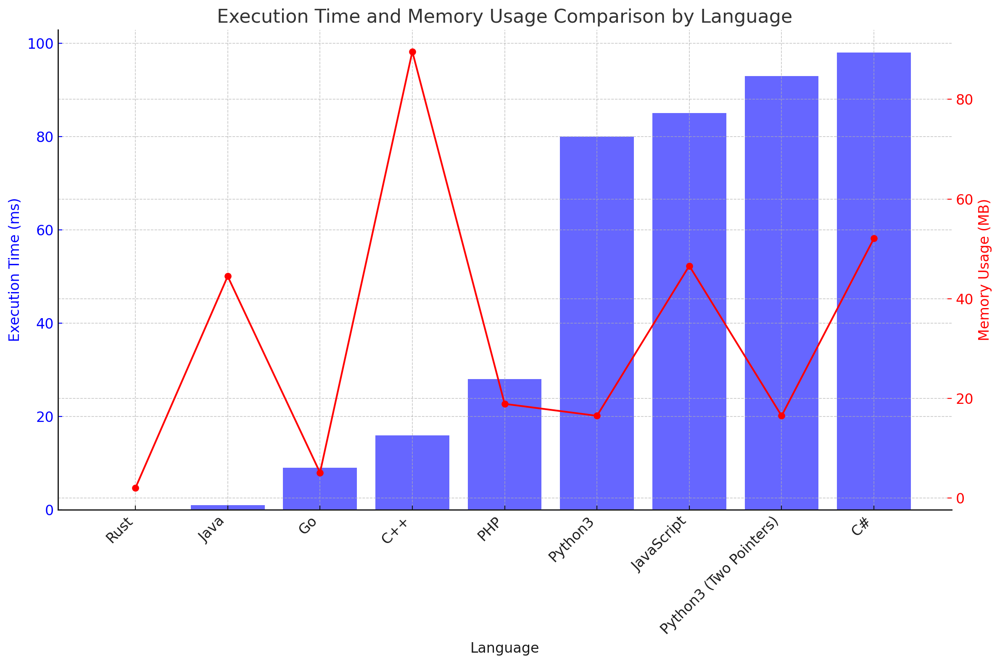

# ✅ 94.96% Binary Search & Two Pointers

**Author:** vanAmsen
**Votes:** 130
**Link:** [https://leetcode.com/problems/median-of-two-sorted-arrays/solutions/4070371/](https://leetcode.com/problems/median-of-two-sorted-arrays/solutions/4070371/)

---

# Comprehensive Guide to Solving "Median of Two Sorted Arrays"

## Introduction & Problem Statement

"Median of Two Sorted Arrays" is a classic problem that tests one's algorithmic depth and understanding of binary search and two-pointer techniques. The challenge is to find the median of two sorted arrays, `nums1` and `nums2`, with potentially different sizes. The objective is to solve it in logarithmic time complexity in terms of the minimum size of the two arrays.

## Key Concepts and Constraints

### What Makes This Problem Unique?

1. **Array Constraints**:  
    - The length of `nums1` (denoted as $$ m $$) can range from 0 to 1000.
    - The length of `nums2` (denoted as $$ n $$) can also vary between 0 and 1000.
    - The combined size (i.e., $$ m + n $$) of both arrays can go up to 2000.
  
2. **Element Constraints**:
    - Each element in both `nums1` and `nums2` can be any integer from -$$ 10^6 $$ to $$ 10^6 $$.

3. **Runtime Complexity**:  
    The primary challenge is to achieve a runtime of $$ O(\\log(\\min(m, n))) $$. This constraint rules out naive solutions that might merge and then find the median.

### Solution Strategies:

1. **Two Pointers Approach**:  
    This technique involves iterating through both arrays using two pointers. By comparing the elements at the current pointers, we can merge the two arrays. Once merged, finding the median is straightforward.

2. **Binary Search Approach**:  
    Leveraging the properties of sorted arrays, we can apply a binary search on the smaller array, effectively partitioning both arrays. This method ensures we find the median without explicitly merging the arrays, adhering to the desired logarithmic time complexity.

---

## Live Coding Binary Search & Explain 
https://youtu.be/9LZcuEBjD9o?si=5A6xTTLfH0HW0kal

## Strategy to Solve the Problem:

## Two Pointers Merging Technique

The core idea here is to merge the two sorted arrays, nums1 and nums2, using a two-pointer approach. After merging, the median of the combined array can be found directly based on its length.

## Key Data Structures:

- `merged`: An array to store the merged result of `nums1` and `nums2`.
- `i` and `j`: Two pointers to traverse `nums1` and `nums2` respectively.

## Enhanced Breakdown:

1. **Initialize Pointers**:
   - Set `i` and `j` to 0. These pointers will help traverse `nums1` and `nums2`.

2. **Merging using Two Pointers**:
   - Merge elements of `nums1` and `nums2` in sorted order using two pointers. If an element in `nums1` is smaller, append it to `merged` and move the `i` pointer. Otherwise, append the element from `nums2` and move the `j` pointer.

3. **Handle Remaining Elements**:
   - If there are any remaining elements in `nums1` or `nums2`, append them directly to `merged`.

4. **Calculate Median**:
   - Based on the length of `merged`, compute the median. If the length is even, the median is the average of the two middle elements. Otherwise, it's the middle element.

## Complexity Analysis:

**Time Complexity**: 
- The merging process traverses both arrays once, resulting in a time complexity of $$ O(m + n) $$, where $$ m $$ and $$ n $$ are the lengths of `nums1` and `nums2` respectively.

**Space Complexity**: 
- The algorithm creates a merged array of length $$ m + n $$, leading to a space complexity of $$ O(m + n) $$.


## Code Two Pointers
``` Python []
class Solution:
    def findMedianSortedArrays(self, nums1: List[int], nums2: List[int]) -> float:
        merged = []
        i, j = 0, 0
        
        while i < len(nums1) and j < len(nums2):
            if nums1[i] < nums2[j]:
                merged.append(nums1[i])
                i += 1
            else:
                merged.append(nums2[j])
                j += 1
                
        while i < len(nums1):
            merged.append(nums1[i])
            i += 1
            
        while j < len(nums2):
            merged.append(nums2[j])
            j += 1
        
        mid = len(merged) // 2
        if len(merged) % 2 == 0:
            return (merged[mid-1] + merged[mid]) / 2
        else:
            return merged[mid]

```
``` Go []
func findMedianSortedArrays(nums1 []int, nums2 []int) float64 {
    merged := make([]int, 0, len(nums1)+len(nums2))
    i, j := 0, 0

    for i < len(nums1) && j < len(nums2) {
        if nums1[i] < nums2[j] {
            merged = append(merged, nums1[i])
            i++
        } else {
            merged = append(merged, nums2[j])
            j++
        }
    }

    for i < len(nums1) {
        merged = append(merged, nums1[i])
        i++
    }
    for j < len(nums2) {
        merged = append(merged, nums2[j])
        j++
    }

    mid := len(merged) / 2
    if len(merged)%2 == 0 {
        return (float64(merged[mid-1]) + float64(merged[mid])) / 2.0
    } else {
        return float64(merged[mid])
    }
}
```
``` Rust []
impl Solution {
    pub fn find_median_sorted_arrays(nums1: Vec<i32>, nums2: Vec<i32>) -> f64 {
        let mut merged: Vec<i32> = Vec::new();
        let (mut i, mut j) = (0, 0);
        
        while i < nums1.len() && j < nums2.len() {
            if nums1[i] < nums2[j] {
                merged.push(nums1[i]);
                i += 1;
            } else {
                merged.push(nums2[j]);
                j += 1;
            }
        }
        
        while i < nums1.len() {
            merged.push(nums1[i]);
            i += 1;
        }
        while j < nums2.len() {
            merged.push(nums2[j]);
            j += 1;
        }
        
        let mid = merged.len() / 2;
        if merged.len() % 2 == 0 {
            return (merged[mid-1] + merged[mid]) as f64 / 2.0;
        } else {
            return merged[mid] as f64;
        }
    }
}
```
``` C++ []
class Solution {
public:
    double findMedianSortedArrays(vector<int>& nums1, vector<int>& nums2) {
        vector<int> merged;
        int i = 0, j = 0;
        
        while (i < nums1.size() && j < nums2.size()) {
            if (nums1[i] < nums2[j]) {
                merged.push_back(nums1[i++]);
            } else {
                merged.push_back(nums2[j++]);
            }
        }
        
        while (i < nums1.size()) merged.push_back(nums1[i++]);
        while (j < nums2.size()) merged.push_back(nums2[j++]);
        
        int mid = merged.size() / 2;
        if (merged.size() % 2 == 0) {
            return (merged[mid-1] + merged[mid]) / 2.0;
        } else {
            return merged[mid];
        }
    }
};
```
``` Java []
public class Solution {
    public double findMedianSortedArrays(int[] nums1, int[] nums2) {
        List<Integer> merged = new ArrayList<>();
        int i = 0, j = 0;
        
        while (i < nums1.length && j < nums2.length) {
            if (nums1[i] < nums2[j]) {
                merged.add(nums1[i++]);
            } else {
                merged.add(nums2[j++]);
            }
        }
        
        while (i < nums1.length) merged.add(nums1[i++]);
        while (j < nums2.length) merged.add(nums2[j++]);
        
        int mid = merged.size() / 2;
        if (merged.size() % 2 == 0) {
            return (merged.get(mid-1) + merged.get(mid)) / 2.0;
        } else {
            return merged.get(mid);
        }
    }
}
```
``` C# []
public class Solution {
    public double FindMedianSortedArrays(int[] nums1, int[] nums2) {
        List<int> merged = new List<int>();
        int i = 0, j = 0;
        
        while (i < nums1.Length && j < nums2.Length) {
            if (nums1[i] < nums2[j]) {
                merged.Add(nums1[i++]);
            } else {
                merged.Add(nums2[j++]);
            }
        }
        
        while (i < nums1.Length) merged.Add(nums1[i++]);
        while (j < nums2.Length) merged.Add(nums2[j++]);
        
        int mid = merged.Count / 2;
        if (merged.Count % 2 == 0) {
            return (merged[mid-1] + merged[mid]) / 2.0;
        } else {
            return merged[mid];
        }
    }
}
```
``` JavaScript []
/**
 * @param {number[]} nums1
 * @param {number[]} nums2
 * @return {number}
 */
var findMedianSortedArrays = function(nums1, nums2) {
    let merged = [];
    let i = 0, j = 0;

    while (i < nums1.length && j < nums2.length) {
        if (nums1[i] < nums2[j]) {
            merged.push(nums1[i++]);
        } else {
            merged.push(nums2[j++]);
        }
    }

    while (i < nums1.length) merged.push(nums1[i++]);
    while (j < nums2.length) merged.push(nums2[j++]);

    let mid = Math.floor(merged.length / 2);
    if (merged.length % 2 === 0) {
        return (merged[mid-1] + merged[mid]) / 2;
    } else {
        return merged[mid];
    }
};
```
``` PHP []
class Solution {

    function findMedianSortedArrays($nums1, $nums2) {
        $merged = array();
        $i = $j = 0;

        while ($i < count($nums1) && $j < count($nums2)) {
            if ($nums1[$i] < $nums2[$j]) {
                array_push($merged, $nums1[$i++]);
            } else {
                array_push($merged, $nums2[$j++]);
            }
        }

        while ($i < count($nums1)) array_push($merged, $nums1[$i++]);
        while ($j < count($nums2)) array_push($merged, $nums2[$j++]);

        $mid = intdiv(count($merged), 2);
        if (count($merged) % 2 == 0) {
            return ($merged[$mid-1] + $merged[$mid]) / 2;
        } else {
            return $merged[$mid];
        }
    }
}
```

---

## Binary Search with Partitioning

The problem can be elegantly solved using binary search by partitioning the two arrays such that elements on the left are smaller or equal to elements on the right.

## Key Data Structures:

- `partitionX` and `partitionY`: To store the partition indices for `nums1` and `nums2` respectively.
- `maxX`, `minX`, `maxY`, `minY`: To store the values around the partition in both arrays.

## Enhanced Breakdown:

1. **Initialize and Swap Arrays if Needed**:
   - Swap `nums1` and `nums2` if `nums1` is larger. This ensures we always binary search the smaller array, optimizing the time complexity.

2. **Binary Search Setup**:
   - Initialize `low` to 0 and `high` to the size of the smaller array.
  
3. **Start Binary Search Loop**:
   - The loop continues until `low` is not greater than `high`.
   - Calculate `partitionX` and `partitionY` based on `low` and `high`.

4. **Calculate Partition Values**:
   - Compute `maxX`, `minX`, `maxY`, `minY` based on the partitions.
  
5. **Check for Correct Partition**:
   - If `maxX <= minY` and `maxY <= minX`, we have found the correct partition.
   - Calculate and return the median based on the values around the partition.

6. **Adjust Binary Search Bounds**:
   - If `maxX > minY`, adjust `high` to `partitionX - 1`.
   - Otherwise, adjust `low` to `partitionX + 1`.

## Complexity Analysis:

**Time Complexity**: 
- The algorithm performs a binary search on the smaller array, leading to a time complexity of $$ O(\\log(\\min(m, n))) $$.

**Space Complexity**: 
- The algorithm uses only a constant amount of extra space, thus having a space complexity of $$ O(1) $$.

# Code Binary Search
``` Python []
class Solution:
    def findMedianSortedArrays(self, nums1: List[int], nums2: List[int]) -> float:
        if len(nums1) > len(nums2):
            nums1, nums2 = nums2, nums1
        
        m, n = len(nums1), len(nums2)
        low, high = 0, m
        
        while low <= high:
            partitionX = (low + high) // 2
            partitionY = (m + n + 1) // 2 - partitionX
            
            maxX = float('-inf') if partitionX == 0 else nums1[partitionX - 1]
            maxY = float('-inf') if partitionY == 0 else nums2[partitionY - 1]
            minX = float('inf') if partitionX == m else nums1[partitionX]
            minY = float('inf') if partitionY == n else nums2[partitionY]
            
            if maxX <= minY and maxY <= minX:
                if (m + n) % 2 == 0:
                    return (max(maxX, maxY) + min(minX, minY)) / 2
                else:
                    return max(maxX, maxY)
            elif maxX > minY:
                high = partitionX - 1
            else:
                low = partitionX + 1
```
``` Go []
func findMedianSortedArrays(nums1 []int, nums2 []int) float64 {
	if len(nums1) > len(nums2) {
		nums1, nums2 = nums2, nums1
	}

	m, n := len(nums1), len(nums2)
	low, high := 0, m

	for low <= high {
		partitionX := (low + high) / 2
		partitionY := (m + n + 1) / 2 - partitionX

		maxX := math.MinInt64
		if partitionX > 0 {
			maxX = nums1[partitionX-1]
		}

		minX := math.MaxInt64
		if partitionX < m {
			minX = nums1[partitionX]
		}

		maxY := math.MinInt64
		if partitionY > 0 {
			maxY = nums2[partitionY-1]
		}

		minY := math.MaxInt64
		if partitionY < n {
			minY = nums2[partitionY]
		}

		if maxX <= minY && maxY <= minX {
			if (m+n)%2 == 0 {
				return (float64(max(maxX, maxY)) + float64(min(minX, minY))) / 2.0
			}
			return float64(max(maxX, maxY))
		} else if maxX > minY {
			high = partitionX - 1
		} else {
			low = partitionX + 1
		}
	}

	return 0.0
}

func max(a, b int) int {
	if a > b {
		return a
	}
	return b
}

func min(a, b int) int {
	if a < b {
		return a
	}
	return b
}
```
``` Rust []
impl Solution {
    pub fn find_median_sorted_arrays(nums1: Vec<i32>, nums2: Vec<i32>) -> f64 {
        let (mut nums1, mut nums2) = if nums1.len() > nums2.len() {
            (nums2, nums1)
        } else {
            (nums1, nums2)
        };
        
        let (m, n) = (nums1.len(), nums2.len());
        let (mut low, mut high) = (0, m);
        
        while low <= high {
            let partition_x = (low + high) / 2;
            let partition_y = (m + n + 1) / 2 - partition_x;
            
            let max_x = if partition_x == 0 { i32::MIN } else { nums1[partition_x - 1] };
            let min_x = if partition_x == m { i32::MAX } else { nums1[partition_x] };
            
            let max_y = if partition_y == 0 { i32::MIN } else { nums2[partition_y - 1] };
            let min_y = if partition_y == n { i32::MAX } else { nums2[partition_y] };
            
            if max_x <= min_y && max_y <= min_x {
                if (m + n) % 2 == 0 {
                    return (max_x.max(max_y) + min_x.min(min_y)) as f64 / 2.0;
                } else {
                    return max_x.max(max_y) as f64;
                }
            } else if max_x > min_y {
                high = partition_x - 1;
            } else {
                low = partition_x + 1;
            }
        }
        
        0.0
    }
}
```
``` C++ []
class Solution {
public:
    double findMedianSortedArrays(vector<int>& nums1, vector<int>& nums2) {
        if (nums1.size() > nums2.size()) {
            swap(nums1, nums2);
        }
        
        int m = nums1.size();
        int n = nums2.size();
        int low = 0, high = m;
        
        while (low <= high) {
            int partitionX = (low + high) / 2;
            int partitionY = (m + n + 1) / 2 - partitionX;
            
            int maxX = (partitionX == 0) ? INT_MIN : nums1[partitionX - 1];
            int maxY = (partitionY == 0) ? INT_MIN : nums2[partitionY - 1];
            
            int minX = (partitionX == m) ? INT_MAX : nums1[partitionX];
            int minY = (partitionY == n) ? INT_MAX : nums2[partitionY];
            
            if (maxX <= minY && maxY <= minX) {
                if ((m + n) % 2 == 0) {
                    return (max(maxX, maxY) + min(minX, minY)) / 2.0;
                } else {
                    return max(maxX, maxY);
                }
            } else if (maxX > minY) {
                high = partitionX - 1;
            } else {
                low = partitionX + 1;
            }
        }
        
        throw invalid_argument("Input arrays are not sorted.");
    }
};
```
``` Java []
public class Solution {
    public double findMedianSortedArrays(int[] nums1, int[] nums2) {
        if (nums1.length > nums2.length) {
            int[] temp = nums1;
            nums1 = nums2;
            nums2 = temp;
        }
        
        int m = nums1.length;
        int n = nums2.length;
        int low = 0, high = m;
        
        while (low <= high) {
            int partitionX = (low + high) / 2;
            int partitionY = (m + n + 1) / 2 - partitionX;
            
            int maxX = (partitionX == 0) ? Integer.MIN_VALUE : nums1[partitionX - 1];
            int maxY = (partitionY == 0) ? Integer.MIN_VALUE : nums2[partitionY - 1];
            
            int minX = (partitionX == m) ? Integer.MAX_VALUE : nums1[partitionX];
            int minY = (partitionY == n) ? Integer.MAX_VALUE : nums2[partitionY];
            
            if (maxX <= minY && maxY <= minX) {
                if ((m + n) % 2 == 0) {
                    return (Math.max(maxX, maxY) + Math.min(minX, minY)) / 2.0;
                } else {
                    return Math.max(maxX, maxY);
                }
            } else if (maxX > minY) {
                high = partitionX - 1;
            } else {
                low = partitionX + 1;
            }
        }
        
        throw new IllegalArgumentException("Input arrays are not sorted.");
    }
}
```
``` C# []
public class Solution {
    public double FindMedianSortedArrays(int[] nums1, int[] nums2) {
        if (nums1.Length > nums2.Length) {
            int[] temp = nums1;
            nums1 = nums2;
            nums2 = temp;
        }
        
        int m = nums1.Length;
        int n = nums2.Length;
        int low = 0, high = m;
        
        while (low <= high) {
            int partitionX = (low + high) / 2;
            int partitionY = (m + n + 1) / 2 - partitionX;
            
            int maxX = (partitionX == 0) ? int.MinValue : nums1[partitionX - 1];
            int maxY = (partitionY == 0) ? int.MinValue : nums2[partitionY - 1];
            
            int minX = (partitionX == m) ? int.MaxValue : nums1[partitionX];
            int minY = (partitionY == n) ? int.MaxValue : nums2[partitionY];
            
            if (maxX <= minY && maxY <= minX) {
                if ((m + n) % 2 == 0) {
                    return (Math.Max(maxX, maxY) + Math.Min(minX, minY)) / 2.0;
                } else {
                    return Math.Max(maxX, maxY);
                }
            } else if (maxX > minY) {
                high = partitionX - 1;
            } else {
                low = partitionX + 1;
            }
        }
        
        throw new ArgumentException("Input arrays are not sorted.");
    }
}
```
``` JavaScript []
var findMedianSortedArrays = function(nums1, nums2) {
    if (nums1.length > nums2.length) {
        [nums1, nums2] = [nums2, nums1];
    }
    
    const m = nums1.length;
    const n = nums2.length;
    let low = 0, high = m;
    
    while (low <= high) {
        const partitionX = Math.floor((low + high) / 2);
        const partitionY = Math.floor((m + n + 1) / 2) - partitionX;
        
        const maxX = (partitionX === 0) ? Number.MIN_SAFE_INTEGER : nums1[partitionX - 1];
        const maxY = (partitionY === 0) ? Number.MIN_SAFE_INTEGER : nums2[partitionY - 1];
        
        const minX = (partitionX === m) ? Number.MAX_SAFE_INTEGER : nums1[partitionX];
        const minY = (partitionY === n) ? Number.MAX_SAFE_INTEGER : nums2[partitionY];
        
        if (maxX <= minY && maxY <= minX) {
            if ((m + n) % 2 === 0) {
                return (Math.max(maxX, maxY) + Math.min(minX, minY)) / 2;
            } else {
                return Math.max(maxX, maxY);
            }
        } else if (maxX > minY) {
            high = partitionX - 1;
        } else {
            low = partitionX + 1;
        }
    }
    
    throw new Error("Input arrays are not sorted.");
};
```
``` PHP []
class Solution {
    function findMedianSortedArrays($nums1, $nums2) {
        if (count($nums1) > count($nums2)) {
            list($nums1, $nums2) = [$nums2, $nums1];
        }
        
        $m = count($nums1);
        $n = count($nums2);
        $low = 0; $high = $m;
        
        while ($low <= $high) {
            $partitionX = intdiv($low + $high, 2);
            $partitionY = intdiv($m + $n + 1, 2) - $partitionX;
            
            $maxX = ($partitionX == 0) ? PHP_INT_MIN : $nums1[$partitionX - 1];
            $maxY = ($partitionY == 0) ? PHP_INT_MIN : $nums2[$partitionY - 1];
            
            $minX = ($partitionX == $m) ? PHP_INT_MAX : $nums1[$partitionX];
            $minY = ($partitionY == $n) ? PHP_INT_MAX : $nums2[$partitionY];
            
            if ($maxX <= $minY && $maxY <= $minX) {
                if (($m + $n) % 2 == 0) {
                    return (max($maxX, $maxY) + min($minX, $minY)) / 2.0;
                } else {
                    return max($maxX, $maxY);
                }
            } elseif ($maxX > $minY) {
                $high = $partitionX - 1;
            } else {
                $low = $partitionX + 1;
            }
        }
        
        throw new Exception("Input arrays are not sorted.");
    }
}
```

## Performance

| Language  | Execution Time (ms) | Memory Usage (MB) |
|-----------|---------------------|--------------------|
| Rust      | 0                   | 2                  |
| Java      | 1                   | 44.5               |
| Go        | 9                   | 5.1                |
| C++       | 16                  | 89.6               |
| PHP       | 28                  | 18.9               |
| Python3   | 80                  | 16.5               |
| JavaScript| 85                  | 46.6               |
| Python3 (Two Pointers)  | 93                  | 16.5               |
| C#        | 98                  | 52.1               |




## Live Coding in Rust - 0 ms 
https://youtu.be/i7qROr8VOuA?si=sjYuouuMThe8BUAM

## Conclusion

Both strategies have their own unique benefits. While the two-pointers approach offers simplicity and clarity, the binary search approach showcases efficiency and mastery over the properties of sorted arrays. Choosing between them depends on the specific constraints and requirements of a given scenario.