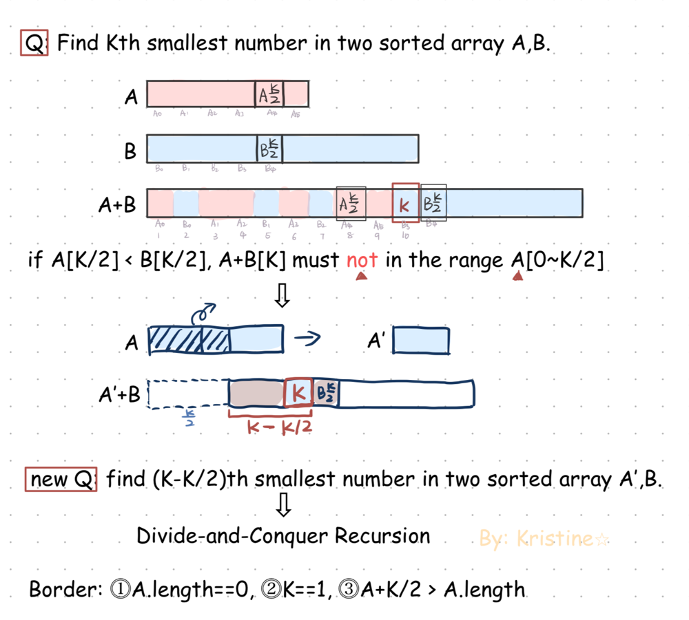

# 🍊 O(log(min(m,n))) Very Concise, Easy Visualized Explanation | Divide-and-conquer

**Author:** kristine70
**Votes:** 16
**Link:** [https://leetcode.com/problems/median-of-two-sorted-arrays/solutions/3486424/](https://leetcode.com/problems/median-of-two-sorted-arrays/solutions/3486424/)

---

# Intuition

Divide-and-conquer Method
- big question: Find Kth smallest number in two sorted array A,B.
- divide big question into smaller question: find (K-ak)th smallest number in two sorted array A[aK~aLength],B.

Use recursion to deal with each smaller question.




# Approach

parameters in `FindKthSmallList()`:
- `A` `B`: lists A,b
- `aL` `bL`: left border of list A/B
- `a` `b`: length of A/B

# Complexity
- Time complexity: $O(log(min(m,n)))$

# TypeScript Code

`FindKthSmallList()`:
```ts
const FindKthSmallList = (A: number[], aL: number, a: number, B: number[], bL: number, b: number, K: number): number => {
  if (a > b) return FindKthSmallList(B, bL, b, A, aL, a, K);

  if (a === 0) return B[bL + K - 1];
  if (K === 1) return Math.min(A[aL], B[bL]);

  const aK = Math.min(a, Math.ceil(K / 2));   // A+K/2 > A length
  const bK = K - aK;   // aK+bK=K (K/2+K/2=K or a+bK=K)

  if (A[aL + aK - 1] < B[bL + bK - 1]) { // array index include 0 so index=length-1
    return FindKthSmallList(A, aL + aK, a - aK, B, bL, b, K - aK); 
  } else {
    return FindKthSmallList(A, aL, a, B, bL + bK, b - bK, K - bK);
  }
};
```
`Main()`:

```ts
function findMedianSortedArrays(nums1: number[], nums2: number[]): number {
  const mn = nums1.length + nums2.length;
  const res = FindKthSmallList(nums1, 0, nums1.length, nums2, 0, nums2.length, Math.ceil(mn / 2));
  if (mn % 2) return res;
  return (res + FindKthSmallList(nums1, 0, nums1.length, nums2, 0, nums2.length, (mn + 2) / 2)) / 2;
}

```


