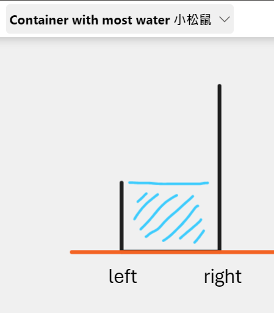
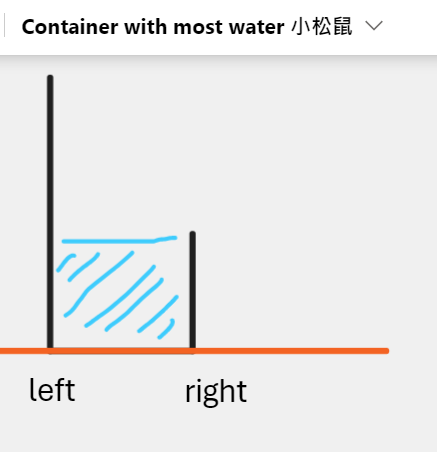

# Python/JS/Go/C++ O(n) by two-pointers [w/ Visualization] 有中文解題文章

**Author:** brianchiang_tw
**Votes:** 56
**Link:** [https://leetcode.com/problems/container-with-most-water/solutions/1069698/](https://leetcode.com/problems/container-with-most-water/solutions/1069698/)

---

O(n) by two-pointers 

[\u4E2D\u6587\u8A73\u89E3\u89E3\u984C\u6587\u7AE0](https://vocus.cc/article/65a104dafd897800011b0b3a)

---

# Keypoint

During adjusment the *shorter wall*, between left and right, decides the local max water we can keep.

# Visualization




or





---

**Implementation** by two-pointers in Python:

```
class Solution:
    def maxArea(self, height: List[int]) -> int:
        
        # length of input array
        size = len(height)
        
        # two pointers, left init as 0, right init as size-1
        left, right = 0, size-1
        
        # maximal width between leftmost stick and rightmost stick
        max_width = size - 1
        
        # area also known as the amount of water
        area = 0
        
		# trade-off between width and height
        # scan each possible width and compute maximal area
        for width in range(max_width, 0, -1):
            
            if height[left] < height[right]:
                # the height of lefthand side is shorter
                area = max(area, width * height[left] )
                
                # update left index to righthand side
                left += 1
                
            else:
                # the height of righthand side is shorter
                area = max(area, width * height[right] )
                
                # update right index to lefthand side
                right -= 1
                
        return area
                
```

---

**Implementation** by two-pointers in Javscript:

```
var maxArea = function(height) {
    
    // length of input array
    const size = height.length;
    
    // two pointers, leftinit as 0, right init as size-1
    let [left, right] = [0, size-1];
    
    let maxWidth = size-1;
    
    let area = 0;
    
    // trade-off between width and height
    // scan each possible width and compute maximal area
    for( let width = maxWidth ; width > 0 ; width-- ){
        
        if( height[left] < height[right] ){    
            area = Math.max(area, width * height[left] );
            
            // move left index to righthand side
            left += 1;
        }else{
            area = Math.max(area, width * height[right] );
            
            // move right index to lefthand side
            right -= 1;
        }
        
    }
    return area;
};
```

---

**Implementation** by two-pointers in Golang:

```
func Max(x, y int)int{
    if x >= y {
        return x
    }
    
    return y
}

func maxArea(height []int) int {
    
    // length of input array
    size := len(height)
    
    // tow pointers, left init as 0, right init as size-1
    left, right := 0, size-1
    
    // maximal width between leftmost stick and rightmost stick
    maxWidth := size-1
    
    // area also known as the amount of water
    area := 0
    
    // trade-off between width and height
    // scan each possible width and compute maximal area
    for width := maxWidth ; width > 0 ; width-- {
        
        if height[left] < height[right]{
            
            // the height of lefthand side is shorter
            area = Max(area, width * height[left])
            
            // update left index to righthand side
            left += 1
            
        }else{
            
            // the height of righthand side is shorter
            area = Max(area, width * height[right])
            
            // update left index to righthand side
            right -= 1
        }
        
    }
    return area
}
```

---

**Implementation** by two-pointers in C++

```
class Solution {
public:
    int maxArea(vector<int>& height) {
        
        int size = height.size();
        
        
        // two pointers, left init as 0, right init as size-1
        int left = 0, right = size-1;
        
        // maximal width between leftmost stick and rightmost stick
        int maxWidth = size-1;
            
        // area also known as the amount of water
        int area = 0;
        
        
        // trade-off between width and height
        // scan each possible width and compute mximal area
        for( int width = maxWidth ; width > 0 ; width-=1 ){
            
            if( height[left] < height[right] ){
                
                // the height of lefthand side is shorter
                area = max(area, width * height[left] );
                              
                // update left index to righthand side
                left += 1;
                
            }
            else{
                
                // the height of righthand side is shorter
                area = max(area, width * height[right] );
                
                // update right index to lefthand side
                right -= 1;
                
            }
        }
        
        return area;
    }
};
```