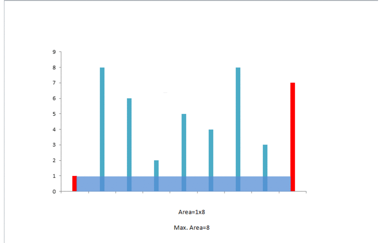

# Official Solution

**Link:** [https://leetcode.com/problems/container-with-most-water/solution/](https://leetcode.com/problems/container-with-most-water/solution/)

---

[TOC]


## Video Solution

---

<div>
    <div class="video-container">
        <iframe src="https://player.vimeo.com/video/513169200" width="640" height="360" frameborder="0" allow="autoplay; fullscreen" allowfullscreen></iframe>
    </div>
</div>

<div>&nbsp;
</div>

## Solution Article

---

## Overview

We have to maximize the Area that can be formed between the vertical lines using the shorter line as length and the distance between the lines as the width of the rectangle forming the area.

</br>

---

### Approach 1: Brute Force

**Algorithm**

In this case, we will simply consider the area for every possible pair of lines and find out the maximum area out of those.

> **Note:** Brute force approaches are often included because they are intuitive starting points when solving a problem. However, they are often expected to receive Time Limit Exceeded since they would not be accepted in an interview setting.

<iframe src="https://leetcode.com/playground/YGyCimYV/shared" frameBorder="0" width="100%" height="327" name="YGyCimYV"></iframe>

**Complexity Analysis**

* Time complexity: $$O(n^2)$$. Calculating area for all $$\dfrac{n(n-1)}{2}$$ height pairs.
* Space complexity: $$O(1)$$. Constant extra space is used.

---

### Approach 2: Two Pointer Approach

**Algorithm**

The intuition behind this approach is that the area formed between the lines will always be limited by the height of the shorter line. Further, the farther the lines, the more will be the area obtained.

We take two pointers, one at the beginning and one at the end of the array constituting the length of the lines. Further, we maintain a variable $$\text{maxarea}$$ to store the maximum area obtained till now. At every step, we find out the area formed between them, update $$\text{maxarea}$$, and move the pointer pointing to the shorter line towards the other end by one step.

The algorithm can be better understood by looking at the example below:
```
1 8 6 2 5 4 8 3 7
```

<!---->
!?!../Documents/11_Container_Water.json:1000,563!?!

How does this approach work?

Initially, we consider the area constituting the exterior most lines. Now, to maximize the area, we need to consider the area between the lines of larger lengths. If we try to move the pointer at the longer line inwards, we won't gain any increase in area, since it is limited by the shorter line. But moving the shorter line's pointer could turn out to be beneficial, as per the same argument, despite the reduction in the width. This is done since a relatively longer line obtained by moving the shorter line's pointer might overcome the reduction in area caused by the width reduction.

For further clarification click [here](https://leetcode.com/problems/container-with-most-water/discuss/6099/yet-another-way-to-see-what-happens-in-the-on-algorithm) and for the proof click [here](https://leetcode.com/problems/container-with-most-water/discuss/6089/Anyone-who-has-a-O(N)-algorithm/7268).

<iframe src="https://leetcode.com/playground/RvATDcyR/shared" frameBorder="0" width="100%" height="395" name="RvATDcyR"></iframe>

**Complexity Analysis**

* Time complexity: $$O(n)$$. Single pass.

* Space complexity: $$O(1)$$. Constant space is used.