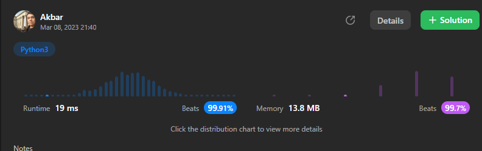

# ✅Python3 || C++|| Java✅ 19 ms || Beats 99.91%

**Author:** abdullayev_akbar
**Votes:** 3258
**Link:** [https://leetcode.com/problems/longest-common-prefix/solutions/3273176/](https://leetcode.com/problems/longest-common-prefix/solutions/3273176/)

---

# Please UPVOTE\uD83D\uDE0A


This code implements the longestCommonPrefix function that takes a list of strings v as input and returns the longest common prefix of all the strings. Here is an explanation of how the code works:

1. Initialize an empty string ans to store the common prefix.
2. Sort the input list v lexicographically. This step is necessary because the common prefix should be common to all the strings, so we need to find the common prefix of the first and last string in the sorted list.
3. Iterate through the characters of the first and last string in the sorted list, stopping at the length of the shorter string.
4. If the current character of the first string is not equal to the current character of the last string, return the common prefix found so far.
5. Otherwise, append the current character to the ans string.
6. Return the ans string containing the longest common prefix.

Note that the code assumes that the input list v is non-empty, and that all the strings in v have at least one character. If either of these assumptions is not true, the code may fail.
# Python3
```
class Solution:
    def longestCommonPrefix(self, v: List[str]) -> str:
        ans=""
        v=sorted(v)
        first=v[0]
        last=v[-1]
        for i in range(min(len(first),len(last))):
            if(first[i]!=last[i]):
                return ans
            ans+=first[i]
        return ans 

```
# C++
```
class Solution {
public:
    string longestCommonPrefix(vector<string>& v) {
        string ans="";
        sort(v.begin(),v.end());
        int n=v.size();
        string first=v[0],last=v[n-1];
        for(int i=0;i<min(first.size(),last.size());i++){
            if(first[i]!=last[i]){
                return ans;
            }
            ans+=first[i];
        }
        return ans;
    }
};
```
# Java 
```
class Solution {
    public String longestCommonPrefix(String[] v) {
        StringBuilder ans = new StringBuilder();
        Arrays.sort(v);
        String first = v[0];
        String last = v[v.length-1];
        for (int i=0; i<Math.min(first.length(), last.length()); i++) {
            if (first.charAt(i) != last.charAt(i)) {
                return ans.toString();
            }
            ans.append(first.charAt(i));
        }
        return ans.toString();
    }
}
```
