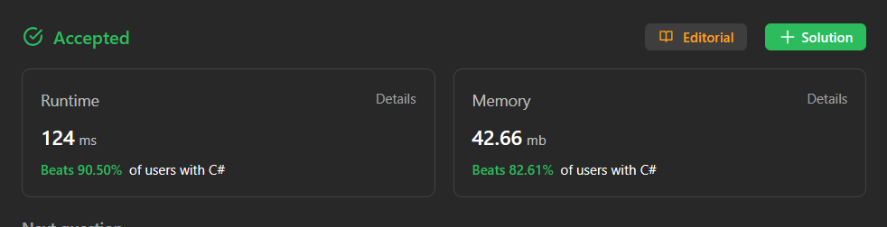

# ✅ C#/Java solution with easy explanation | Beats 90% in runtime

**Author:** Muhammad-Diyor
**Votes:** 55
**Link:** [https://leetcode.com/problems/remove-element/solutions/3913495/](https://leetcode.com/problems/remove-element/solutions/3913495/)

---


# Approach
Apply a two-pointer technique for efficient element removal. Use `result` to track the index of non-equal elements. Iterate through the array with `item`. If `item` is not equal to `val`, update `nums[result]` and increment result.

# Intuition

This technique efficiently separates non-equal from `val` elements while maintaining element order. `result` index represents the count of non-equal elements, which is returned as the final result.


# Complexity



# Code
```
public class Solution {
    public int RemoveElement(int[] nums, int val) {
        int result = 0;
        foreach (var item in nums)
        {
            if(item != val)
            {
                nums[result] = item;
                result++;
            }
        }   

        return result;
    }
}
```

## If you found my solution helpful, please consider giving it an upvote. Happy coding!