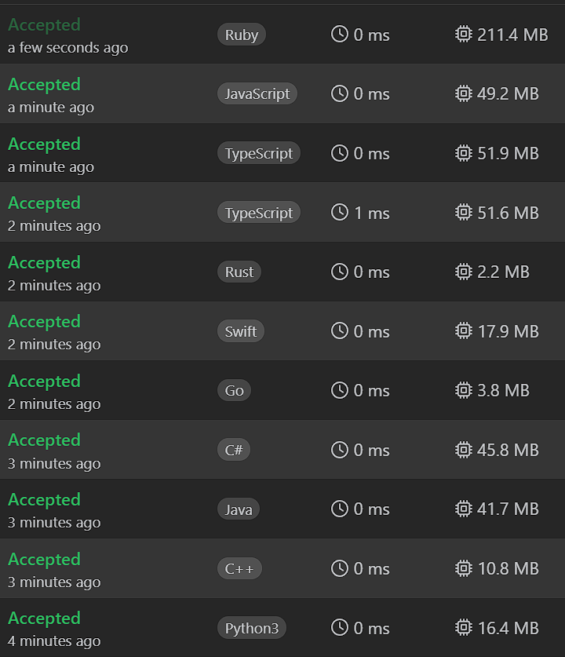

# ✅Beats 100% | Explained Step by Step | List Most Common Array Interview Problems✅

**Author:** Piotr_Maminski
**Votes:** 11
**Link:** [https://leetcode.com/problems/remove-element/solutions/6031528/](https://leetcode.com/problems/remove-element/solutions/6031528/)

---

https://www.youtube.com/watch?v=Pcd1ii9P9ZI
## Two Pointers (All beats 100% 0ms)


```python3 []
class Solution:
\xA0 \xA0 def removeElement(self, nums: List[int], val: int) -> int:
\xA0 \xA0 \xA0 \xA0 write_index = 0
\xA0 \xA0 \xA0 \xA0 for read_index in range(len(nums)):
\xA0 \xA0 \xA0 \xA0 \xA0 \xA0 if nums[read_index] != val:
\xA0 \xA0 \xA0 \xA0 \xA0 \xA0 \xA0 \xA0 nums[write_index] = nums[read_index]
\xA0 \xA0 \xA0 \xA0 \xA0 \xA0 \xA0 \xA0 write_index += 1
\xA0 \xA0 \xA0 \xA0 return write_index
```
```cpp []
class Solution {
public:
    int removeElement(vector<int>& nums, int val) {
        int writeIndex = 0;
        for (int readIndex = 0; readIndex < nums.size(); readIndex++) {
            if (nums[readIndex] != val) {
                nums[writeIndex] = nums[readIndex];
                writeIndex++;
            }
        }
        return writeIndex;
    }
};
```
```java []
class Solution {
    public int removeElement(int[] nums, int val) {
        int writeIndex = 0;
        for (int readIndex = 0; readIndex < nums.length; readIndex++) {
            if (nums[readIndex] != val) {
                nums[writeIndex] = nums[readIndex];
                writeIndex++;
            }
        }
        return writeIndex;
    }
}
```
```csharp []
public class Solution {
    public int RemoveElement(int[] nums, int val) {
        int writeIndex = 0;
        for (int readIndex = 0; readIndex < nums.Length; readIndex++) {
            if (nums[readIndex] != val) {
                nums[writeIndex] = nums[readIndex];
                writeIndex++;
            }
        }
        return writeIndex;
    }
}
```
```golang []
func removeElement(nums []int, val int) int {
    writeIndex := 0
    for readIndex := 0; readIndex < len(nums); readIndex++ {
        if nums[readIndex] != val {
            nums[writeIndex] = nums[readIndex]
            writeIndex++
        }
    }
    return writeIndex
}
```
```swift []
class Solution {
    func removeElement(_ nums: inout [Int], _ val: Int) -> Int {
        var writeIndex = 0
        for readIndex in 0..<nums.count {
            if nums[readIndex] != val {
                nums[writeIndex] = nums[readIndex]
                writeIndex += 1
            }
        }
        return writeIndex
    }
}
```
```javascript [JS]
// JavaScript

var removeElement = function(nums, val) {
    let writeIndex = 0;
    for (let readIndex = 0; readIndex < nums.length; readIndex++) {
        if (nums[readIndex] !== val) {
            nums[writeIndex] = nums[readIndex];
            writeIndex++;
        }
    }
    return writeIndex;
};
```
```typescript [TS]
// TypeScript

function removeElement(nums: number[], val: number): number {
    let writeIndex: number = 0;
    for (let readIndex = 0; readIndex < nums.length; readIndex++) {
        if (nums[readIndex] !== val) {
            nums[writeIndex] = nums[readIndex];
            writeIndex++;
        }
    }
    return writeIndex;
}
```
```rust []
impl Solution {
    pub fn remove_element(nums: &mut Vec<i32>, val: i32) -> i32 {
        let mut write_index = 0;
        for read_index in 0..nums.len() {
            if nums[read_index] != val {
                nums[write_index] = nums[read_index];
                write_index += 1;
            }
        }
        write_index as i32
    }
}
```
```ruby []
def remove_element(nums, val)
    write_index = 0
    
    nums.each_with_index do |num, read_index|
        if num != val
            nums[write_index] = nums[read_index]
            write_index += 1
        end
    end
    
    write_index
end
```
# Complexity
- Time complexity: O(n)


- Space complexity O(1)


# Aproach
---

1. We need two pointers: `write_index` and `read_index`

    - `write_index` keeps track of where to place the next valid element
    - `read_index` scans through the array looking for valid elements

2. Algorithm:

- It iterates through the array using `read_index`
- When it finds an element that's not equal to val, it:
    - Copies that element to the position indicated by `write_index`
    - Increments `write_index` to prepare for the next valid element
3. Return `write_index` 


---


# Most common Array Interview Problems
List based on my research (interviews, reddit, github) Probably not 100% accurate but very close to my recruitments. Leetcode Premium is probably more accurate [I don't have]


**Easy:** [[1. Two Sum]](https://leetcode.com/problems/two-sum/solutions/5999466/beats-100-explained-step-by-step-list-most-common-array-inverview) **(common warm-up)** [[121. Best Time to Buy and Sell Stock]](https://leetcode.com/discuss/topic/6027720/solution/) [[88. Merge Sorted Array]](https://leetcode.com/problems/merge-sorted-array/solutions/6031394/beats-100-explained-step-by-step-list-most-common-string-interview-problems) [[27. Remove Element]](https://leetcode.com/problems/remove-element/solutions/6031528/beats-100-explained-step-by-step-list-most-common-array-interview-problems) [[929. Unique Email Addresses]](https://leetcode.com/problems/unique-email-addresses/solutions/6031687/explained-step-by-step-video-list-most-common-array-interview-problems) 


**Medium/Hard:** [[15. 3Sum]](https://leetcode.com/problems/3sum/description/) [[42. Trapping Rain Water]](https://leetcode.com/problems/trapping-rain-water/?envType=problem-list-v2&envId=atbyk0mj) [[56. Merge Intervals]](https://leetcode.com/problems/merge-intervals/description/) [[57. Insert Interval]](https://leetcode.com/problems/insert-interval/description/) [[46. Permutations]](https://leetcode.com/problems/permutations/description/) [[53. Maximum Subarray]](https://leetcode.com/problems/maximum-subarray/description/) [[73. Set Matrix Zeroes]](https://leetcode.com/problems/set-matrix-zeroes/description/) [[284. Peeking Iterator]](https://leetcode.com/problems/peeking-iterator/description/)


# Interview Priorities


| Patterns                | Difficulty | Interview Frequently           |
|----------------------|---------------------|----------------------|
| **Basic [Array](https://leetcode.com/problems/two-sum/solutions/5999466/beats-100-explained-step-by-step-list-most-common-array-inverview) / [String](https://leetcode.com/problems/valid-parentheses/solutions/6013115/solution)**                 | **Easy**              | **Very High**               |
| **Two Pointers**         | **Easy**                | **High**                 |
| **Sliding Window**       | **Easy**                | **High**                 |
| **Breadth-First Search** | **Easy**                | **High**                 |
| **Depth-First Search**   | **Medium**              | **High**                 |
| **[Backtracking](https://leetcode.com/problems/letter-combinations-of-a-phone-number/solutions/5976064/complex-backtracking-interview-prepare-list-of-backtracking-questions-beats-100)**         | **High**                | **High**                 |
| Heap                 | Medium              | Medium               |
| Binary Search        | Easy                | Medium               |
| [Dynamic Programming](https://leetcode.com/problem-list/atwflvk7/)  | High                | Medium               |
| Divide and Conquer   | Medium              | Low                  |
| Trie                 | Medium              | Low                  |
| Union Find           | Medium              | Low                  |
| Greedy               | High                | Low                  |


####  [Interview Questions and Answers Repository](https://github.com/RooTinfinite/Interview-questions-and-answers)



