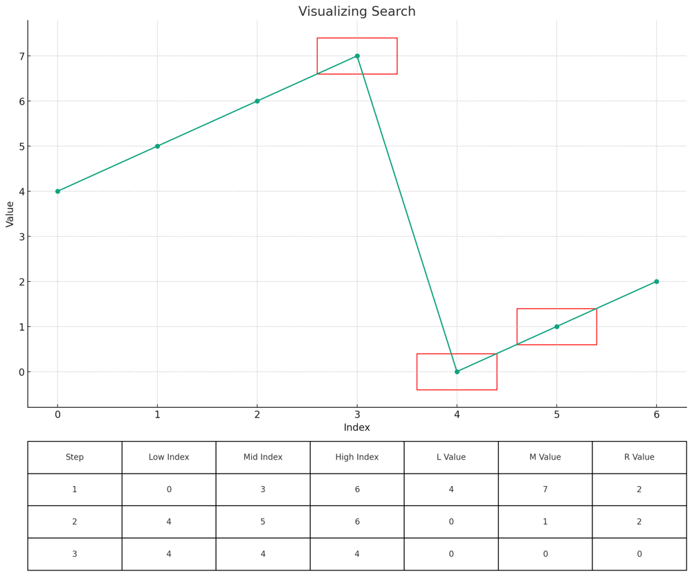
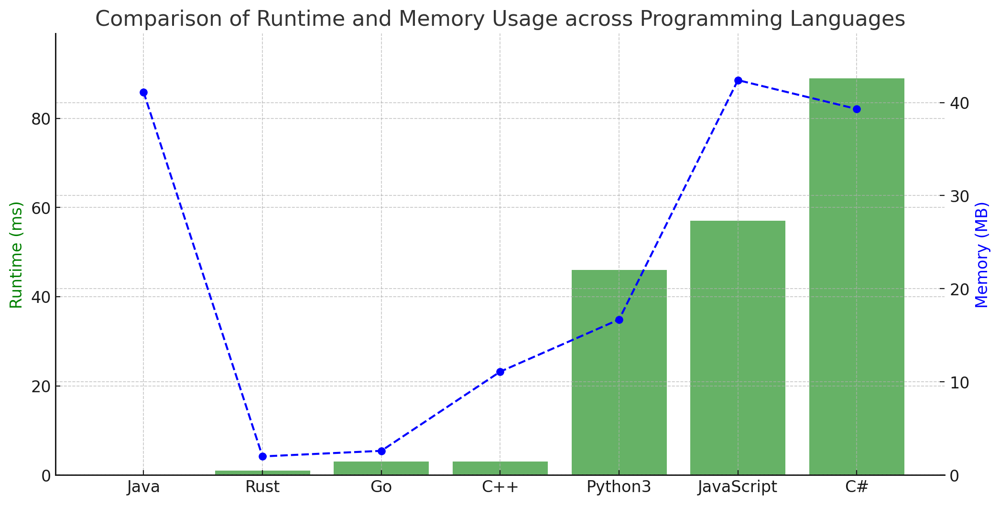

# ✅ 100% Binary Search Easy [VIDEO] O(log(n)) Optimal Solution

**Author:** vanAmsen
**Votes:** 539
**Link:** [https://leetcode.com/problems/search-in-rotated-sorted-array/solutions/3879263/](https://leetcode.com/problems/search-in-rotated-sorted-array/solutions/3879263/)

---

# Problem Understanding

The task is to search for a target integer in a sorted array that has been rotated at an unknown pivot. 

For instance, the array $$[0,1,2,4,5,6,7]$$ could be rotated at the 4th position to give $$[4,5,6,7,0,1,2]$$. The challenge is to find the position of the target integer in this rotated array. 



- The top section shows the `nums` array with a red rectangle highlighting the current "mid" value being considered in each step.
- The bottom section displays a table that presents the steps of the binary search. Each row corresponds to a step, detailing:
  - The step number.
  - The indices of the low (L), mid (M), and high (R) pointers.
  - The values at the low (L), mid (M), and high (R) positions.

# Live Coding & Explenation
https://youtu.be/hywGbVJldj0

# Approach

Given the properties of the array, it's tempting to perform a linear search. However, that would result in a time complexity of $$O(n)$$. Instead, we can use the properties of the array to our advantage and apply a binary search to find the target with time complexity of $$ O(\\log n) $$ only.

## Treating the Rotated Array

Although the array is rotated, it retains some properties of sorted arrays that we can leverage. Specifically, one half of the array (either the left or the right) will always be sorted. This means we can still apply binary search by determining which half of our array is sorted and whether the target lies within it.

## Binary Search

Binary search is an efficient algorithm for finding a target value within a sorted list. It works by repeatedly dividing the search interval in half. If the value of the search key is less than the item in the middle of the interval, narrow the interval to the lower half. Otherwise, narrow it to the upper half. Repeatedly check until the value is found or the interval is empty.

## Initialization

We start with two pointers:

- $$ \	ext{left} $$ - This represents the beginning of the array. We initialize it to 0, the index of the first element.
- $$ \	ext{right} $$ - This represents the end of the array. It's set to $$ n - 1 $$, the index of the last element, where $$ n $$ is the length of the array.

## Iterative Binary Search

We perform the binary search within a while loop until $$ \	ext{left} $$ exceeds $$ \	ext{right} $$. In each iteration, we calculate the midpoint between $$ \	ext{left} $$ and $$ \	ext{right} $$.

### Deciding the Sorted Half:

At any point during the search in the rotated array, one half (either the left or the right) will always be sorted. Determining which half is sorted is crucial for our modified binary search. 

- **If left half $$[low...mid]$$ is sorted**: We know this if the element at $$ \	ext{low} $$ is less than or equal to the element at $$ \	ext{mid} $$. In a normally sorted array, if the start is less than or equal to the midpoint, it means all elements till the midpoint are in the correct increasing order.

  - **If the target lies within this sorted left half**: We know this if the target is greater than or equal to the element at $$ \	ext{low} $$ and less than the element at $$ \	ext{mid} $$. If this is the case, we then move our search to this half, meaning, we update $$ \	ext{high} $$ to $$ \	ext{mid} - 1 $$.

  - **Otherwise**: The target must be in the right half. So, we update $$ \	ext{low} $$ to $$ \	ext{mid} + 1 $$.

- **If right half $$[mid...high]$$ is sorted**: This is the else part. If the left half isn't sorted, the right half must be!

  - **If the target lies within this sorted right half**: We know this if the target is greater than the element at $$ \	ext{mid} $$ and less than or equal to the element at $$ \	ext{high} $$. If so, we move our search to this half by updating $$ \	ext{low} $$ to $$ \	ext{mid} + 1 $$.

  - **Otherwise**: The target must be in the left half. So, we update $$ \	ext{high} $$ to $$ \	ext{mid} - 1 $$.

### Rationale:

The beauty of this approach lies in its ability to determine with certainty which half of the array to look in, even though the array is rotated. By checking which half of the array is sorted and then using the sorted property to determine if the target lies in that half, we can effectively eliminate half of the array from consideration at each step, maintaining the $$ O(\\log n) $$ time complexity of the binary search.

## Complexity

**Time Complexity**: The time complexity is $$ O(\\log n) $$ since we're performing a binary search over the elements of the array.

**Space Complexity**: The space complexity is $$ O(1) $$ because we only use a constant amount of space to store our variables ($$ \	ext{left} $$, $$\	ext{right} $$, $$ \	ext{mid} $$), regardless of the size of the input array.

# Performance




# Code

``` Python []
class Solution:
    def search(self, nums: List[int], target: int) -> int:
        left, right = 0, len(nums) - 1

        while left <= right:
            mid = (left + right) // 2

            if nums[mid] == target:
                return mid

            # Check if left half is sorted
            if nums[left] <= nums[mid]:
                if nums[left] <= target < nums[mid]:
                    right = mid - 1
                else:
                    left = mid + 1
            # Otherwise, right half is sorted
            else:
                if nums[mid] < target <= nums[right]:
                    left = mid + 1
                else:
                    right = mid - 1

        return -1
```
``` C++ []
class Solution {
public:
    int search(std::vector<int>& nums, int target) {
        int low = 0, high = nums.size() - 1;

        while (low <= high) {
            int mid = (low + high) / 2;

            if (nums[mid] == target) {
                return mid;
            }

            if (nums[low] <= nums[mid]) {
                if (nums[low] <= target && target < nums[mid]) {
                    high = mid - 1;
                } else {
                    low = mid + 1;
                }
            } else {
                if (nums[mid] < target && target <= nums[high]) {
                    low = mid + 1;
                } else {
                    high = mid - 1;
                }
            }
        }

        return -1;
    }
};
```
``` Go []
func search(nums []int, target int) int {
    low, high := 0, len(nums) - 1

    for low <= high {
        mid := (low + high) / 2

        if nums[mid] == target {
            return mid
        }

        if nums[low] <= nums[mid] {
            if nums[low] <= target && target < nums[mid] {
                high = mid - 1
            } else {
                low = mid + 1
            }
        } else {
            if nums[mid] < target && target <= nums[high] {
                low = mid + 1
            } else {
                high = mid - 1
            }
        }
    }

    return -1
}
```
``` Rust []
impl Solution {
    pub fn search(nums: Vec<i32>, target: i32) -> i32 {
        let mut low = 0;
        let mut high = nums.len() as i32 - 1;

        while low <= high {
            let mid = (low + high) / 2;

            if nums[mid as usize] == target {
                return mid;
            }

            if nums[low as usize] <= nums[mid as usize] {
                if nums[low as usize] <= target && target < nums[mid as usize] {
                    high = mid - 1;
                } else {
                    low = mid + 1;
                }
            } else {
                if nums[mid as usize] < target && target <= nums[high as usize] {
                    low = mid + 1;
                } else {
                    high = mid - 1;
                }
            }
        }

        -1
    }
}
```
``` Java []
class Solution {
    public int search(int[] nums, int target) {
        int low = 0, high = nums.length - 1;

        while (low <= high) {
            int mid = (low + high) / 2;

            if (nums[mid] == target) {
                return mid;
            }

            if (nums[low] <= nums[mid]) {
                if (nums[low] <= target && target < nums[mid]) {
                    high = mid - 1;
                } else {
                    low = mid + 1;
                }
            } else {
                if (nums[mid] < target && target <= nums[high]) {
                    low = mid + 1;
                } else {
                    high = mid - 1;
                }
            }
        }

        return -1;
    }
}
```
``` JavaScript []
/**
 * @param {number[]} nums
 * @param {number} target
 * @return {number}
 */
var search = function(nums, target) {
    let low = 0, high = nums.length - 1;

    while (low <= high) {
        let mid = Math.floor((low + high) / 2);

        if (nums[mid] === target) {
            return mid;
        }

        if (nums[low] <= nums[mid]) {
            if (nums[low] <= target && target < nums[mid]) {
                high = mid - 1;
            } else {
                low = mid + 1;
            }
        } else {
            if (nums[mid] < target && target <= nums[high]) {
                low = mid + 1;
            } else {
                high = mid - 1;
            }
        }
    }

    return -1;
};
```
``` C# []
public class Solution {
    public int Search(int[] nums, int target) {
        int low = 0, high = nums.Length - 1;

        while (low <= high) {
            int mid = (low + high) / 2;

            if (nums[mid] == target) {
                return mid;
            }

            if (nums[low] <= nums[mid]) {
                if (nums[low] <= target && target < nums[mid]) {
                    high = mid - 1;
                } else {
                    low = mid + 1;
                }
            } else {
                if (nums[mid] < target && target <= nums[high]) {
                    low = mid + 1;
                } else {
                    high = mid - 1;
                }
            }
        }

        return -1;
    }
}
```

I hope this explanation provides clarity on the "Search in Rotated Sorted Array" problem. If you have any more questions, feel free to ask! If you found this helpful, consider giving it a thumbs up. Happy coding! \uD83D\uDC69\u200D\uD83D\uDCBB\uD83D\uDE80\uD83D\uDC68\u200D\uD83D\uDCBB