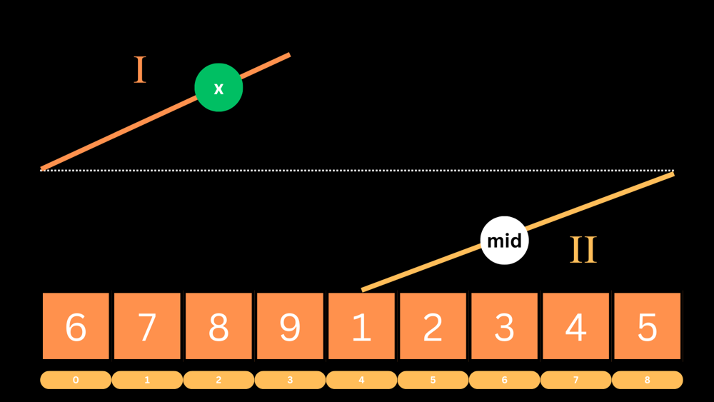

# [16 LOC] Binary Search In Parts

**Author:** atroid
**Votes:** 2
**Link:** [https://leetcode.com/problems/search-in-rotated-sorted-array/solutions/3879542/](https://leetcode.com/problems/search-in-rotated-sorted-array/solutions/3879542/)

---

# Intuition
<!-- Describe your first thoughts on how to solve this problem. -->
The given array `nums` is sorted then rotated, i.e. it has 2 ascending parts, we can perform a normal binary search on either of them

# Approach
<!-- Describe your approach to solving the problem. -->
We can visualise the array as given in *fig. 1*, where X represents the `target` value



Then we folow the given steps in order to solve the problem

1. figure out if the target lies in the `I` ascend or the `II` ascend
2. Start binary search
    1. calculate `mid`
    2. if mid $$\\in$$ `I` and target $$\\in$$ `II`, shift `low`
    3. else if mid $$\\in$$ `II` and target $$\\in$$ `I`, shift `high`
    4. else update with normal binary search conditions for ascending order

# Complexity
- Time complexity: $$O(log n)$$ 
[n = `nums.length`]
<!-- Add your time complexity here, e.g. $$O(n)$$ -->

- Space complexity: $$ O(1) $$
<!-- Add your space complexity here, e.g. $$O(n)$$ -->

# Code

```javascript []
/**
 * @param {number[]} nums
 * @param {number} target
 * @return {number}
 */
var search = function(nums, target) {
    let low = 0, high = nums.length - 1;
    const targetI = target >= nums[0];
    while(low <= high) {
        const mid = low + Math.floor((high - low) / 2);
        const midI = nums[mid] >= nums[0];
        if(nums[mid] === undefined) return -1;
        if(midI && !targetI) low = mid + 1;
        else if(!midI && targetI) high = mid - 1;
        else if(nums[mid] < target) low = mid + 1;
        else if(nums[mid] > target) high = mid - 1;
        else return mid;
    }
    return -1;
};
```
```python3 []
class Solution:
    def search(self, nums: List[int], target: int) -> int:
        low, high = 0, len(nums) - 1
        targetI = target >= nums[0]
        while low <= high:
            mid = low + (high - low) // 2
            midI = nums[mid] >= nums[0]
            if midI and not targetI:
                low = mid + 1
            elif not midI and targetI:
                high = mid - 1
            elif nums[mid] < target:
                low = mid + 1
            elif nums[mid] > target:
                high = mid - 1
            else:
                return mid
        return -1
```
```C# []
public class Solution {
    public int Search(int[] nums, int target) {
        int low = 0, high = nums.Length - 1;
        bool targetI = target >= nums[0];
        while(low <= high) {
            int mid = low + (high - low) / 2;
            bool midI = nums[mid] >= nums[0];
            if(midI && !targetI) low = mid + 1;
            else if(!midI && targetI) high = mid - 1;
            else if(nums[mid] < target) low = mid + 1;
            else if(nums[mid] > target) high = mid - 1;
            else return mid;
        }
        return -1;
    }
}
```
```C++ []
class Solution {
public:
    int search(vector<int>& nums, int target) {
        int low = 0, high = nums.size() - 1;
        bool targetI = target >= nums[0];
        while (low <= high) {
            int mid = low + (high - low) / 2;
            bool midI = nums[mid] >= nums[0];
            if (midI && !targetI) low = mid + 1;
            else if (!midI && targetI) high = mid - 1;
            else if (nums[mid] < target) low = mid + 1;
            else if (nums[mid] > target) high = mid - 1;
            else return mid;
        }
        return -1;
    }
};
```
``` Dart []
class Solution {
  int search(List<int> nums, int target) {
    int low = 0, high = nums.length - 1;
    bool targetI = target >= nums[0];
    while(low <= high) {
        int mid = (low + (high - low) / 2).toInt();
        bool midI = nums[mid] >= nums[0];
        if(midI && !targetI) low = mid + 1;
        else if(!midI && targetI) high = mid - 1;
        else if(nums[mid] < target) low = mid + 1;
        else if(nums[mid] > target) high = mid - 1;
        else return mid;
    }
    return -1;
  }
}
```
```C []
int search(int* nums, int numsSize, int target){
    int low = 0, high = numsSize - 1;
    bool targetI = target >= nums[0];

    while(low <= high) {
        int mid = low + (high - low) / 2;
        bool midI = nums[mid] >= nums[0];
        if(midI && !targetI) low = mid + 1;
        else if(!midI && targetI) high = mid - 1;
        else if(nums[mid] < target) low = mid + 1;
        else if(nums[mid] > target) high = mid - 1;
        else return mid;
    }
    
    return -1;
}
```
```Java []
class Solution {
    public int search(int[] nums, int target) {
        int low = 0, high = nums.length - 1;
        boolean targetI = target >= nums[0];
        while(low <= high) {
            int mid = low + (high - low) / 2;
            boolean midI = nums[mid] >= nums[0];
            if(midI && !targetI) low = mid + 1;
            else if(!midI && targetI) high = mid - 1;
            else if(nums[mid] < target) low = mid + 1;
            else if(nums[mid] > target) high = mid - 1;
            else return mid;
        }
        return -1;
    }
}
```
