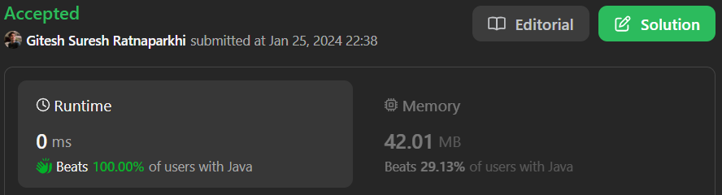

# Easy & Beginner & dry run|| Brute force & Binary Search || Time - O(Log n) & Space - O(1) || Gits✅✅

**Author:** GiteshSK_12
**Votes:** 7
**Link:** [https://leetcode.com/problems/search-in-rotated-sorted-array/solutions/4676365/](https://leetcode.com/problems/search-in-rotated-sorted-array/solutions/4676365/)

---

# Guys if you like the solution and explanation then upvote me


# Intuition
In question given a rotated sorted array. To solve this question there are two approach brute force and optimised which include binary search.

# **Brute force approach -** 
- In one traversal we will find the element in the array but the time complexity will be O(n) but the condition is to solve in O(log n) complexity.

```C []
int search(int* nums, int numsSize, int target) {
    for(int i = 0; i < numsSize ;i++){
        if(nums[i] == target)return i;
    }
    return -1;
}
```
```C++ []
class Solution {
public:
    int search(vector<int>& nums, int target) {
        int len = nums.size();
        for(int i = 0; i < len ;i++){
            if(nums[i] == target)return i;
        }
        return -1;
    }
};
```
```Java []
class Solution {
    public int search(int[] nums, int target) {
        for(int i = 0; i<nums.length ; i++){
            if(nums[i] == target)return i;
        }
        return -1;
    }
}
```
```javascript []
/**
 * @param {number[]} nums
 * @param {number} target
 * @return {number}
 */
var search = function(nums, target) {
    let len = nums.length
    for(let i = 0; i< len; i++){
        if(nums[i] === target)return i
    }
    return -1
};
```
```python []
class Solution(object):
    def search(self, nums, target):
        """
        :type nums: List[int]
        :type target: int
        :rtype: int
        """
        for i in nums:
            if i == target: return nums.index(i)
        return -1
```
```ruby []
# @param {Integer[]} nums
# @param {Integer} target
# @return {Integer}
def search(nums, target)
    nums.each_with_index do |num, index|
        return index if num == target
    end
    -1
end
```

# **Optimised Approach (Binary Search) -**
- To solve this question using binary search we should know what is binary search.
- Binary Search is defined as a searching algorithm used in a sorted array by repeatedly dividing the search interval in half. The idea of binary search is to use the information that the array is sorted and reduce the time complexity to O(log N).
- Conditions for when to apply Binary Search in a Data Structure:
# To apply Binary Search algorithm:
    1. The data structure must be sorted.
    2. Access to any element of the data structure takes constant time. 
    
# **Binary Search Algorithm:**
In this algorithm, 
1. Divide the search space into two halves by finding the middle index \u201Cmid\u201D.


2. Compare the middle element of the search space with the key. 
3. If the key is found at middle element, the process is terminated.
4. If the key is not found at middle element, choose which half will be used as the next search space.
    - If the key is smaller than the middle element, then the left side is used for next search.
    - If the key is larger than the middle element, then the right side is used for next search.
5. This process is continued until the key is found or the total search space is exhausted.

# Code Explanation 
1. **Initialization:**
    - 'start' and 'end' are pointers for the binary search, initially set to the first (0) and last (len) indices of the array.
    `int len = nums.length - 1,start = 0, end = len;`
2. **Binary Search Loop:**
    - The while loop (while(start <= end)) continues as long as start is less than or equal to end. This ensures that the search space is valid.
    `while(start <= end){}`
3. **Midpoint Calculation:**
    - Inside the loop, mid is calculated as the midpoint between start and end. This is done using (start+end)/2.
    `int mid = (start+end)/2;`
4. **Checking for Target:**
    - If nums[mid] equals target, the method returns mid, indicating the position of target in the array.
    `if(target == nums[mid])return mid;`
5. **Determining the Sorted Half:**
    - The array is rotated, so one half of it will always be sorted. The condition nums[mid] < nums[end] checks if the right half (from mid to end) is sorted.
6. **Binary Search Logic:**
    - If the right half is sorted:
        - Check if target is in this range (nums[mid] to nums[end]). If yes, move start to mid + 1 to search in this half.
        - Otherwise, move end to mid - 1 to search in the left half.

    - If the right half is not sorted, then the left half (from start to mid) must be sorted:
        - Check if target is in this range (nums[start] to nums[mid]). If yes, move end to mid - 1 to search in this half.
        - Otherwise, move start to mid + 1 to search in the right half.
7. **Target Not Found:**
    - If the loop exits without finding target, the method returns -1, indicating that target is not in the array.

- # Complexity
    - **Time complexity:** Time complexity of optimised approach is O(log n)

    - **Space complexity:** O(1)

# Code
```C []
int search(int* nums, int numsSize, int target) {
    int start = 0 , end = numsSize - 1;
    while(start <= end){
        int mid =(start + end)/2;
        if(nums[mid] == target)return mid;
        else if(nums[mid] < nums[end]){
            if(target > nums[mid] && target <= nums[end])start = mid+1;
            else end = mid -1;
        }else{
            if(target >= nums[start] && target < nums[mid])end = mid -1;
            else start = mid +1;
        }
    }             
    return -1;
}
```
```C++ []
class Solution {
public:
    int search(vector<int>& nums, int target) {
        int len = nums.size();
        int start = 0, end = len - 1;
        while(start <= end){
            int mid = (start + end)/2;
            if(nums[mid] == target)return mid;
            else if(nums[mid] < nums[end]){
                if(target > nums[mid] && target <= nums[end])start = mid +1;
                else end = mid -1;
            }else{
                if(target >= nums[start] && target<nums[mid])end = mid -1;
                else start = mid +1;
            }
        }
       
        return -1;
    }
};
```
```Java []
class Solution {
    public int search(int[] nums, int target) {
        int len = nums.length - 1,start = 0, end = len;
        while(start <= end){
            int mid = (start+end)/2;

            if(target == nums[mid])return mid;

            else if(nums[mid] < nums[end]){
                if(target > nums[mid] && target <= nums[end])start = mid+1;
                else end = mid -1;
            }

            else{
                if(target >= nums[start] && target<nums[mid])end = mid -1;
                else start = mid +1;
            }
        }
        return -1;
    }
}
```
```javascript []
/**
 * @param {number[]} nums
 * @param {number} target
 * @return {number}
 */
var search = function(nums, target) {
    let start = 0 , end = nums.length -1
    while(start <= end){
        let mid = Math.floor((start + end) / 2);
        if(nums[mid] === target)return mid
        else if(nums[mid] < nums[end]){
            if(target > nums[mid] && target <= nums[end])start = mid + 1
            
            else end = mid - 1
        }else{
            if(target >= nums[start] && target < nums[mid]) end = mid -1
            else start = mid + 1
        }
    }
    return -1
};
```
```python []
class Solution(object):
    def search(self, nums, target):
        """
        :type nums: List[int]
        :type target: int
        :rtype: int
        """
        start = 0
        end = len(nums) - 1
        while start<= end:
            mid = (start + end)/2
            if nums[mid] == target:
                return mid
            elif nums[mid] < nums[end]:
                if target > nums[mid] and target <= nums[end]: start = mid + 1
                else : end = mid -1
            else :
                if target >= nums[start] and target < nums[mid]: end = mid -1
                else : start = mid + 1
        return -1

```
```python3 []
class Solution:
    def search(self, nums: List[int], target: int) -> int:
        start = 0
        end = len(nums) - 1
        while start<= end:
            mid = (start + end)//2
            if nums[mid] == target: return mid
            elif nums[mid] < nums[end]:
                if target > nums[mid] and target <= nums[end]: start = mid + 1
                else : end = mid -1
            else :
                if target >= nums[start] and target < nums[mid]: end = mid -1
                else : start = mid + 1
        return -1

```
```ruby []
# @param {Integer[]} nums
# @param {Integer} target
# @return {Integer}
def search(nums, target)
    start = 0
  ending = nums.length - 1

  while start <= ending
    mid = (start + ending) / 2
    return mid if nums[mid] == target

    if nums[mid] < nums[ending]
      if target > nums[mid] && target <= nums[ending]
        start = mid + 1
      else
        ending = mid - 1
      end
    else
      if target >= nums[start] && target < nums[mid]
        ending = mid - 1
      else
        start = mid + 1
      end
    end
  end

  -1
end
```

# **Dry Run -** 
The algorithm is quite complex so here is a dry run for this code.

**Initial Setup -**
- nums = [4, 5, 6, 7, 0, 1, 2]
- len = 7 - 1
- start = 0
- end = 6
    
**Iteration 1:**
- start = 0
- end = 6
- Formula to find mid is mid = (start + end)/2
- mid is (0 + 6) / 2, which is 3 . nums[mid] is 7
- nums[mid] < nums[end] is 7 < 2, which is false. So, the left half is sorted.
- target >= nums[start] && target < nums[mid] is 0 >= 4 && 0 < 7, which is false. So, we search in the right half.
- Update start to mid + 1, which is 4.

**Iteration 2:**
- Now start = 4 and end = 6
- mid is (4 + 6) / 2, which is 5. nums[mid] is 1.
- nums[mid] < nums[end] is 1 < 2, which is true. So, the right half is sorted.
- target > nums[mid] && target <= nums[end] is 0 > 1 && 0 <= 2, which is false. So, we search in the left half.
- Update end to mid - 1, which is 4.

**Iteration 3:**
- Now start = 4 and end = 4
- mid is (4 + 4) / 2, which is 4. nums[mid] is 0.
- target == nums[mid] is 0 == 0, which is true. We have found the target.
- The method returns 4, which is the index of target in the array.

# If the explanation is helpful then upvote me guys.

