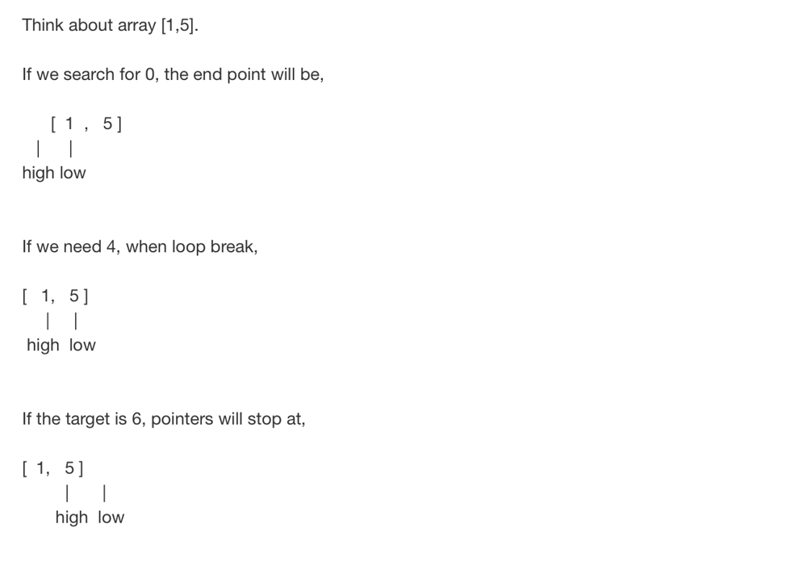

# C++ | 3 Solutions | Well-explained with example and concise solution

**Author:** priyam_vd
**Votes:** 101
**Link:** [https://leetcode.com/problems/search-insert-position/solutions/1596479/](https://leetcode.com/problems/search-insert-position/solutions/1596479/)

---

**The One-Liner ::**
```
class Solution {
public:
    int searchInsert(vector<int>& nums, int target) {
        return lower_bound(nums.begin(), nums.end(), target) - nums.begin();
    }
};
```

*The lower_bound() is used to return an iterator pointing to the first element in the range [first, last) which has a value >= target. 
Function returns the index of the next smallest number just greater than or equal to that number. That's what our search insert position will be ....*
   
###   Recursive and iterative ways to implement this function -->>
  
 
* Iterative method 
```                                                                                        
class Solution {
public:
    int searchInsert(vector<int>& nums, int target) {
     
        int low = 0, high = nums.size()-1;
        
        while(low<=high){
            int mid = low + (high-low)/2;
            
            if(nums[mid] == target) return mid;
            
            else if(nums[mid] > target) high = mid-1;
            
            else low = mid+1;
        }
        return low;
    }
};         
```
**why to return low ?** 
      *Because when high = low+1, then mid = low.*
      *If the target > nums[mid], then low = mid + 1 = high. The target position can be low or high, since they are the same.*
      *but if the target < nums[mid], then high = mid - 1 = low - 1. The target position must be low, not the high.*
  See the example -->      
                       
         ***Hence, low is  always at the search index position*** 
  
  
  
*    Recursive method
```                                                                                            
class Solution {
public:
    
    int rec(vector<int>& nums,int& target,int l,int r){
        if(l >= r) return nums[l] >= target ? l : l + 1;
        int mid = l + ((r - l) >> 1);
        return nums[mid] == target ? mid : nums[mid] > target ? rec(nums,target,l,mid-1) : rec(nums,target,mid+1,r);
    }
    
    int searchInsert(vector<int>& nums, int target) {
        return rec(nums,target,0,(int)nums.size()-1);
    }
};