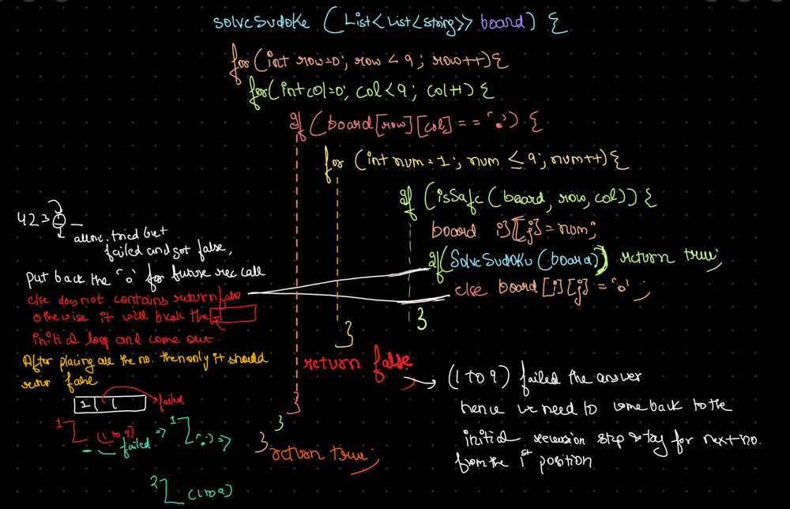

# 🔥BEATS 💯 % 🎯 |✨SUPER EASY BEGINNERS 👏

**Author:** CodeWithSparsh
**Votes:** 11
**Link:** [https://leetcode.com/problems/sudoku-solver/solutions/5971202/](https://leetcode.com/problems/sudoku-solver/solutions/5971202/)

---


---



---

# Intuition
To solve a Sudoku puzzle, try to place numbers one by one in each cell, ensuring that the number placement obeys the Sudoku rules. If placing a number leads to a valid board configuration, continue; otherwise, backtrack by removing the number.

# Approach
1. Traverse the board cell by cell:
   - If a cell is empty, try placing each number from 1 to 9.
   - After placing a number, check if the board remains valid.
   - Recursively attempt to solve the remaining board with the current placement.
   - If the placement fails, reset the cell and try the next number.
2. Use backtracking to explore all possible configurations until the board is solved.

# Complexity
- Time complexity:  
  $$O(9^{(n \	imes n)})$$ where \\( n = 9 \\), due to backtracking over each cell and number combination.

- Space complexity:  
  $$O(n^2)$$ due to recursive stack usage in backtracking.

# Code

```dart []
class Solution {
  void solveSudoku(List<List<String>> board) {
    _solve(board);
  }

  bool _solve(List<List<String>> board) {
    for (int row = 0; row < 9; row++) {
      for (int col = 0; col < 9; col++) {
        if (board[row][col] == ".") {
          for (int num = 1; num <= 9; num++) {
            String char = num.toString();
            if (_isValid(board, row, col, char)) {
              board[row][col] = char;
              if (_solve(board)) return true;
              board[row][col] = ".";
            }
          }
          return false;
        }
      }
    }
    return true;
  }

  bool _isValid(List<List<String>> board, int row, int col, String char) {
    for (int i = 0; i < 9; i++) {
      if (board[row][i] == char || board[i][col] == char) return false;
    }
    int startRow = (row ~/ 3) * 3;
    int startCol = (col ~/ 3) * 3;
    for (int i = startRow; i < startRow + 3; i++) {
      for (int j = startCol; j < startCol + 3; j++) {
        if (board[i][j] == char) return false;
      }
    }
    return true;
  }
}
```

```java []
class Solution {
    public void solveSudoku(char[][] board) {
        solve(board);
    }

    private boolean solve(char[][] board) {
        for (int row = 0; row < 9; row++) {
            for (int col = 0; col < 9; col++) {
                if (board[row][col] == '.') {
                    for (char num = '1'; num <= '9'; num++) {
                        if (isValid(board, row, col, num)) {
                            board[row][col] = num;
                            if (solve(board)) return true;
                            board[row][col] = '.';
                        }
                    }
                    return false;
                }
            }
        }
        return true;
    }

    private boolean isValid(char[][] board, int row, int col, char num) {
        for (int i = 0; i < 9; i++) {
            if (board[row][i] == num || board[i][col] == num) return false;
        }
        int startRow = (row / 3) * 3;
        int startCol = (col / 3) * 3;
        for (int i = startRow; i < startRow + 3; i++) {
            for (int j = startCol; j < startCol + 3; j++) {
                if (board[i][j] == num) return false;
            }
        }
        return true;
    }
}
```

```javascript []
var solveSudoku = function(board) {
    const solve = () => {
        for (let row = 0; row < 9; row++) {
            for (let col = 0; col < 9; col++) {
                if (board[row][col] === '.') {
                    for (let num = '1'; num <= '9'; num++) {
                        if (isValid(board, row, col, num)) {
                            board[row][col] = num;
                            if (solve()) return true;
                            board[row][col] = '.';
                        }
                    }
                    return false;
                }
            }
        }
        return true;
    };
    
    const isValid = (board, row, col, num) => {
        for (let i = 0; i < 9; i++) {
            if (board[row][i] === num || board[i][col] === num) return false;
        }
        let startRow = Math.floor(row / 3) * 3;
        let startCol = Math.floor(col / 3) * 3;
        for (let i = startRow; i < startRow + 3; i++) {
            for (let j = startCol; j < startCol + 3; j++) {
                if (board[i][j] === num) return false;
            }
        }
        return true;
    };
    
    solve();
};
```

```python []
class Solution:
    def solveSudoku(self, board):
        def solve():
            for row in range(9):
                for col in range(9):
                    if board[row][col] == '.':
                        for num in '123456789':
                            if is_valid(row, col, num):
                                board[row][col] = num
                                if solve():
                                    return True
                                board[row][col] = '.'
                        return False
            return True

        def is_valid(row, col, num):
            for i in range(9):
                if board[row][i] == num or board[i][col] == num:
                    return False
            start_row, start_col = 3 * (row // 3), 3 * (col // 3)
            for i in range(start_row, start_row + 3):
                for j in range(start_col, start_col + 3):
                    if board[i][j] == num:
                        return False
            return True

        solve()
```

```cpp []
class Solution {
public:
    void solveSudoku(vector<vector<char>>& board) {
        solve(board);
    }

private:
    bool solve(vector<vector<char>>& board) {
        for (int row = 0; row < 9; row++) {
            for (int col = 0; col < 9; col++) {
                if (board[row][col] == '.') {
                    for (char num = '1'; num <= '9'; num++) {
                        if (isValid(board, row, col, num)) {
                            board[row][col] = num;
                            if (solve(board)) return true;
                            board[row][col] = '.';
                        }
                    }
                    return false;
                }
            }
        }
        return true;
    }

    bool isValid(vector<vector<char>>& board, int row, int col, char num) {
        for (int i = 0; i < 9; i++) {
            if (board[row][i] == num || board[i][col] == num) return false;
        }
        int startRow = (row / 3) * 3, startCol = (col / 3) * 3;
        for (int i = startRow; i < startRow + 3; i++) {
            for (int j = startCol; j < startCol + 3; j++) {
                if (board[i][j] == num) return false;
            }
        }
        return true;
    }
};
```

```go []
func solveSudoku(board [][]byte) {
    solve(board)
}

func solve(board [][]byte) bool {
    for row := 0; row < 9; row++ {
        for col := 0; col < 9; col++ {
            if board[row][col] == '.' {
                for num := byte('1'); num <= '9'; num++ {
                    if isValid(board, row, col, num) {
                        board[row][col] = num
                        if solve(board) {
                            return true
                        }
                        board[row][col] = '.'
                    }
                }
                return false
            }
        }
    }
    return true
}

func isValid(board [][]byte, row, col int, num byte) bool {
    for i := 0; i < 9; i++ {
        if board[row][i] == num || board[i][col] == num {
            return false
        }
    }
    startRow, startCol := (row/3)*3, (col/3)*3
    for i := startRow; i < startRow+3; i++ {
        for j := startCol; j < startCol+3; j++ {
            if board[i][j] == num {
                return false
            }
        }
    }
    return true
}
```

 {:style='width:250px'}