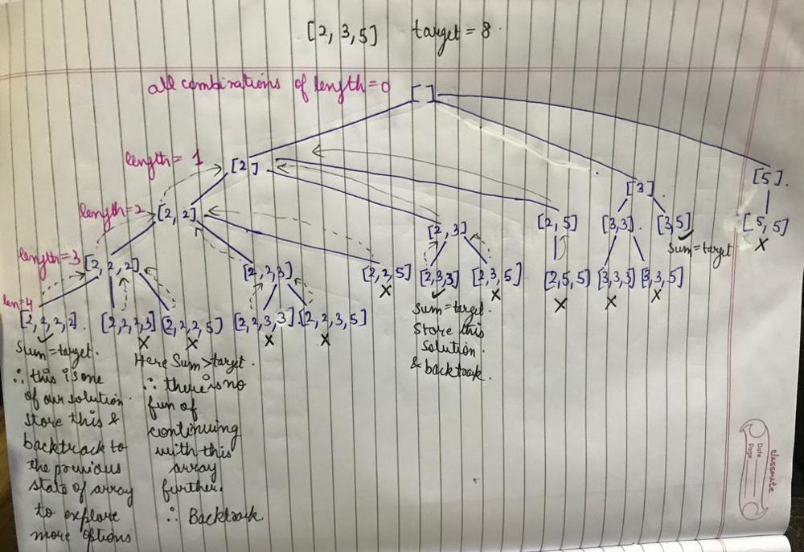

# 🚀FULL EXPLANATION WITH STATE SPACE TREE || Recursion and Backtracking || Well Explained || C++

**Author:** sukhseeratkaur0226
**Votes:** 1001
**Link:** [https://leetcode.com/problems/combination-sum/solutions/1777569/](https://leetcode.com/problems/combination-sum/solutions/1777569/)

---

Reading the question we understand that we need every possible unique combination such that sum of the combination is equal to target.

For such questions where we have to find **"every possible"** we generally use **backtracking**.

Let's understand how can backtracking help us achieve what we want here.
Below is an example with a **state space tree** for better understanding of how backtracking will be used in the solution.

#### Example (State Space Tree):



As you might have noticed that we are not considering the whole array as possible options at every level, because we want **unique combinations**.
e.g. at the node **[2, 2, 3]**, the *possible options* for the next level are only *[3, 5]*. Why?? because if we consider the whole array as possible options, then we we will end up with [2, 2, 3, 2] (with 2 as a possible option), which has already been checked as [2, 2, 2, 3] (see the tree). So to *make the solution unique* we are only considering the *part of the array from current last element to the end element* (like in this example).

#### Algorithm:
```
1. If the sum of the current combination is greater than target, then even if we move forward with this combination, the sum will only increase, so there is no fun to moving further with such a combination as we can never achieve the target sum from this. So backtrack from this.
2. If the sum of the current combination is equal to the target, then we have a solution, so store this combination in the answers. Now moving forward with this combnation also will only increase the sum and we can't achieve the target sum again from this ever. So backtrack from here.
3. if we are here then that means the sum of the combination is still less that the target sum, and we have a scope of finding a combination whose sum can be equal to the target.
		i) Now consider all possible options into this combination, one at a time.
		ii) Go check if considering the current option can give us the solution.
		iii) Now when this option backtracks to this place again, now remove this option and try another option. e.g. at [2, 2, _ ] we have 3 options to fill the 3rd place i.e. [2, 3, 5].
		So firstly we will go on with [2, 2, 2]. Then when this backtracks to this place again, remove the last 2 and try the next option which is 3 that means [2, 2, 3].
		When this also backtracks remove 3 to try 5, that means [2, 2, 5].
		Now as all the options are exhausted for [2, 2, _ ], now backtrack to its previous state which is [2, 2], and so on...
```

#### Code:
```cpp
class Solution {
    void combination(vector<int>& candidates, int target, vector<int> currComb, int currSum, int currIndex, vector<vector<int>>& ans){
        if(currSum>target) return; //backtrack
        if(currSum==target){
            ans.push_back(currComb); //store the solution and backtrack
            return;
        }
        
        for(int i=currIndex; i<candidates.size(); i++){ //try all possible options for the next level
            currComb.push_back(candidates[i]); //put 1 option into the combination
            currSum+=candidates[i];
            combination(candidates, target, currComb, currSum, i, ans); //try with this combination, whether it gives a solution or not.
            currComb.pop_back(); //when this option backtrack to here, remove this and go on to the next option.
            currSum-=candidates[i];
        }
        
    }
public:
    vector<vector<int>> combinationSum(vector<int>& candidates, int target) {
        vector<vector<int>> ans;
        vector<int> currComb;
        combination(candidates, target, currComb, 0, 0, ans);
        return ans;
    }
};

```

***Plz upvote the post if you like the explanation.***


