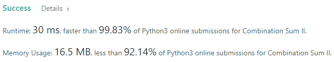

# 💢☠💫Easiest👾Faster✅💯 Lesser🧠 🎯 C++✅Python3🐍✅Java✅C✅Python🐍✅C#✅💥🔥💫Explained☠💥🔥 Beats 💯

**Author:** Edwards310
**Votes:** 7
**Link:** [https://leetcode.com/problems/combination-sum-ii/solutions/5630526/](https://leetcode.com/problems/combination-sum-ii/solutions/5630526/)

---

# Intuition


```javascript []
//JavaScript Code
/**
 * @param {number[]} candidates
 * @param {number} target
 * @return {number[][]}
 */
var combinationSum2 = function (candidates, target) {
    candidates.sort((a, b) => {
        return a - b});

    let output = [];
    let length = candidates.length;

    const treverse = (sum = 0, index = 0, arr = []) => {
        if (sum < 0 || index > length) return;
        if (sum == 0) {
            output.push(arr);
            return;
        }

        for (let i = index; i < length; i++) {
            if (i > index && candidates[i] === candidates[i - 1]) continue;
            let candidate = candidates[i];
            treverse(sum - candidates[i], i + 1, [...arr, candidate]);
        }
    }

    treverse(target);

    return output;
};
```
```C++ []
//C++ Code
#pragma GCC optimize("O2")
#include <bits/stdc++.h>
using namespace std;
typedef vector<int> vi;
typedef vector<vi> vvi;
#define FOR(a, b, c) for (int a = b; a < c; a++)
#define FOR1(a, b, c) for (int a = b; a <= c; ++a)
#define Rep(i, n) FOR(i, 0, n)
#define Rep1(i, n) FOR1(i, 1, n)
#define RepA(ele, nums) for (auto& ele : nums)
#define WHL(i, n) while (i < n)
#define fi first
#define se second
#define mp make_pair
#define pb push_back
#define ALL(v) v.begin(), v.end()
#define SORT(v) sort(ALL(v))

class Solution {
private:
    void dfs(int s, vi& candidates, int target, vi& path, vvi& ans){
        if(target < 0)
            return ;
        if(target == 0){
            ans.pb(vi(path));
            return ;
        }
        FOR(i, s, candidates.size()){
            if(i > s and candidates[i] == candidates[i - 1])
                continue ;
            path.pb(candidates[i]);
            dfs(i + 1, candidates, target - candidates[i], path, ans);
            path.pop_back();
        }
    }
public:
    vector<vector<int>> combinationSum2(vector<int>& candidates, int target) {
        vvi ans;
        SORT(candidates);
        vi path;
        dfs(0, candidates, target, path, ans);
        return ans;
    }
};
```
```Python3 []
#Python3 Code
class Solution:
    def combinationSum2(self, candidates: List[int], target: int) -> List[List[int]]:
        candidates.sort()  # Sort the candidates to handle duplicates and make it easier to skip them
        results = []
        
        def backtrack(start, target, path):
            if target == 0:
                results.append(path)
                return
            if target < 0:
                return
            for i in range(start, len(candidates)):
                if i > start and candidates[i] == candidates[i - 1]:
                    continue
                if candidates[i] > target:
                    break
                backtrack(i + 1, target - candidates[i], path + [candidates[i]])
        
        backtrack(0, target, [])
        return results
```
```Java []
//Java Code
class Solution {
    public List<List<Integer>> combinationSum2(int[] candidates, int target) {
        List<List<Integer>> ans = new ArrayList<>();
        Arrays.sort(candidates);
        dfs(0, candidates, target, new ArrayList<>(), ans);
        return ans;
    }

    private void dfs(int s, int[] candidates, int target, List<Integer> path,
            List<List<Integer>> ans) {
        if (target < 0)
            return;
        if (target == 0) {
            ans.add(new ArrayList<>(path));
            return;
        }

        for (int i = s; i < candidates.length; ++i) {
            if (i > s && candidates[i] == candidates[i - 1])
                continue;
            path.add(candidates[i]);
            dfs(i + 1, candidates, target - candidates[i], path, ans);
            path.remove(path.size() - 1);
        }
    }
}
```
```C []
//C Code
/**
 * Return an array of arrays of size *returnSize.
 * The sizes of the arrays are returned as *returnColumnSizes array.
 * Note: Both returned array and *columnSizes array must be malloced, assume
 * caller calls free().
 */
int compare(const void* a, const void* b) {
    int* nodeA = (int*)a;
    int* nodeB = (int*)b;
    return *nodeA - *nodeB;
}

void backtrack(int* candidates, int candidatesSize, int target, int* returnSize,
               int** returnColumnSizes, int** result, int* temp, int tempSize,
               int start) {
    if (target == 0) {
        result[*returnSize] = (int*)malloc(tempSize * sizeof(int));
        for (int i = 0; i < tempSize; i++) {
            result[*returnSize][i] = temp[i];
        }
        (*returnColumnSizes)[*returnSize] = tempSize;
        (*returnSize)++;
        return;
    }

    for (int i = start; i < candidatesSize; i++) {
        if (i > start && candidates[i] == candidates[i - 1])
            continue;
        if (candidates[i] > target)
            break;

        temp[tempSize] = candidates[i];
        backtrack(candidates, candidatesSize, target - candidates[i],
                  returnSize, returnColumnSizes, result, temp, tempSize + 1,
                  i + 1);
    }
}

int** combinationSum2(int* candidates, int candidatesSize, int target,
                      int* returnSize, int** returnColumnSizes) {
    *returnSize = 0;
    int maxSize = 100;
    int** result = (int**)malloc(maxSize * sizeof(int*));
    *returnColumnSizes = (int*)malloc(maxSize * sizeof(int));

    int* temp = (int*)malloc(candidatesSize * sizeof(int));
    int tempSize = 0;

    qsort(candidates, candidatesSize, sizeof(int), compare);

    backtrack(candidates, candidatesSize, target, returnSize, returnColumnSizes,
              result, temp, tempSize, 0);

    free(temp);
    return result;
}
```
```Python []
#Python Code
class Solution(object):
    def combinationSum2(self, candidates, target):
        """
        :type candidates: List[int]
        :type target: int
        :rtype: List[List[int]]
        """
        ans = []
        candidates.sort()
        def dfs(s, candidates, target, path, ans):
            if target < 0:
                return 
            if target == 0:
                ans.append([x for x in path])
                return
            for i in range(s, len(candidates)):
                if i > s and candidates[i] == candidates[i - 1]:
                    continue
                path.append(candidates[i])
                dfs(i + 1, candidates, target - candidates[i], path, ans)
                path.pop()

        dfs(0, candidates, target, [], ans)
        return ans
```
```C# []
//C# Code
public class Solution {
    IList<IList<int>> result;
    public IList<IList<int>> CombinationSum2(int[] candidates, int target) {
        result = new List<IList<int>>();
        Array.Sort(candidates);
        GenerateCombinations(candidates, target, 0, new bool[candidates.Length], new List<int>());
        return result;
    }

    private void GenerateCombinations(int[] candidates, int remaining, int idx, bool[] used, IList<int> tempList) {
        if(remaining < 0)   return;
        else if(remaining == 0)     result.Add(tempList.ToList());
        else {
            for(int i=idx; i<candidates.Length; i++) {
    
                if(used[i] || (i > idx && candidates[i] == candidates[i-1] && !used[i]))
                    continue;
                
                tempList.Add(candidates[i]);
                used[i] = true;
                GenerateCombinations(candidates, remaining-candidates[i], i+1, used, tempList);
                tempList.RemoveAt(tempList.Count - 1);
                used[i] = false;
            }
        }
    }
}
```
<!-- Describe your first thoughts on how to solve this problem. -->

# Approach
<!-- Describe your approach to solving the problem. -->

# Complexity
- Time complexity:
<!-- Add your time complexity here, e.g. $$O(n)$$ -->
     O(2^N)
- Space complexity:
<!-- Add your space complexity here, e.g. $$O(n)$$ -->
    O(N)
# Code
