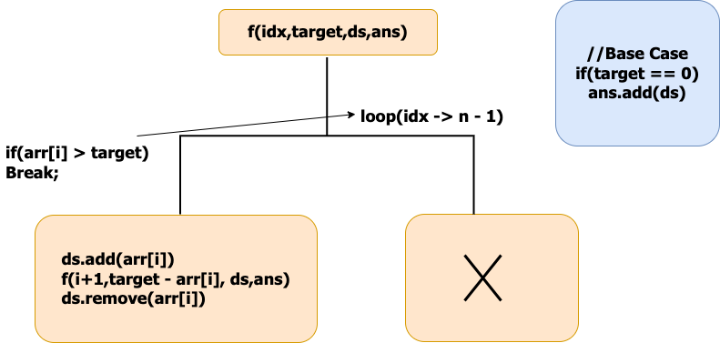
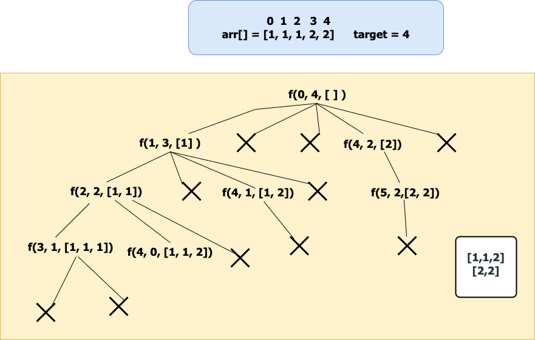

# ✅Beats 100% -Explained with [ Video ] -C++/Java/Python/ - Backtracking - Explained in Detail

**Author:** lancertech6
**Votes:** 149
**Link:** [https://leetcode.com/problems/combination-sum-ii/solutions/5628773/](https://leetcode.com/problems/combination-sum-ii/solutions/5628773/)

---


# YouTube Video Explanation:

### To watch the video please click on "Watch On Youtube" option  available the left bottom corner of the thumbnail.

<!-- **If you want a video for this question please write in the comments** -->


https://youtu.be/7M5Ed3lKcXs


**\uD83D\uDD25 Please like, share, and subscribe to support our channel's mission of making complex concepts easy to understand.**

Subscribe Link: https://www.youtube.com/@leetlogics/?sub_confirmation=1

*Subscribe Goal: 2800 Subscribers*
*Current Subscribers: 2726*

Follow me on Instagram : https://www.instagram.com/divyansh.nishad/

---

# Intuition
<!-- Describe your first thoughts on how to solve this problem. -->
The problem is a variation of the "Combination Sum" problem, where each candidate number can only be used once, and we need to find all unique combinations that sum up to the target. The key challenge here is to avoid duplicate combinations, especially when the input array contains repeated elements.

# Approach
<!-- Describe your approach to solving the problem. -->
1. **Sorting the Array**: First, we sort the `candidates` array. Sorting helps in easily skipping duplicates and ensures that we can break out of the loop early when the remaining candidates cannot form the target sum.

2. **Backtracking**:
   - We use a backtracking approach to explore all possible combinations.
   - Start from the first element and try to include it in the current combination.
   - If the current element is the same as the previous element and it wasn't included in the previous combination, skip it to avoid duplicates.
   - Subtract the value of the current element from the target and recursively search for the remaining target in the subarray starting from the next index.
   - If the target becomes `0`, it means we have found a valid combination, so we add it to the result list.
   - If the target becomes negative or we run out of elements, backtrack by removing the last element from the current combination.

3. **Pruning the Search**:
   - As the array is sorted, if at any point an element is greater than the target, we can break the loop since no further elements can be part of a valid combination (because they will all be greater).


# Step By Step Explanation

**Defining the Recursive Function:**



Before starting the recursive call make sure to sort the elements because the ans should contain the combinations in sorted order and should not be repeated.

Initially, We start with the index 0, At index 0 we have n - 1 way to pick the first element of our subsequence.

Check if the current index value can be added to our ds. If yes add it to the ds and move the index by 1. while moving the index skip the consecutive repeated elements because they will form duplicate sequences.

Reduce the target by arr[i],call the recursive call for f(idx + 1,target - 1,ds,ans) after the call make sure to pop the element from the ds.(By seeing the example recursive You will understand).

if(arr[i] > target) then terminate the recursive call because there is no use to check as the array is sorted in the next recursive call the index will be moving by 1 all the elements to its right will be in increasing order.

**Base Condition:**

Whenever the target value is zero add the ds to the ans return.

Representation of Recursive call for the example given below:



**If we observe the recursive call for f(2,2,[1,1]) when it is returning the ds doesn\u2019t include 1 so make sure to remove it from ds after the call.**


# Complexity
1. **Time Complexity**:
   - The time complexity of this solution is generally hard to quantify precisely because it depends on the number of possible combinations. However, in the worst case, the time complexity can be approximated as `O(2^n)` where `n` is the number of candidates. This is because, in the worst case, each candidate can either be included or excluded, leading to an exponential number of possible combinations.

2. **Space Complexity**:
   - The space complexity is `O(k * x)` where `k` is the average length of each combination and `x` is the total number of valid combinations. This is because we store all valid combinations in the result list.
   - Additionally, the recursive call stack also uses space proportional to the depth of the recursion, which can be up to `O(n)` where `n` is the number of candidates.


# Code
```java []
class Solution {
    public List<List<Integer>> combinationSum2(int[] candidates, int target) {
        List < List < Integer >> ans = new ArrayList < > ();
        Arrays.sort(candidates);
        findCombinations(0, candidates, target, ans, new ArrayList < > ());
        return ans;
    }
    static void findCombinations(int ind, int[] arr, int target, List < List < Integer >> ans, List < Integer > ds) {
        if (target == 0) {
            ans.add(new ArrayList < > (ds));
            return;
        }

        for (int i = ind; i < arr.length; i++) {
            if (i > ind && arr[i] == arr[i - 1]) continue;
            if (arr[i] > target) break;

            ds.add(arr[i]);
            findCombinations(i + 1, arr, target - arr[i], ans, ds);
            ds.remove(ds.size() - 1);
        }
    }
}
```
```C++ []
class Solution {
public:
    vector<vector<int>> combinationSum2(vector<int>& candidates, int target) {
        sort(candidates.begin(), candidates.end());
        vector < vector < int >> ans;
        vector < int > ds;
        findCombination(0, target, candidates, ans, ds);
        return ans;
    }
    void findCombination(int ind, int target, vector < int > & arr, vector < vector < int >> & ans, vector < int > & ds) {
        if (target == 0) {
            ans.push_back(ds);
            return;
        }
        for (int i = ind; i < arr.size(); i++) {
            if (i > ind && arr[i] == arr[i - 1]) continue;
            if (arr[i] > target) break;
            ds.push_back(arr[i]);
            findCombination(i + 1, target - arr[i], arr, ans, ds);
            ds.pop_back();
        }
    }
};
```
```Python []
class Solution(object):
    def combinationSum2(self, candidates, target):
        ans = []
        ds = []
        candidates.sort()


        def findCombination(ind, target):
            if target == 0:
                ans.append(ds[:])
                return
            for i in range(ind, len(candidates)):
                if i > ind and candidates[i] == candidates[i - 1]:
                    continue
                if candidates[i] > target:
                    break
                ds.append(candidates[i])
                findCombination(i + 1, target - candidates[i])
                ds.pop()


        findCombination(0, target)
        return ans
        
```
```JavaScript []
/**
 * @param {number[]} candidates
 * @param {number} target
 * @return {number[][]}
 */
var combinationSum2 = function(candidates, target) {
    let results = [];
    
    // Sort the candidates to handle duplicates easily
    candidates.sort((a, b) => a - b);

    // Helper function for backtracking
    function backtrack(start, target, currentCombination) {
        if (target === 0) {
            results.push([...currentCombination]);
            return;
        }
        
        for (let i = start; i < candidates.length; i++) {
            // Skip duplicates
            if (i > start && candidates[i] === candidates[i - 1]) continue;

            // If the current candidate exceeds the target, no point in continuing
            if (candidates[i] > target) break;

            // Include the current candidate
            currentCombination.push(candidates[i]);
            
            // Recur with the remaining target and move to the next index
            backtrack(i + 1, target - candidates[i], currentCombination);
            
            // Backtrack: remove the last added candidate
            currentCombination.pop();
        }
    }

    // Start the backtracking process
    backtrack(0, target, []);
    
    return results;
};
```

