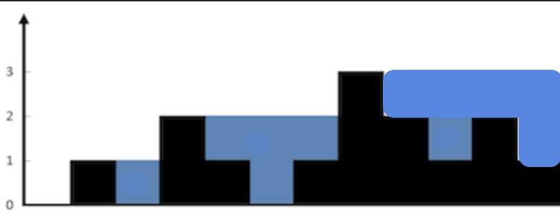
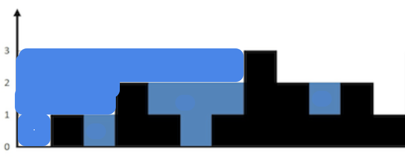

# [C++] DP and 2 Pointer Solutions Compared and Explained, 100% Time, ~85% Space

**Author:** Ajna2
**Votes:** 54
**Link:** [https://leetcode.com/problems/trapping-rain-water/solutions/1374012/](https://leetcode.com/problems/trapping-rain-water/solutions/1374012/)

---

For the first solution, we could figure out the maximum capacity of our environment checking from the left and then checking it from the right, keeping the minimum of the two.

For example, given the initial example input of `{0,1,0,2,1,0,1,3,2,1,2,1}` we would have from the left:


And from the right:


Easy to see now that the correct answer is the area included in both perspectives, as shown in the original picture accompanying the problem.

We might be tempted to store both results in a DP container, but actually we can proceed to go in one direction, store what we saw and, while looking from the other direction, directly compute and store the result for each cell as we go.

To do so, we will first of all rule out an annoying edge case for empty inputs, then declare a few support variables:
* `len` will store the length of our input;
* `dp` is going to be our array of `len` elements in which we will store what we see going from one side first (left to right, in our case, but it would not change to do the opposite);
* `currMax` will store the value of the currently observed maximum, initially set to `-1`;
* `res`, finally, will store our result going in the other direction (right to left for us), cell by cell.

We will then proceed looking from the left and with `i` going from `0` to `len` (excluded) we will:
* assign `h[i]` to `e`;
* compute `currMax` as the maximum between its present value and `e`;
* store the value of `currMax - e` in `dp[i]`.

We can now reset `currMax` to `-1` and proceed the other way around, with `i` going from `len - 1` up to `0` (included) we will:
* assign `h[i]` to `e`;
* compute `currMax` as the maximum between its present value and `e`;
* increase `res` by `currMax - e`.

Once done, we can `return` `res` :)

The code:

```cpp
class Solution {
public:
    int trap(vector<int>& h) {
        // edge case: empty input
        if (!h.size()) return 0;
        // support variables
        int len = h.size(), dp[len], currMax = -1, res = 0;
        // computing the maximum capacity looking from left
        for (int i = 0, e; i < len; i++) {
            e = h[i];
            currMax = max(currMax, e);
            dp[i] = currMax - e;
        }
        // computing the maximum capacity looking from right
        currMax = -1;
        for (int i = len - 1, e; i > -1; i--) {
            e = h[i];
            currMax = max(currMax, e);
            res += min(dp[i], currMax - e);
        }
        return res;
    }
};
```

Then it dawned to me that we can avoid the DP modest costs altogether and go for a single pass, using 2 pointers, `i` and `j`, that we will advance until they meet, always moving the one that points at the smallest element, keeping track of the biggest number we saw in each direction and and building `res` as we go.

The improved code, which surprisingly does not do that much better in terms of memory usage:

```cpp
class Solution {
public:
    int trap(vector<int>& h) {
        // edge case: empty input
        if (!h.size()) return 0;
        // support variables
        int i = 0, j = h.size() - 1, maxLeft = h[i], maxRight = h[j], res = 0, e;
        while (i <= j) {
            // case 1: i points to a bigger element, so we advance j
            if (h[i] > h[j]) {
                e = h[j];
                if (e > maxRight) maxRight = e;
                else res += maxRight - e;
                j--;
            }
            // case 2: j points to a bigger/equal element, so we advance i
            else {
                e = h[i];
                if (e > maxLeft) maxLeft = e;
                else res += maxLeft - e;
                i++;
            }
        }
        return res;
    }
};
```