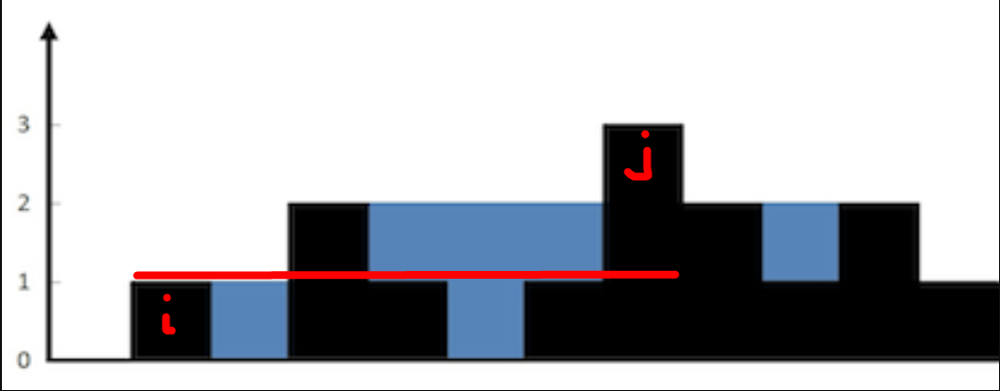
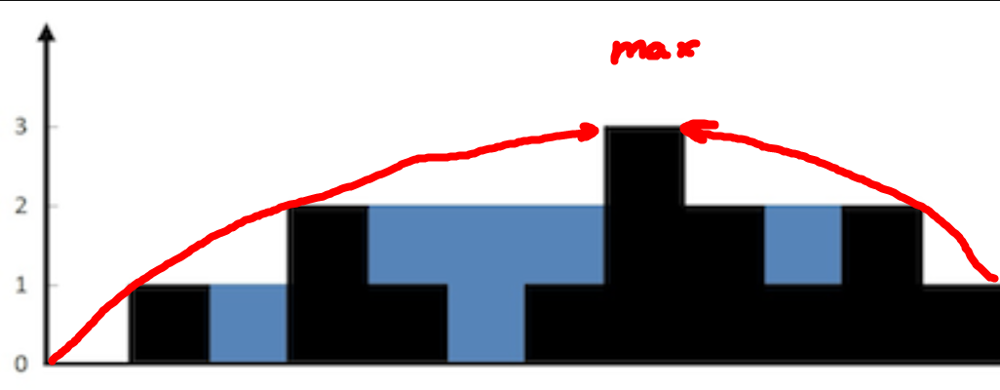
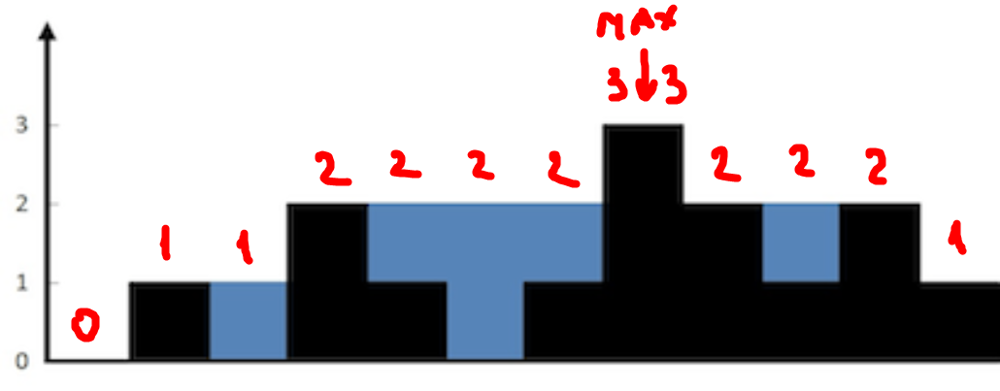
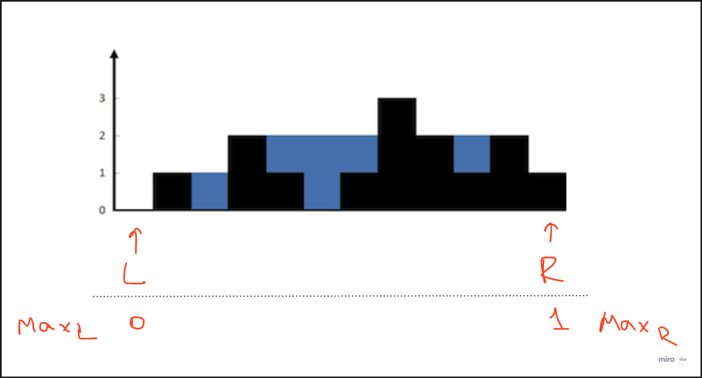
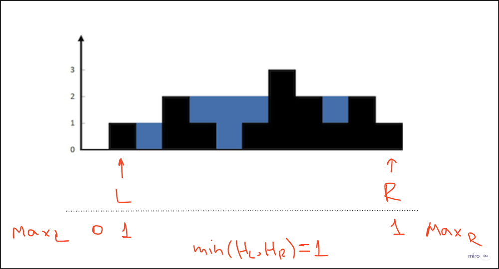
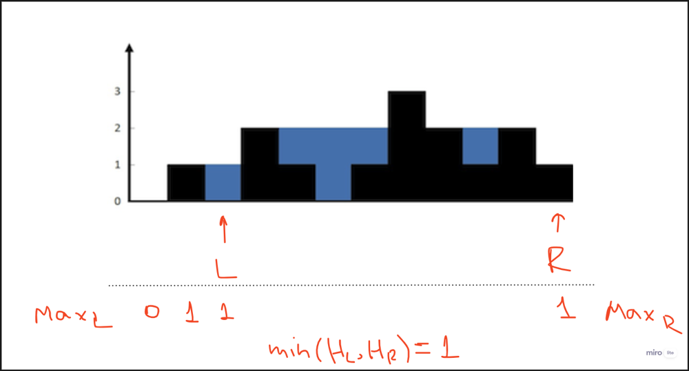
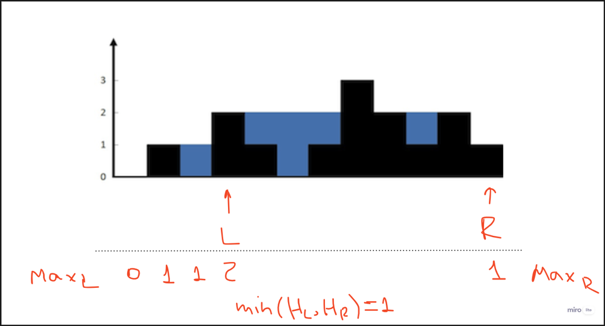
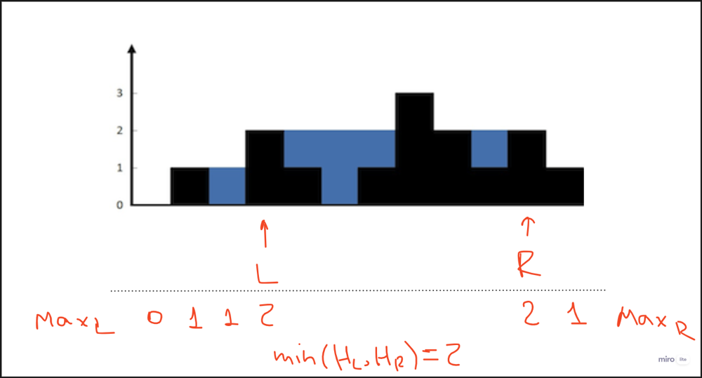

# ✅ [Two pointers][Follow Max] Beats 97%

**Author:** jarto666
**Votes:** 16
**Link:** [https://leetcode.com/problems/trapping-rain-water/solutions/4041787/](https://leetcode.com/problems/trapping-rain-water/solutions/4041787/)

---

## Intuition

It is easily noticeable that maximum level of water between 2 heights is minimum between the 2:




In this example maximum level of water that `i` and `j` can contain is `height[i]`, because it is capped by it.

Also, it is easy to notice, that maximum amount of water that we can pour is going only up closer we are to global maximum height.




## Follow Max

**AC:** $O(n)$
**SC:** $O(1)$

For any point to the left of the global maximum, we know that the closer we are to it, the greater the value of the maximum height to the left. The same applies to values to the right of the global maximum.




With this knowledge, we can iterate from both sides to the position of the maximum height, keeping track of the current maximum height. We can then use this maximum height to calculate the amount of water we can pour, which essentially involves subtracting the current height from the current maximum height.

Going from the left [i = 0] to max [i = 7]:

| index | height | cur_max | fill amount (cur_max - height) |
| --- | --- | --- | --- |
| 0 | 0 | 0 | 0 |
| 1 | 1 | 1 | 0 |
| 2 | 0 | 1 | 1 |
| 3 | 2 | 2 | 0 |
| 4 | 1 | 2 | 1 |
| 5 | 0 | 2 | 2 |
| 6 | 1 | 2 | 1 |
| 7 | 3 | 3 | 0 |
|  |  | Total | 5 |

Going from the left [i = 11] to max [i = 7]:

| index | height | cur_max | fill amount (cur_max - height) |
| --- | --- | --- | --- |
| 11 | 1 | 1 | 0 |
| 10 | 2 | 2 | 0 |
| 9 | 1 | 2 | 1 |
| 8 | 2 | 2 | 0 |
| 7 | 3 | 3 | 0 |
|  |  | Total | 1 |

Sum of fill amounts give as the result: 6 water squares.

### Pseudocode

1. Calculate position of maximum element (doesn\u2019t matter if there are multiple maximum elements, any would work).
2. Store \u2018current maximum\u2019 height as height of the first element.
3. Iterate from the left until maximum is reached:
    1. Calculate difference between \u2018current maximum\u2019 and and \u2018current height\u2019.
    2. If the difference is negative:
        1. Round it to 0, we cannot pour negative amount of water.
    3. Add the difference to the result.
    4. If \u2018current height\u2019 is greater that \u2018current maximum\u2019 - update \u2018current maximum\u2019.
4. Iterate from the right until maximum is reached:
    1. \u2014 same as p.3 \u2014

### Complexity analysis

Algorithmic: $O(n)$

Despite us going through heights multiple times, we never use the same element twice in the same iteration - therefore:

[calculate global max] $O(n)$ + [iterate from the left] $O(n)$ + [iterate from the right] $O(n)$ = $O(3n)$ = $O(n)$

Space: $O(1)$

No need for storing anything except a couple of temporary variables, like maximums.

```csharp
public class Solution {
    public int Trap(int[] height) {
        int n = height.Length;
        int maxi = 0;
        for (int i = 1; i < n; i++) {
            if (height[maxi] < height[i]) {
                maxi = i;
            }
        }

        int res = 0;

        int max = height[0];
        for (int i = 0; i <= maxi; i++) {
            res += Math.Max(0, max - height[i]);
            if (height[i] > max) {
                max = height[i];
            }
        }

        max = height[n-1];
        for (int i = n-1; i >= maxi; i--) {
            res += Math.Max(0, max - height[i]);
            if (height[i] > max) {
                max = height[i];
            }
        }

        return res;
    }
}
```

## Two Pointers

**AC:** $O(n)$
**SC:** $O(1)$

Why do we need to look for max and go through array multiple times, when we can go from both sides simultaneously?

Setting 2 pointers to both ends allows us to move one of them at a time, until they meet at the global maximum, essentially achieving the same thing as the solution before, but without visiting same element more than once.

For each of the pointer we are required to also store local maximums: for left pointer it would be the maximum height on the left to it and for right one - max height to the right to it. It would allow us to know maximum level of water we can pour into a height for any given height until we reach new local max.




For initial heights L and R maximums are pretty obvious - the height of themselves, so we initialize them accordingly.

By default, we cannot pour any water into side heights, because they act as outer walls. So let\u2019s move one of the pointer inwards. But which one? Condition is as follows: we always move the one for which local max height is lower to make sure we are following global maximum. So in this case we move L to the right:

Now, since height of the new position of L became bigger than local maximum, we update it. This provides us information that for any height between current L and R positions we can pour at least MIN(HL, HR) = MIN(1,1) = 1 cell.

But since height[L] = 1 and max amount of water we can fill is 1 - we cannot pour anything into this cell, so we can move forward. 




Since Max[L] = Max[R] we can move any, doesn\u2019t matter, let\u2019s agree that in case of equality we always move the left one.




Minimum between Max[L] and Max[R] is still the same, BUT height of L became less than Min(Max(L, R)). Subtracting it from Min(Max(L, R)) gives us amount of water we can pour into L - add it to the total result.

Moving L again:




Interesting case, because now Height[L] got bigger that Max[L]. First of all, this means that we can update Max[L] to this height = 2. But unfortunately, since we are still capped by minimum between Max[L] and Max[R] we cannot pour more than 1 height. Anyway, height - Min(Max(L,R)) gives us negative number -1 so we are ignoring this.

Now, since Max[R] got less than Max[L] - lets move it to the left:




And so on\u2026

### Pseudocode

1. Place 2 pointers to both ends of array
2. Store initial local heights `MaxL` and `MaxR`
3. While position of left pointer `L` is less than `R`:
    1.  If `MaxL` less than or equal to `MaxR`:
        1. Move `L` to the right.
        2. Add positive difference between `MaxL` and current height of `L` to the total result.
        3. Update `MaxL` if height of `L` got bigger that it.
    2. Otherwise:
        1. Move `R` to the left.
        2. Add positive difference between `MaxR` and current height of `R` to the total result.
        3. Update `MaxR` if height of `R` got bigger that it.

### Complexity analysis

Algorithmic: $O(n)$

We iterate through the array just once.

Space: $O(1)$

No extra space is needed except for storing pointers and local maximums.

```csharp
public class Solution {
    public int Trap(int[] height) {
        int n = height.Length;
        int res = 0;

        int l = 0;
        int r = n - 1;
        int maxL = height[l];
        int maxR = height[r];
        while (l < r) {
            if (maxL <= maxR) {
                l++;
                res += Math.Max(0, maxL - height[l]);
                maxL = Math.Max(maxL, height[l]);
            } else {
                r--;
                res += Math.Max(0, maxR - height[r]);
                maxR = Math.Max(maxR, height[r]);
            }
        }

        return res;
    }
}
```