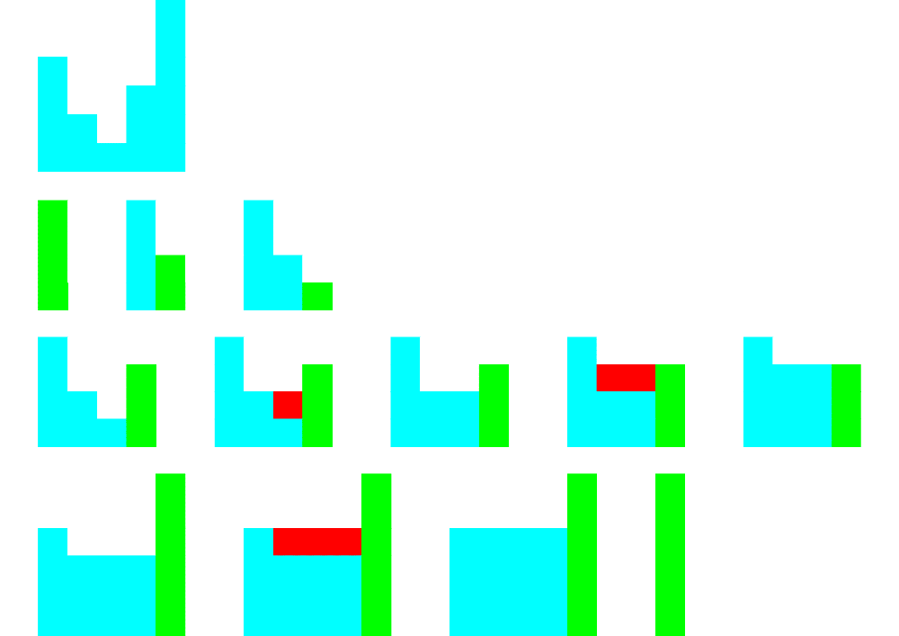

# [C++ / Go] Monotonic Descreasing Stack - O(n) time + O(n) space solution

**Author:** mikazuki4712
**Votes:** 5
**Link:** [https://leetcode.com/problems/trapping-rain-water/solutions/5011334/](https://leetcode.com/problems/trapping-rain-water/solutions/5011334/)

---

# Intuition


# Approach
- Using Monotonic Descreasing Stack. Iterate through each bar:
    - While stack isn't empty and height of top stored bar <= height of current bar, there is a water is saved in this top stored bar zone.
        - This zone is trapped by current bar and next bar stored in store (if existed)
        - Calculate the trapped water, fill the water and pop out this zone.
    - Add current bar to stack.

# Complexity
- Time complexity: $O(n)$
- Space complexity: $O(n)$

# Code
```C++ []
class Solution {
public:
    int trap(vector<int>& height) {
        int n = height.size();
        int res = 0;
        vector<int> st;
        for (int r = 0; r < n; r++) {
            while (st.size() && height[st.back()] <= height[r]) {
                int m = st.back();
                st.pop_back();

                if (!st.empty()) {
                    int l = st.back();
                    int d = min(height[l], height[r]);
                    int k = r - 1 - (l + 1) + 1;
                    res += k * (d - height[m]);
                }
            }
            st.push_back(r);
        }
        return res;
    }
};
```
```Go []
func trap(height []int) int {
    n := len(height)
    res := 0
    var st []int

    for r := 0; r < n; r++ {
        for len(st) > 0 && height[st[len(st) - 1]] <= height[r] {
            m := st[len(st) - 1] 
            st = st[:len(st) - 1]

            if len(st) > 0 {
                l := st[len(st) - 1]
                d := min(height[l], height[r])
                k := r - 1 - (l + 1) + 1
                res += k * (d - height[m])
            }
        }
        st = append(st, r)
    }

    return res
}
```