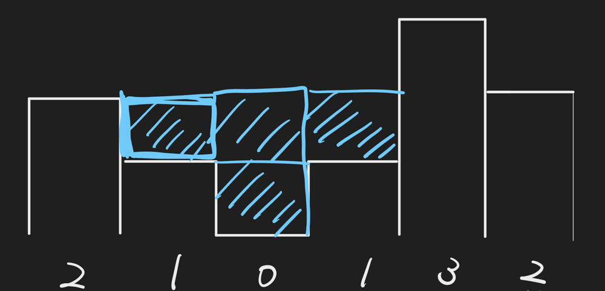

# 【Video】Keep max height on the both side.

**Author:** niits
**Votes:** 503
**Link:** [https://leetcode.com/problems/trapping-rain-water/solutions/5126477/](https://leetcode.com/problems/trapping-rain-water/solutions/5126477/)

---

# Intuition
Keep max height on the both side.

---

# Solution Video

https://youtu.be/7yg_WJA35uo

### \u2B50\uFE0F\u2B50\uFE0F Don't forget to subscribe to my channel! \u2B50\uFE0F\u2B50\uFE0F

**\u25A0 Subscribe URL**
http://www.youtube.com/channel/UC9RMNwYTL3SXCP6ShLWVFww?sub_confirmation=1

Subscribers: 4,819
Thank you for your support!

---

# Approach

To keep water, we have to have a bar on the left side and on the right side. Between them, we can keep water.

Let's think about this example.

```
Input: height = [2,1,0,1,3,2]
```


I think we can easily imagine that we can keep water at `0 height`(= index `2`), because we have bars in the adjacent places(= index `1` and `3`).

But how about `1 height` at index `1`. We can keep water there. I think left side is easy to imagine because we have a bar in adjacent place(= index `0`). But how about right side? In the end, we can keep water because we have `3 height` at index `4`.


---

Question

How can we judge if we can have water when there is some distance between water and a bar? In this case, water is at index `1` and the bar is at index `4`.

---

My strategy is to keep `max height of left and right`. I'll show you how algorithm works.

## How it works

```
[2,1,0,1,3,2]
 L         R

left max = 2
right max = 2
water = 0
```
`L` is current left pointer.
`R` is current right pointer.
`left max` is max height of left side we found so far. Initialized with the first number.
`right max` is max height of right side we found so far. Initialized with the last number
`water` is return value.

If `L` is smaller than `R`, we continue. After that, check `left max` and `right max` and **take smaller max height**. I'll explain why later.

In this case, they are the same, so we can choose one of them. I'll take `right`.

First of all, move `R` to the next.

```
[2,1,0,1,3,2]
 L       R

left max = 2
right max = 2
water = 0
```
Next, update `right max` if current bar is taller than current `right max`.
```
current bar vs current max right
= 3 vs 2
= 3

[2,1,0,1,3,2]
 L       R

left max = 2
right max = 3
water = 0
```
Then, count number of water. Formula is
```
water = current right max - current bar
= 3 - 3
= 0
```
`water` should be `0`.

Next, `L < R`, so we continue

First of all, take smaller max height between left and right. I'll take `left max`.

Move `L` to the next and update `left max` if needed. No udpate this time.

```
[2,1,0,1,3,2]
   L     R

left max = 2
right max = 3
water = 0
```
Then here is an important point. `water` should be
```
current left max - current bar
2 - 1 = 1

water = 1
```

Are you sure?

Yes, I'm sure.


---

\u2B50\uFE0F Points

We take smaller max height between left(= `2 height`) and right(= `3 height`) and handle left side because `left max` is smaller than `right max`. That means we don't have to care about right side because we know that we have current tallest bar(= `3 height` at index `4`) on the right side, so at least we can keep water at `2 height`(= `left max`)

---

That's the reason why we take smaller max height.

We can take 2 height as max height but there is bar at index `1`. That's why

```
left max - current height
= 2 - 1
= 1 water
```

```
[2,1,0,1,3,2]
   L     R

left max = 2
right max = 3
water = 1
```
I'll speed up.

`L < R`, so we continue.
Move `L` to the next because left max is smaller than right max and update `left max` if needed. No update this time.
```
[2,1,0,1,3,2]
     L   R

left max = 2
right max = 3
water = 1
```
`water` should be...

```
2 - 0 = 2
total water = 3
```

Next, `L < R`, so we continue.
Move `L` to the next because left max is smaller than right max and update `left max` if needed. No update this time.
```
[2,1,0,1,3,2]
       L R

left max = 2
right max = 3
water = 3
```
`water` should be...
```
2 - 1 = 1
total water = 4
```

Next, `L < R`, so we continue.
Move `L` to the next because left max is smaller than right max and update `left max` if needed. we found `3` this time.
```
[2,1,0,1,3,2]
         L
         R
left max = 3 (updated. 2 vs 3)
right max = 3
water = 3
```
`water` should be...
```
3 - 3 = 0
total water = 4
```
Now `L == R`. We stop iteration.

```
return 4
```


---

https://youtu.be/Abdq3lNRocc

---

# Complexity
- Time complexity: $$O(n)$$
<!-- Add your time complexity here, e.g. $$O(n)$$ -->

- Space complexity: $$O(1)$$
<!-- Add your space complexity here, e.g. $$O(n)$$ -->

```python []
class Solution:
    def trap(self, height: List[int]) -> int:
        left = 0
        right = len(height) - 1
        left_max = height[left]
        right_max = height[right]
        water = 0

        while left < right:
            if left_max < right_max:
                left += 1
                left_max = max(left_max, height[left])
                water += left_max - height[left]
            else:
                right -= 1
                right_max = max(right_max, height[right])
                water += right_max - height[right]
        
        return water
```
```javascript []
var trap = function(height) {
    let left = 0;
    let right = height.length - 1;
    let leftMax = height[left];
    let rightMax = height[right];
    let water = 0;

    while (left < right) {
        if (leftMax < rightMax) {
            left++;
            leftMax = Math.max(leftMax, height[left]);
            water += leftMax - height[left];
        } else {
            right--;
            rightMax = Math.max(rightMax, height[right]);
            water += rightMax - height[right];
        }
    }

    return water;    
};
```
```java []
class Solution {
    public int trap(int[] height) {
        int left = 0;
        int right = height.length - 1;
        int leftMax = height[left];
        int rightMax = height[right];
        int water = 0;

        while (left < right) {
            if (leftMax < rightMax) {
                left++;
                leftMax = Math.max(leftMax, height[left]);
                water += leftMax - height[left];
            } else {
                right--;
                rightMax = Math.max(rightMax, height[right]);
                water += rightMax - height[right];
            }
        }

        return water;        
    }
}
```
```C++ []
class Solution {
public:
    int trap(vector<int>& height) {
        int left = 0;
        int right = height.size() - 1;
        int leftMax = height[left];
        int rightMax = height[right];
        int water = 0;

        while (left < right) {
            if (leftMax < rightMax) {
                left++;
                leftMax = max(leftMax, height[left]);
                water += leftMax - height[left];
            } else {
                right--;
                rightMax = max(rightMax, height[right]);
                water += rightMax - height[right];
            }
        }

        return water;        
    }
};
```

## Step by Step Algorithm

1. **Initialize pointers and variables**:
   - Initialize two pointers `left` and `right` at the beginning and end of the `height` list respectively.
   - Initialize variables `left_max` and `right_max` to store the maximum height encountered from the left and right sides respectively.
   - Initialize a variable `water` to keep track of the total trapped water.

```python
left = 0
right = len(height) - 1
left_max = height[left]
right_max = height[right]
water = 0
```

2. **Loop until pointers meet**:
   - Continue looping while `left` pointer is less than `right` pointer, indicating there are still bars to process.

```python
while left < right:
```

3. **Check which side to move**:
   - Compare `left_max` and `right_max` heights.
   - If `left_max` is less than `right_max`, move the `left` pointer to the right and update `left_max`.
   - Otherwise, move the `right` pointer to the left and update `right_max`.

```python
if left_max < right_max:
    left += 1
    left_max = max(left_max, height[left])
    water += left_max - height[left]
else:
    right -= 1
    right_max = max(right_max, height[right])
    water += right_max - height[right]
```

4. **Calculate trapped water**:
   - Calculate the water trapped at the current position based on the difference between the maximum height and the current height.
   - Accumulate this water amount to the `water` variable.

5. **Return total trapped water**:
   - After the loop ends, return the total trapped water accumulated in the `water` variable.

```python
return water
```

This algorithm efficiently iterates through the elevation map, moving pointers inward based on the comparison of maximum heights encountered so far from both sides, ultimately calculating the total trapped water between the bars.

---

Thank you for reading my post. Please upvote it and don't forget to subscribe to my channel!

## \u2B50\uFE0F Subscribe URL
http://www.youtube.com/channel/UC9RMNwYTL3SXCP6ShLWVFww?sub_confirmation=1

## \u2B50\uFE0F Twitter
https://twitter.com/CodingNinjaAZ

## \u2B50\uFE0F Related question #322 - Coin Change

https://youtu.be/IrHPiwWUTKw