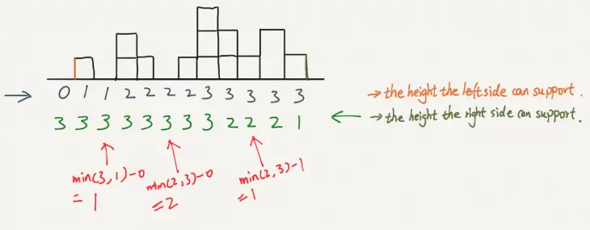

# 🚀 ✅100% , Detailed explaination 🔥 with Pictures ✅ 🔥 🚀 in C++ , Java , Python , two pointers. 🔥

**Author:** chandra0918
**Votes:** 346
**Link:** [https://leetcode.com/problems/trapping-rain-water/solutions/3401992/](https://leetcode.com/problems/trapping-rain-water/solutions/3401992/)

---

# Approach
- Here the approach is like we basically find the left max and right max and based on that we start our movement in two pointer , first have a glance at the below depicted figure which is later followed by explaination.



>- As shown in the figure we start with finding the left most height and the right most height and then we do left++ , right-- and continue. Now if the new left height is greater than max left height then we update the lmax height and similarly for the right side.
>- When This is not the case the we proceed with the side with the minimum height , say it's left for the further understanding , now we take the difference b/w the left heights and add to the water stored $i.e$ `water += lmax - height[lpos];` or `water += rmax - height[rpos];` according to the current scenario as explained above.

>- In the same way depicted above we further continue till the loop $i.e$ ends `while(lpos <= ros)` then we would finally obtain the water which can be trapped during this process.

---

# Code
```C++ []
class Solution {
public:
    int trap(vector<int>& height) {
        int n = height.size();
        int lmax = height[0];
        int rmax = height[n-1];
        int lpos = 1;
        int rpos = n-2;
        int water = 0;
        while(lpos <= rpos)
        {
            if(height[lpos] >= lmax)
            {
                lmax = height[lpos];
                lpos++;
            }
            else if(height[rpos] >= rmax)
            {
                rmax = height[rpos];
                rpos--;
            }
            else if(lmax <= rmax && height[lpos] < lmax)
            {
                water += lmax - height[lpos];
                lpos++;
            }
            else
            {
                water += rmax - height[rpos];
                rpos--;
            }
        
        }
        return water;
    }
};
```
```java []
class Solution {
    public int trap(int[] height) {
        int left = 0, right = height.length - 1;
        int leftMax = height[0], rightMax = height[height.length - 1];
        int water = 0;
        while (left < right) {
            if (leftMax < rightMax) {
                left++;
                if (leftMax < height[left]) {
                    leftMax = height[left];
                } else {
                    water += leftMax - height[left];
                }
            } else {
                right--;
                if (rightMax < height[right]) {
                    rightMax = height[right];
                } else {
                    water += rightMax - height[right];
                }
            }
        }
        return water;
    }
}
```
```Python []
class Solution:
    def sumBackets(self, height: list[int], left, right):

        minHeightLeft = height[left]
        total = 0
        leftBacket = 0
        locationMinLeft = left

        while left < right:
            
            if height[left] < minHeightLeft:
                leftBacket += minHeightLeft - height[left]                
            else:
                minHeightLeft = height[left]
                total +=  leftBacket
                leftBacket = 0
                locationMinLeft = left            
            left += 1
            
        if minHeightLeft <= height[right]:
             return total + leftBacket, right
        else :      
            return total, locationMinLeft

    def sumBacketsReverce(self, height: list[int], left, right):

        minHeightRight = height[right]
        total = 0
        rightBacket = 0
        locationMinRight = right

        while left < right:
            
            if height[right] < minHeightRight:
                rightBacket += minHeightRight - height[right]                
            else :
                minHeightRight = height[right]
                total +=  rightBacket
                rightBacket = 0
                locationMinRight = right            
            right -= 1


        if minHeightRight <= height[left]:
            return total + rightBacket, left
        else :
            return total, locationMinRight
    
    def trap(self, height: List[int]) -> int:                      
        right = len(height)-1
        left =0
        totalSum =0


        while left < right-1:            
            if( height[left]< height[right]):
                total, left = self.sumBackets(height, left, right)    
            else:
                total, right = self.sumBacketsReverce(height, left, right)        
                
            totalSum += total       
             
        return totalSum
```
---

# Complexity
>- Time complexity:Here the time complexity would be $O(n)$ as there is only one loop running in the two pointers.

>- Space complexity:Here the space complexity is constant as we are not creating any extra space excluding the variables.

---

**IF YOU LIKE THE SOLUTION THEN PLEASE UPVOTE MY SOLUTION BECAUSE IT GIVES ME MOTIVATION TO REGULARLY POST THE SOLUTION.**


