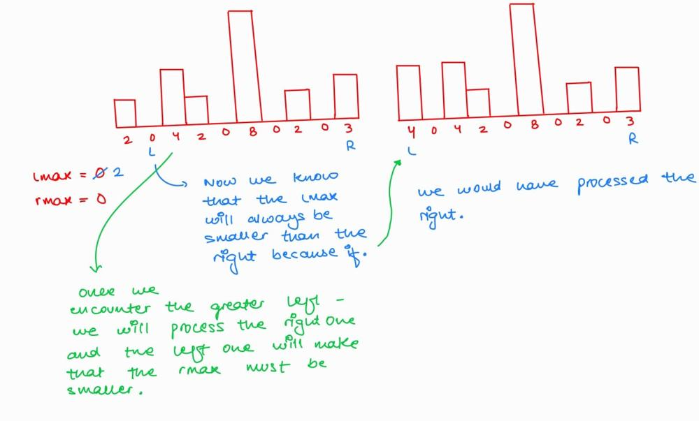
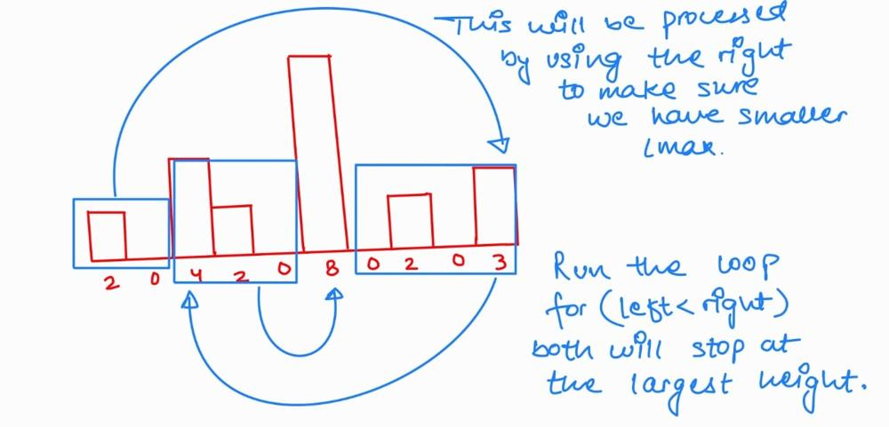

# 🔥Beats 100% (0ms) 2-Pointer sol. with explaination.

**Author:** veer1214
**Votes:** 15
**Link:** [https://leetcode.com/problems/trapping-rain-water/solutions/5620351/](https://leetcode.com/problems/trapping-rain-water/solutions/5620351/)

---

Prerequisite: Trapping rain water solution with suffix and prefix. Or see the solution down there...

# Intuition
Intuition behind this solution is that we just care about the smaller one and no matter how long is the wall on the other side because once we know the smaller one we can just use it to calculate the water.

# Approach
We'll use $$lmax$$, $$rmax$$, $$left$$, and $$right$$ pointers. The idea is to process the left and right pointers simultaneously, calculating the trapped water and updating lmax and rmax.
# The Challenge
We can't simply process both sides simultaneously because there might be heights in the middle that affect how much water is trapped.  We need to ensure we're always working with the smaller of the two heights ($$lmax$$ or $$rmax$$).

# Solution

We'll process the side with the smaller height first.

* Case 1: Smaller $$left$$ height:
    Processing the left side first ensures that $$lmax$$ is always smaller than the height on the right side. This is because if there was a greater value on the left, we would have processed the right side first.
On the right side, $$rmax$$ will be smaller than or equal to the current height.
* Case 2: Smaller $$right$$ height:
   The logic is similar to Case 1, but with the roles of left and right reversed.




and now this is a simple coding....
I hope you got it, if not lets discuss it.

# Upvote please \uD83D\uDE42

# Code
```java [java]
class Solution {
    public int trap(int[] height) {
        int water=0;
        int lmax=0, rmax=0, left=0, right=height.length-1;
        while(left<right){
            if(height[left]<height[right]){
                if(lmax>height[left]) water+=lmax-height[left];
                else lmax=height[left];
                left++;
            }else{
                if(rmax>height[right]) water+=rmax-height[right];
                else rmax=height[right];
                right--;
            }
        }
        return water;
    }
}
```
```java []
class Solution {
    public int trap(int[] height) {
        int n = height.length;
        if (n == 0) return 0;
        
        int[] left = new int[n];
        int[] right = new int[n];
        int storedWater = 0;
        
        // Fill left array
        left[0] = height[0];
        for (int i = 1; i < n; i++) {
            left[i] = Math.max(left[i - 1], height[i]);
        }
        
        // Fill right array
        right[n - 1] = height[n - 1];
        for (int i = n - 2; i >= 0; i--) {
            right[i] = Math.max(right[i + 1], height[i]);
        }
        
        // Calculate trapped water
        for (int i = 0; i < n; i++) {
            int minHeight = Math.min(left[i], right[i]);
            storedWater += minHeight - height[i];
        }
        
        return storedWater;
    }
}
```
```python []
puts 'Hello world!'
```
```rust []
impl Solution {
    pub fn trap(height: Vec<i32>) -> i32 {
        let mut l: usize = 0;
        let mut r: usize = height.len()-1;
        let mut vol: i32 = 0;
        let mut max_l: i32 = 0;
        let mut max_r: i32 = 0;

        while l < r {
            if (height[l] < height[r]){
                if (max_l > height[l]){
                    vol += max_l - height[l];
                }
                else {
                    max_l = height[l];
                }
                l += 1;
            }
            else {
                if (max_r > height[r]){
                    vol += max_r - height[r];
                }
                else {
                    max_r = height[r];
                }
                r -= 1;
            }
        }

        return vol;
    }
}
```
