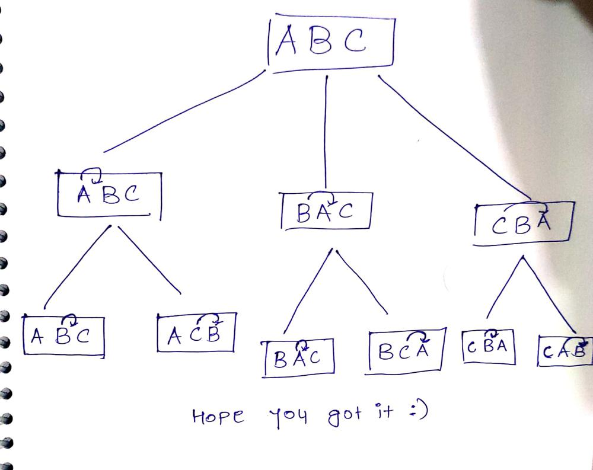

# Backtracking Solution || C++ || Easy To Understand || With explanation

**Author:** vivek_javiya
**Votes:** 153
**Link:** [https://leetcode.com/problems/permutations/solutions/1257633/](https://leetcode.com/problems/permutations/solutions/1257633/)

---


Suppose if give string is ABC then recursive tree like this



```
class Solution {
public:
    vector<vector<int>> result;
    
    // Backtracking
    void permutation(vector<int> &nums,int i,int n){
        if(i==n){
            result.push_back(nums);
            return ;
        }

        for(int j=i;j<=n;j++){
            swap( nums[i],nums[j]);
            permutation(nums,i+1,n);
            swap( nums[i],nums[j]);
        }
    }
    
    vector<vector<int>> permute(vector<int>& nums) {
        
        permutation(nums,0,nums.size()-1);
        
        return result;
    }
};
```