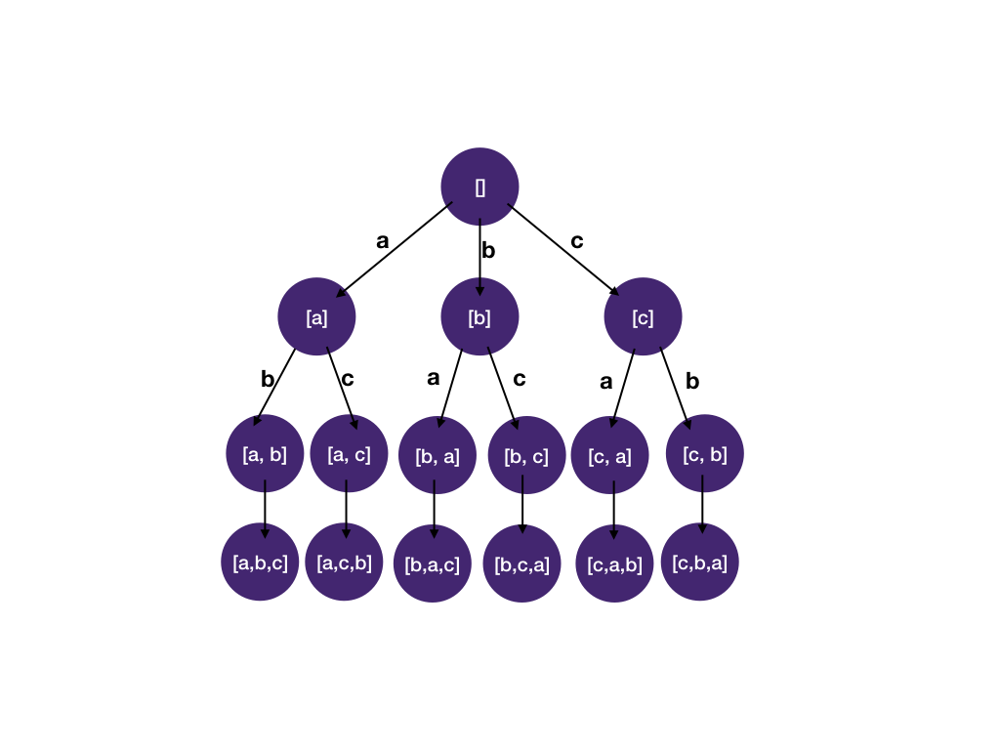

# DFS/backtracking - Python/Java/Javascript, PICTURE

**Author:** lukskywalkerrr
**Votes:** 269
**Link:** [https://leetcode.com/problems/permutations/solutions/685868/](https://leetcode.com/problems/permutations/solutions/685868/)

---

Classic combinatorial search problem, we can solve it using 3-step system 

1. Identify states
What state do we need to know whether we have reached a solution (and using it to construct a solution if the problem asks for it).
We need a state to keep track of the list of letters we have chosen for the current permutation

What state do we need to decide which child nodes should be visited next and which ones should be pruned?
We have to know what are the letters left that we can still use (since each letter can only be used once).

2. Draw the State-space Tree


3. DFS on the State-space tree
Using the [backtracking template](https://algo.monster/problems/backtracking) as basis, we add the two states we identified in step 1:

A list to represent permutation constructed so far, path
A list to record which letters are already used, used, used[i] == true means ith letter in the origin list has been used.

Implementation in 3 languages:

Python
```
class Solution:
    def permute(self, l: List[int]) -> List[List[int]]:
        def dfs(path, used, res):
            if len(path) == len(l):
                res.append(path[:]) # note [:] make a deep copy since otherwise we'd be append the same list over and over
                return

            for i, letter in enumerate(l):
                # skip used letters
                if used[i]:
                    continue
                # add letter to permutation, mark letter as used
                path.append(letter)
                used[i] = True
                dfs(path, used, res)
                # remove letter from permutation, mark letter as unused
                path.pop()
                used[i] = False
            
        res = []
        dfs([], [False] * len(l), res)
        return res
```

Java
```
class Solution {
    public List<List<Integer>> permute(int[] letters) {
        List<List<Integer>> res = new ArrayList<>();
        dfs(new ArrayList<>(), new boolean[letters.length], res, letters);
        return res;
    }

    private static void dfs(List<Integer> path, boolean[] used, List<List<Integer>> res, int[] letters) {
        if (path.size() == used.length) {
            // make a deep copy since otherwise we'd be append the same list over and over
            res.add(new ArrayList<Integer>(path));
            return;
        }

        for (int i = 0; i < used.length; i++) {
            // skip used letters
            if (used[i]) continue;
            // add letter to permutation, mark letter as used
            path.add(letters[i]);
            used[i] = true;
            dfs(path, used, res, letters);
            // remove letter from permutation, mark letter as unused
            path.remove(path.size() - 1);
            used[i] = false;
        }
    }    
}
```

Javascript
```
var permute = function(letters) {
    let res = [];
    dfs(letters, [], Array(letters.length).fill(false), res);
    return res;
}

function dfs(letters, path, used, res) {
    if (path.length == letters.length) {
        // make a deep copy since otherwise we'd be append the same list over and over
        res.push(Array.from(path));
        return;
    }
    for (let i = 0; i < letters.length; i++) {
        // skip used letters
        if (used[i]) continue;
        // add letter to permutation, mark letter as used
        path.push(letters[i]);
        used[i] = true;
        dfs(letters, path, used, res);
        // remove letter from permutation, mark letter as unused
        path.pop();
        used[i] = false;
    }
}
```

Please upvote if you find it useful. And learn more about backtracking/dfs here https://algo.monster/problems/backtracking