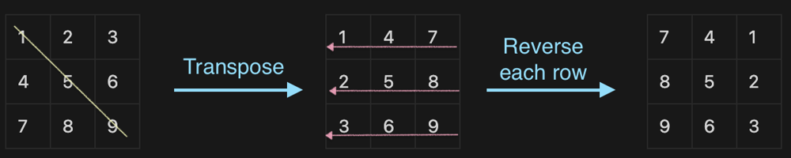

# Easy to understand TypeScript solution with explanation

**Author:** Zhenyuan0Li
**Votes:** 9
**Link:** [https://leetcode.com/problems/rotate-image/solutions/2617602/](https://leetcode.com/problems/rotate-image/solutions/2617602/)

---

Sometimes, the obvious and easy way comes up our mind maybe is not efficient enough for computer. But the most elegant and efficient way for computer is not straightforward and intuitive. Hence, think outside of box. 

For computer, the hard part is to transfer row to column, or column to row. But transpose a matrix is fairly easy. Take this as the first step, and try to find the pattern of final result.

1. transpose the matrix
2. reverse each role
3. here comes the result: rotate the image by\xA090 ****degrees (clockwise)



```ts
function rotate(matrix: number[][]): void {
    for (let i = 0; i < matrix.length; i++) {
        for (let j = i; j < matrix.length; j++) {
			// Transpose
            [matrix[i][j], matrix[j][i]] = [matrix[j][i], matrix[i][j]];
        }
    }
    // Reverse
    matrix.forEach(arr => arr.reverse());
};
```
What if the question ask anticlockwise? Just transpose the matrix by another diagonal.
```ts
function rotate2(matrix: number[][]): void {
    for (let i = 0; i < matrix.length; i++) {
        for (let j = 0; j < matrix.length - 1; j++) {
            [matrix[i][j], matrix[n-j-1][n-i-1]] = [matrix[n-j-1][n-i-1], matrix[i][j]];
        }
    }
    
    matrix.forEach(arr => arr.reverse());
};
```