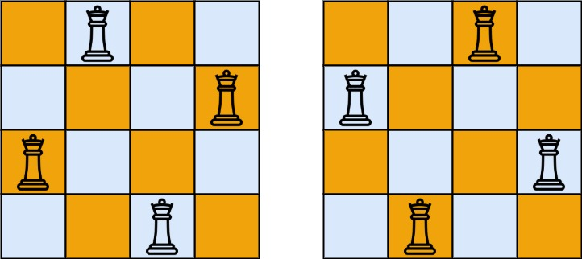

# [51. N-Queens](https://leetcode.com/problems/n-queens/)

| Category | Difficulty | Likes | Dislikes |
| :------: | :--------: | :---: | :------: |
| Algorithms | Hard | 13959 | 339 |

**Tags:** [`array`](https://leetcode.com/tag/array), [`backtracking`](https://leetcode.com/tag/backtracking)

**Companies:** `google`, `amazon`, `microsoft`, `bloomberg`, `facebook`, `goldman-sachs`, `tiktok`, `oracle`, `zoho`, `ibm`, `apple`, `uber`, `adobe`, `tcs`

## Description

The **n-queens** puzzle is the problem of placing `n` queens on an `n x n` chessboard such that no two queens attack each other.

Given an integer `n`, return *all distinct solutions to the **n-queens puzzle***. You may return the answer in **any order**.

Each solution contains a distinct board configuration of the n-queens' placement, where `'Q'` and `'.'` both indicate a queen and an empty space, respectively.

 

**Example 1:**


```

Input: n = 4
Output: [[&quot;.Q..&quot;,&quot;...Q&quot;,&quot;Q...&quot;,&quot;..Q.&quot;],[&quot;..Q.&quot;,&quot;Q...&quot;,&quot;...Q&quot;,&quot;.Q..&quot;]]
Explanation: There exist two distinct solutions to the 4-queens puzzle as shown above

```

**Example 2:**

```

Input: n = 1
Output: [[&quot;Q&quot;]]

```

 

**Constraints:**

	- `1 <= n <= 9`

---

**Links:** [Submissions](https://leetcode.com/problems/n-queens/) | [Solutions](https://leetcode.com/problems/n-queens/)
