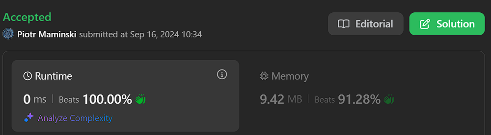
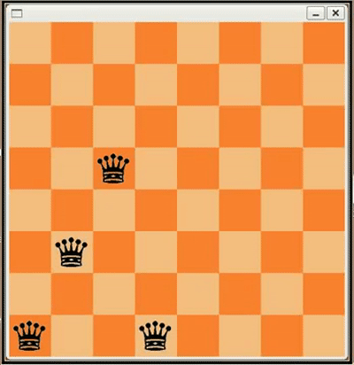

# ✅ Beats 100%| List of Common Backtracking Problems ✅

**Author:** Piotr_Maminski
**Votes:** 12
**Link:** [https://leetcode.com/problems/n-queens/solutions/5988136/](https://leetcode.com/problems/n-queens/solutions/5988136/)

---


# Most common Backtracking Problems
From the most to the least common (from GitHub/reddit):

 [[17. Letter Combinations of a Phone Number]](https://leetcode.com/problems/letter-combinations-of-a-phone-number/solutions/5976064/complex-backtracking-interview-prepare-list-of-backtracking-questions-beats-100) [[51. N-Queens]](https://leetcode.com/discuss/topic/5988136/beats-100-list-of-common-backtracking-problems/) \xA0[[47. Permutations II ]](https://leetcode.com/problems/permutations-ii/description/) [[40. Combination Sum II]](https://leetcode.com/problems/combination-sum-ii/description/) [[46. Permutations]](https://leetcode.com/problems/permutations/solutions/5976304/complex-backtracking-interview-prepare-list-of-backtracking-questions-beats-100) [[22. Generate Parentheses]](https://leetcode.com/problems/generate-parentheses/solutions/5976224/complex-backtracking-interview-prepare-list-of-backtracking-questions-beats-100) [[78. Subsets]](https://leetcode.com/problems/subsets/description/) \xA0[[39. Combination Sum]](https://leetcode.com/problems/combination-sum/solutions/5976264/complex-backtracking-interview-prepare-list-of-backtracking-questions-beats-100)


If you've encountered any of these or have other problems that aren't on this list, please leave a comment so I can update list.

```python3 []
class Solution:
    def solveNQueens(self, n: int) -> List[List[str]]:
        # Helper function that implements backtracking algorithm
        def backtrack(r):
            # Base case: if we've placed queens in all rows successfully
            if r == n:
                # Create a deep copy of current board state
                copy = board[:]
                sol = []
                # Convert each row to string representation
                for c in copy:
                    sol.append("".join(c[:]))
                # Add valid solution to final answer list
                ans.append(sol)
                return

            # Try placing queen in each column of current row
            for c in range(n):
                # Skip if column is attacked by another queen:
                # - placedCol: same column
                # - placedPos: same positive diagonal (r + c)
                # - placedNeg: same negative diagonal (r - c)
                if c in placedCol or r + c in placedPos or r - c in placedNeg:
                    continue

                # Place queen and mark attacked positions
                board[r][c] = "Q"
                placedCol.add(c)
                placedPos.add(r + c)
                placedNeg.add(r - c)

                # Recursively try to place queens in next rows
                backtrack(r + 1)

                # Backtrack: remove queen and unmark attacked positions
                board[r][c] = "."
                placedCol.remove(c)
                placedPos.remove(r + c)
                placedNeg.remove(r - c)

        # Initialize empty chess board
        board = [["."] * n for _ in range(n)]
        
        # Sets to track attacked positions:
        placedCol = set()  # Columns with queens
        placedPos = set()  # Positive diagonals (r + c)
        placedNeg = set()  # Negative diagonals (r - c)
        ans = []  # Store all valid solutions
        
        # Start backtracking from row 0
        backtrack(0)
        return ans


```
```cpp []
class Solution {
private: 
    // Helper function to check if placing a queen at position (row,col) is safe
    bool isSafePlace(int n, vector<string>& nQueens, int row, int col) {
        // Check if there's any queen in the same column above current position
        for(int i=0; i<n; i++) {
            if(nQueens[i][col] == 'Q') {
                return false;
            }
        }

        // Check upper-left diagonal for any queen
        for(int i=row-1, j=col-1; i>=0 && j>=0; i--, j--) {
            if(nQueens[i][j] == 'Q') {
                return false;
            }
        }

        // Check upper-right diagonal for any queen
        for(int i=row-1, j=col+1; i>=0 && j<n; i--, j++) {
            if(nQueens[i][j] == 'Q') {
                return false;
            }
        }

        // If no conflicts found, position is safe
        return true;
    }

    // Recursive helper function to solve N-Queens problem
    void solveNQueens(int n, vector<vector<string>>& output, vector<string>& nQueens, int row) {
        // Base case: if we've placed queens in all rows, we found a valid solution
        if(row == n) {
            output.push_back(nQueens);
            return;
        }

        // Try placing queen in each column of current row
        for(int col=0; col<n; col++) {
            // If current position is safe
            if(isSafePlace(n, nQueens, row, col)) {
                // Place queen
                nQueens[row][col] = 'Q';
                // Recursively solve for next row
                solveNQueens(n, output, nQueens, row+1);
                // Backtrack: remove queen for trying next position
                nQueens[row][col] = '.';
            }
        }
    }

public:
    // Main function to solve N-Queens problem
    vector<vector<string>> solveNQueens(int n) {
        vector<vector<string>> output;  // Stores all valid solutions
        vector<string> nQueens(n, string(n, '.')); // Initialize empty board
        solveNQueens(n, output, nQueens, 0); // Start solving from row 0
        return output;
    }
};
```
```java []
class Solution {
    // Helper function to check if placing a queen at position (row,col) is safe
    private boolean isSafePlace(int n, char[][] nQueens, int row, int col) {
        // Check if there's any queen in the same column above current position
        for (int i = 0; i < n; i++) {
            if (nQueens[i][col] == 'Q') {
                return false;
            }
        }

        // Check upper-left diagonal for any queen
        for (int i = row - 1, j = col - 1; i >= 0 && j >= 0; i--, j--) {
            if (nQueens[i][j] == 'Q') {
                return false;
            }
        }

        // Check upper-right diagonal for any queen
        for (int i = row - 1, j = col + 1; i >= 0 && j < n; i--, j++) {
            if (nQueens[i][j] == 'Q') {
                return false;
            }
        }

        // If no conflicts found, position is safe
        return true;
    }

    // Recursive helper function to solve N-Queens problem
    private void solveNQueens(int n, List<List<String>> output, char[][] nQueens, int row) {
        // Base case: if we've placed queens in all rows, we found a valid solution
        if (row == n) {
            List<String> solution = new ArrayList<>();
            for (char[] rowArray : nQueens) {
                solution.add(new String(rowArray));
            }
            output.add(solution);
            return;
        }

        // Try placing queen in each column of current row
        for (int col = 0; col < n; col++) {
            // If current position is safe
            if (isSafePlace(n, nQueens, row, col)) {
                // Place queen
                nQueens[row][col] = 'Q';
                // Recursively solve for next row
                solveNQueens(n, output, nQueens, row + 1);
                // Backtrack: remove queen for trying next position
                nQueens[row][col] = '.';
            }
        }
    }

    // Main function to solve N-Queens problem
    public List<List<String>> solveNQueens(int n) {
        List<List<String>> output = new ArrayList<>();  // Stores all valid solutions
        char[][] nQueens = new char[n][n];  // Initialize empty board
        
        // Fill the board with dots
        for (int i = 0; i < n; i++) {
            Arrays.fill(nQueens[i], '.');
        }
        
        solveNQueens(n, output, nQueens, 0); // Start solving from row 0
        return output;
    }
}
```
```csharp []
public class Solution {
    // Helper function to check if placing a queen at position (row,col) is safe
    private bool IsSafePlace(int n, List<string> nQueens, int row, int col) {
        // Check if there's any queen in the same column above current position
        for (int i = 0; i < n; i++) {
            if (nQueens[i][col] == 'Q') {
                return false;
            }
        }

        // Check upper-left diagonal for any queen
        for (int i = row - 1, j = col - 1; i >= 0 && j >= 0; i--, j--) {
            if (nQueens[i][j] == 'Q') {
                return false;
            }
        }

        // Check upper-right diagonal for any queen
        for (int i = row - 1, j = col + 1; i >= 0 && j < n; i--, j++) {
            if (nQueens[i][j] == 'Q') {
                return false;
            }
        }

        // If no conflicts found, position is safe
        return true;
    }

    // Recursive helper function to solve N-Queens problem
    private void SolveNQueens(int n, IList<IList<string>> output, List<string> nQueens, int row) {
        // Base case: if we've placed queens in all rows, we found a valid solution
        if (row == n) {
            output.Add(new List<string>(nQueens));
            return;
        }

        // Try placing queen in each column of current row
        for (int col = 0; col < n; col++) {
            // If current position is safe
            if (IsSafePlace(n, nQueens, row, col)) {
                // Place queen
                char[] rowChars = nQueens[row].ToCharArray();
                rowChars[col] = 'Q';
                nQueens[row] = new string(rowChars);
                
                // Recursively solve for next row
                SolveNQueens(n, output, nQueens, row + 1);
                
                // Backtrack: remove queen for trying next position
                rowChars[col] = '.';
                nQueens[row] = new string(rowChars);
            }
        }
    }

    // Main function to solve N-Queens problem
    public IList<IList<string>> SolveNQueens(int n) {
        IList<IList<string>> output = new List<IList<string>>();  // Stores all valid solutions
        List<string> nQueens = new List<string>(); // Initialize empty board
        
        // Initialize the board with empty squares
        for (int i = 0; i < n; i++) {
            nQueens.Add(new string('.', n));
        }
        
        SolveNQueens(n, output, nQueens, 0); // Start solving from row 0
        return output;
    }
}
```
```golang []
// solveNQueens is the entry point that initializes the board and starts solving
func solveNQueens(n int) [][]string {
    // Create an empty board of size n x n filled with dots
    board := make([]string, n)
    for i := range board {
        board[i] = strings.Repeat(".", n)
    }
    var result [][]string
    backtrack(0, &result, board, n)
    return result
}

// backtrack tries all possible positions recursively
func backtrack(row int, result *[][]string, board []string, n int) {
    // If we reached the end of the board, we found a valid solution
    if row == n {
        // Create a deep copy of the current board state
        temp := make([]string, n)
        copy(temp, board)
        *result = append(*result, temp)
        return
    }
    
    // Try placing a queen in each column of the current row
    for col := 0; col < n; col++ {
        if isValid(board, row, col, n) {
            // Convert string to byte slice to modify single character
            newRow := []byte(board[row])
            // Place the queen
            newRow[col] = 'Q'
            board[row] = string(newRow)
            
            // Move to next row
            backtrack(row+1, result, board, n)
            
            // Backtrack: remove the queen
            newRow[col] = '.'
            board[row] = string(newRow)
        }
    }
}

// isValid checks if placing a queen at given position is safe
func isValid(board []string, row, col, n int) bool {
    // Check all rows above in the same column
    for i := 0; i < row; i++ {
        if board[i][col] == 'Q' {
            return false
        }
    }
    
    // Check upper-left diagonal
    for i, j := row-1, col-1; i >= 0 && j >= 0; i, j = i-1, j-1 {
        if board[i][j] == 'Q' {
            return false
        }
    }
    
    // Check upper-right diagonal
    for i, j := row-1, col+1; i >= 0 && j < n; i, j = i-1, j+1 {
        if board[i][j] == 'Q' {
            return false
        }
    }
    
    // Position is safe if no conflicts found
    return true
}
```
```swift []
class Solution {
    // Helper function to check if placing a queen at position (row,col) is safe
    private func isSafePlace(_ n: Int, _ nQueens: [String], _ row: Int, _ col: Int) -> Bool {
        // Check if there's any queen in the same column above current position
        for i in 0..<n {
            if Array(nQueens[i])[col] == "Q" {
                return false
            }
        }
        
        // Check upper-left diagonal for any queen
        var i = row - 1
        var j = col - 1
        while i >= 0 && j >= 0 {
            if Array(nQueens[i])[j] == "Q" {
                return false
            }
            i -= 1
            j -= 1
        }
        
        // Check upper-right diagonal for any queen
        i = row - 1
        j = col + 1
        while i >= 0 && j < n {
            if Array(nQueens[i])[j] == "Q" {
                return false
            }
            i -= 1
            j += 1
        }
        
        // If no conflicts found, position is safe
        return true
    }
    
    // Recursive helper function to solve N-Queens problem
    private func solveNQueens(_ n: Int, _ output: inout [[String]], _ nQueens: inout [String], _ row: Int) {
        // Base case: if we've placed queens in all rows, we found a valid solution
        if row == n {
            output.append(nQueens)
            return
        }
        
        // Try placing queen in each column of current row
        for col in 0..<n {
            // If current position is safe
            if isSafePlace(n, nQueens, row, col) {
                // Place queen
                var rowArray = Array(nQueens[row])
                rowArray[col] = "Q"
                nQueens[row] = String(rowArray)
                
                // Recursively solve for next row
                solveNQueens(n, &output, &nQueens, row + 1)
                
                // Backtrack: remove queen for trying next position
                rowArray[col] = "."
                nQueens[row] = String(rowArray)
            }
        }
    }
    
    // Main function to solve N-Queens problem
    func solveNQueens(_ n: Int) -> [[String]] {
        var output: [[String]] = []  // Stores all valid solutions
        var nQueens = Array(repeating: String(repeating: ".", count: n), count: n) // Initialize empty board
        solveNQueens(n, &output, &nQueens, 0) // Start solving from row 0
        return output
    }
}
```
```javascript [JS]
// JavaScript

/**
 * @param {number} n
 * @return {string[][]}
 */
var solveNQueens = function(n) {
    // Store all valid solutions
    const output = [];
    // Create n x n board filled with '.'
    const nQueens = Array(n).fill().map(() => Array(n).fill('.'));
    
    // Check if placing a queen at position (row,col) is valid
    function isSafePlace(row, col) {
        // Check if any queen exists in the same column above
        for (let i = 0; i < n; i++) {
            if (nQueens[i][col] === 'Q') {
                return false;
            }
        }
        
        // Check upper-left diagonal for queens
        // Move diagonally up and left until edge of board
        for (let i = row - 1, j = col - 1; i >= 0 && j >= 0; i--, j--) {
            if (nQueens[i][j] === 'Q') {
                return false;
            }
        }
        
        // Check upper-right diagonal for queens
        // Move diagonally up and right until edge of board
        for (let i = row - 1, j = col + 1; i >= 0 && j < n; i--, j++) {
            if (nQueens[i][j] === 'Q') {
                return false;
            }
        }
        
        // Position is safe if no conflicts found
        return true;
    }
    
    // Recursive function to place queens row by row
    function solve(row) {
        // Base case: all queens are placed successfully
        if (row === n) {
            // Convert current board state to required string format
            output.push(nQueens.map(row => row.join('')));
            return;
        }
        
        // Try placing queen in each column of current row
        for (let col = 0; col < n; col++) {
            if (isSafePlace(row, col)) {
                // Place queen at current position
                nQueens[row][col] = 'Q';
                // Move to next row
                solve(row + 1);
                // Backtrack: remove queen to try next position
                nQueens[row][col] = '.';
            }
        }
    }
    
    // Start solving from first row (row 0)
    solve(0);
    return output;
};
```
```typescript [TS]
// TypeScript

function solveNQueens(n: number): string[][] {
    // Initialize board with n rows of n dots
    const board: string[] = Array(n).fill('.'.repeat(n));
    // Store all valid solutions
    const result: string[][] = [];
    
    // Check if placing a queen at [row,col] is valid
    function isSafe(row: number, col: number): boolean {
        // Check all rows above in the same column
        for (let i = 0; i < row; i++) {
            if (board[i][col] === 'Q') return false;
        }
        
        // Check upper-left diagonal path
        for (let i = row - 1, j = col - 1; i >= 0 && j >= 0; i--, j--) {
            if (board[i][j] === 'Q') return false;
        }
        
        // Check upper-right diagonal path
        for (let i = row - 1, j = col + 1; i >= 0 && j < n; i--, j++) {
            if (board[i][j] === 'Q') return false;
        }
        
        // Position is safe if no conflicts found
        return true;
    }
    
    // Recursive backtracking function
    function backtrack(row: number): void {
        // Base case: valid solution found when all rows are filled
        if (row === n) {
            result.push([...board]); // Create deep copy of solution
            return;
        }
        
        // Try each column in current row
        for (let col = 0; col < n; col++) {
            if (isSafe(row, col)) {
                // Place queen at current position
                board[row] = board[row].substring(0, col) + 'Q' + board[row].substring(col + 1);
                // Move to next row
                backtrack(row + 1);
                // Remove queen (backtrack) to try next position
                board[row] = board[row].substring(0, col) + '.' + board[row].substring(col + 1);
            }
        }
    }
    
    // Start backtracking from first row
    backtrack(0);
    return result;
}
```
```rust []
impl Solution {
    // Main function that returns all valid N-Queens board configurations
    pub fn solve_n_queens(n: i32) -> Vec<Vec<String>> {
        // Initialize solution vector to store all valid board configurations
        let mut sol: Vec<Vec<String>> = Vec::with_capacity(n as usize);
        
        // Start backtracking with empty current state
        backtrack(&mut sol, &mut Vec::new(), n);
        
        sol
    }
}

// Backtracking function that finds all valid queen placements
fn backtrack(sol: &mut Vec<Vec<String>>, curr: &mut Vec<i32>, n: i32) {
    // If current state has n queens placed, we found a valid solution
    if curr.len() == n as usize {
        let mut sub_sol = Vec::new();
        
        // Convert the numerical solution to board representation
        for i in 0..n {
            // Create a row string where 'Q' marks queen position and '.' empty squares
            let chars = (0..n)
                .map(|x| if x == curr[i as usize] { "Q" } else { "." })
                .collect::<String>();
            sub_sol.push(chars);
        }
        
        // Add this valid board configuration to solutions
        sol.push(sub_sol);
    }

    // Try placing queen in each column of the next row
    for i in 0..n {
        // Skip if column already has a queen
        if curr.contains(&i) {
            continue;
        }

        let curr_size = curr.len();
        let mut is_valid = true;

        // Check diagonal conflicts with previously placed queens
        for j in 0..curr_size {
            // If absolute difference between row distances equals column distances,
            // queens are on same diagonal
            if (curr[j] - i).abs() == curr_size as i32 - j as i32 {
                is_valid = false;
                break;
            }
        }

        // Skip if diagonal conflict found
        if !is_valid {
            continue;
        }

        // Place queen and continue searching
        curr.push(i);
        backtrack(sol, curr, n);
        // Backtrack by removing the queen
        curr.pop();
    }
}
```
```ruby []
def solve_n_queens(n)
    @output = []  # Stores all valid solutions
    n_queens = Array.new(n) { '.' * n }  # Initialize empty board
    solve_n_queens_helper(n, n_queens, 0)
    @output
end

private

# Helper function to check if placing a queen at position (row,col) is safe
def is_safe_place(n, n_queens, row, col)
    # Check if there's any queen in the same column above current position
    (0...n).each do |i|
        return false if n_queens[i][col] == 'Q'
    end

    # Check upper-left diagonal for any queen
    i, j = row - 1, col - 1
    while i >= 0 && j >= 0
        return false if n_queens[i][j] == 'Q'
        i -= 1
        j -= 1
    end

    # Check upper-right diagonal for any queen
    i, j = row - 1, col + 1
    while i >= 0 && j < n
        return false if n_queens[i][j] == 'Q'
        i -= 1
        j += 1
    end

    # If no conflicts found, position is safe
    true
end

# Recursive helper function to solve N-Queens problem
def solve_n_queens_helper(n, n_queens, row)
    # Base case: if we've placed queens in all rows, we found a valid solution
    if row == n
        @output.push(n_queens.map(&:clone))
        return
    end

    # Try placing queen in each column of current row
    (0...n).each do |col|
        # If current position is safe
        if is_safe_place(n, n_queens, row, col)
            # Place queen
            n_queens[row][col] = 'Q'
            # Recursively solve for next row
            solve_n_queens_helper(n, n_queens, row + 1)
            # Backtrack: remove queen for trying next position
            n_queens[row][col] = '.'
        end
    end
end
```

## Without Comments

```python3 []
class Solution:
    def solveNQueens(self, n: int) -> List[List[str]]:
        def backtrack(r):
            if r == n:
                copy = board[:]
                sol = []
                for c in copy:
                    sol.append("".join(c[:]))
                ans.append(sol)
                return

            for c in range(n):
                if c in placedCol or r + c in placedPos or r - c in placedNeg: continue

                board[r][c] = "Q"
                placedCol.add(c)
                placedPos.add(r + c)
                placedNeg.add(r - c)

                backtrack(r + 1)

                board[r][c] = "."
                placedCol.remove(c)
                placedPos.remove(r + c)
                placedNeg.remove(r - c)

        board = [["."] * n for _ in range(n)]
        
        placedCol = set()
        placedPos = set()
        placedNeg = set()
        ans = []
        backtrack(0)
        return ans
```
```cpp []
class Solution {
private: 
    bool isSafePlace(int n, vector<string>& nQueens, int row, int col){
        for(int i=0; i<n; i++){
            if(nQueens[i][col] == 'Q'){
                return false;
            }
        }
        for(int i=row-1, j=col-1; i>=0 && j>=0; i--, j--){
            if(nQueens[i][j] == 'Q'){
                return false;
            }
        }
        for(int i=row-1, j=col+1; i>=0 && j<n; i--, j++){
            if(nQueens[i][j] == 'Q'){
                return false;
            }
        }
        return true;
    }
    void solveNQueens(int n, vector<vector<string>>& output, vector<string>& nQueens, int row){
        if(row == n){
            output.push_back(nQueens);
            return;
        }
        for(int col=0; col<n; col++){
            if(isSafePlace(n, nQueens, row, col)){
                nQueens[row][col] = 'Q';
                solveNQueens(n, output, nQueens, row+1);
                nQueens[row][col] = '.';
            }
        }
    }
public:
    vector<vector<string>> solveNQueens(int n) {
        vector<vector<string>> output;
        vector<string> nQueens(n , string(n, '.'));
        solveNQueens(n, output, nQueens, 0);
        return output;
    }
};
```
```java []
class Solution {
    private boolean isSafePlace(int n, char[][] nQueens, int row, int col) {
        for (int i = 0; i < n; i++) {
            if (nQueens[i][col] == 'Q') {
                return false;
            }
        }

        for (int i = row - 1, j = col - 1; i >= 0 && j >= 0; i--, j--) {
            if (nQueens[i][j] == 'Q') {
                return false;
            }
        }

        for (int i = row - 1, j = col + 1; i >= 0 && j < n; i--, j++) {
            if (nQueens[i][j] == 'Q') {
                return false;
            }
        }

        return true;
    }

    private void solveNQueens(int n, List<List<String>> output, char[][] nQueens, int row) {
        if (row == n) {
            List<String> solution = new ArrayList<>();
            for (char[] rowArray : nQueens) {
                solution.add(new String(rowArray));
            }
            output.add(solution);
            return;
        }

        for (int col = 0; col < n; col++) {
            if (isSafePlace(n, nQueens, row, col)) {
                nQueens[row][col] = 'Q';
                solveNQueens(n, output, nQueens, row + 1);
                nQueens[row][col] = '.';
            }
        }
    }

    public List<List<String>> solveNQueens(int n) {
        List<List<String>> output = new ArrayList<>();
        char[][] nQueens = new char[n][n];
        
        for (int i = 0; i < n; i++) {
            Arrays.fill(nQueens[i], '.');
        }
        
        solveNQueens(n, output, nQueens, 0);
        return output;
    }
}
```
```csharp []
public class Solution {
    private bool IsSafePlace(int n, List<string> nQueens, int row, int col) {
        for (int i = 0; i < n; i++) {
            if (nQueens[i][col] == 'Q') {
                return false;
            }
        }

        for (int i = row - 1, j = col - 1; i >= 0 && j >= 0; i--, j--) {
            if (nQueens[i][j] == 'Q') {
                return false;
            }
        }

        for (int i = row - 1, j = col + 1; i >= 0 && j < n; i--, j++) {
            if (nQueens[i][j] == 'Q') {
                return false;
            }
        }

        return true;
    }

    private void SolveNQueens(int n, IList<IList<string>> output, List<string> nQueens, int row) {
        if (row == n) {
            output.Add(new List<string>(nQueens));
            return;
        }

        for (int col = 0; col < n; col++) {
            if (IsSafePlace(n, nQueens, row, col)) {
                char[] rowChars = nQueens[row].ToCharArray();
                rowChars[col] = 'Q';
                nQueens[row] = new string(rowChars);
                
                SolveNQueens(n, output, nQueens, row + 1);
                
                rowChars[col] = '.';
                nQueens[row] = new string(rowChars);
            }
        }
    }

    public IList<IList<string>> SolveNQueens(int n) {
        IList<IList<string>> output = new List<IList<string>>();
        List<string> nQueens = new List<string>();
        
        for (int i = 0; i < n; i++) {
            nQueens.Add(new string('.', n));
        }
        
        SolveNQueens(n, output, nQueens, 0);
        return output;
    }
}
```
```golang []
func solveNQueens(n int) [][]string {
    board := make([]string, n)
    for i := range board {
        board[i] = strings.Repeat(".", n)
    }
    var result [][]string
    backtrack(0, &result, board, n)
    return result
}

func backtrack(row int, result *[][]string, board []string, n int) {
    if row == n {
        temp := make([]string, n)
        copy(temp, board)
        *result = append(*result, temp)
        return
    }
    
    for col := 0; col < n; col++ {
        if isValid(board, row, col, n) {
            newRow := []byte(board[row])
            newRow[col] = 'Q'
            board[row] = string(newRow)
            
            backtrack(row+1, result, board, n)
            
            newRow[col] = '.'
            board[row] = string(newRow)
        }
    }
}

func isValid(board []string, row, col, n int) bool {
    for i := 0; i < row; i++ {
        if board[i][col] == 'Q' {
            return false
        }
    }
    
    for i, j := row-1, col-1; i >= 0 && j >= 0; i, j = i-1, j-1 {
        if board[i][j] == 'Q' {
            return false
        }
    }
    
    for i, j := row-1, col+1; i >= 0 && j < n; i, j = i-1, j+1 {
        if board[i][j] == 'Q' {
            return false
        }
    }
    
    return true
}
```
```swift []
class Solution {
    private func isSafePlace(_ n: Int, _ nQueens: [String], _ row: Int, _ col: Int) -> Bool {
        for i in 0..<n {
            if Array(nQueens[i])[col] == "Q" {
                return false
            }
        }
        
        var i = row - 1
        var j = col - 1
        while i >= 0 && j >= 0 {
            if Array(nQueens[i])[j] == "Q" {
                return false
            }
            i -= 1
            j -= 1
        }
        
        i = row - 1
        j = col + 1
        while i >= 0 && j < n {
            if Array(nQueens[i])[j] == "Q" {
                return false
            }
            i -= 1
            j += 1
        }
        
        return true
    }
    
    private func solveNQueens(_ n: Int, _ output: inout [[String]], _ nQueens: inout [String], _ row: Int) {
        if row == n {
            output.append(nQueens)
            return
        }
        
        for col in 0..<n {
            if isSafePlace(n, nQueens, row, col) {
                var rowArray = Array(nQueens[row])
                rowArray[col] = "Q"
                nQueens[row] = String(rowArray)
                
                solveNQueens(n, &output, &nQueens, row + 1)
                
                rowArray[col] = "."
                nQueens[row] = String(rowArray)
            }
        }
    }
    
    func solveNQueens(_ n: Int) -> [[String]] {
        var output: [[String]] = []
        var nQueens = Array(repeating: String(repeating: ".", count: n), count: n)
        solveNQueens(n, &output, &nQueens, 0)
        return output
    }
}
```
```javascript [JS]
// JavaScript

var solveNQueens = function(n) {
    const output = [];
    const nQueens = Array(n).fill().map(() => Array(n).fill('.'));
    
    function isSafePlace(row, col) {
        for (let i = 0; i < n; i++) {
            if (nQueens[i][col] === 'Q') {
                return false;
            }
        }
        
        for (let i = row - 1, j = col - 1; i >= 0 && j >= 0; i--, j--) {
            if (nQueens[i][j] === 'Q') {
                return false;
            }
        }
        
        for (let i = row - 1, j = col + 1; i >= 0 && j < n; i--, j++) {
            if (nQueens[i][j] === 'Q') {
                return false;
            }
        }
        
        return true;
    }
    
    function solve(row) {
        if (row === n) {
            output.push(nQueens.map(row => row.join('')));
            return;
        }
        
        for (let col = 0; col < n; col++) {
            if (isSafePlace(row, col)) {
                nQueens[row][col] = 'Q';
                solve(row + 1);
                nQueens[row][col] = '.';
            }
        }
    }
    
    solve(0);
    return output;
};
```
```typescript [TS]
// TypeScript

function solveNQueens(n: number): string[][] {
    const board: string[] = Array(n).fill('.'.repeat(n));
    const result: string[][] = [];
    
    function isSafe(row: number, col: number): boolean {
        for (let i = 0; i < row; i++) {
            if (board[i][col] === 'Q') return false;
        }
        
        for (let i = row - 1, j = col - 1; i >= 0 && j >= 0; i--, j--) {
            if (board[i][j] === 'Q') return false;
        }
        
        for (let i = row - 1, j = col + 1; i >= 0 && j < n; i--, j++) {
            if (board[i][j] === 'Q') return false;
        }
        
        return true;
    }
    
    function backtrack(row: number): void {
        if (row === n) {
            result.push([...board]);
            return;
        }
        
        for (let col = 0; col < n; col++) {
            if (isSafe(row, col)) {
                board[row] = board[row].substring(0, col) + 'Q' + board[row].substring(col + 1);
                backtrack(row + 1);
                board[row] = board[row].substring(0, col) + '.' + board[row].substring(col + 1);
            }
        }
    }
    
    backtrack(0);
    return result;
}
```
```rust []
impl Solution {
    pub fn solve_n_queens(n: i32) -> Vec<Vec<String>> {
    let mut sol: Vec<Vec<String>> = Vec::with_capacity(n as usize);
    backtrack(&mut sol, &mut Vec::new(), n);
    sol
}

}


fn backtrack(sol: &mut Vec<Vec<String>>, curr: &mut Vec<i32>, n: i32) {
    if curr.len() == n as usize {
        let mut sub_sol = Vec::new();
        for i in 0..n {
            let chars = (0..n)
                .map(|x| if x == curr[i as usize] { "Q" } else { "." })
                .collect::<String>();
            sub_sol.push(chars);
        }
        sol.push(sub_sol);
    }
    for i in 0..n {
        if curr.contains(&i) {
            continue;
        }
        let curr_size = curr.len();
        let mut is_lgtm = true;
        for j in 0..curr_size {
            if (curr[j] - i).abs() == curr_size as i32 - j as i32 {
                is_lgtm = false;
                break;
            }
        }
        if !is_lgtm {
            continue;
        }

        curr.push(i);
        backtrack(sol, curr, n);
        curr.pop();
    }
}
```
```ruby []
def solve_n_queens(n)
    @output = []
    n_queens = Array.new(n) { '.' * n }
    solve_n_queens_helper(n, n_queens, 0)
    @output
end

private

def is_safe_place(n, n_queens, row, col)
    (0...n).each do |i|
        return false if n_queens[i][col] == 'Q'
    end

    i, j = row - 1, col - 1
    while i >= 0 && j >= 0
        return false if n_queens[i][j] == 'Q'
        i -= 1
        j -= 1
    end

    i, j = row - 1, col + 1
    while i >= 0 && j < n
        return false if n_queens[i][j] == 'Q'
        i -= 1
        j += 1
    end

    true
end

def solve_n_queens_helper(n, n_queens, row)
    if row == n
        @output.push(n_queens.map(&:clone))
        return
    end

    (0...n).each do |col|
        if is_safe_place(n, n_queens, row, col)
            n_queens[row][col] = 'Q'
            solve_n_queens_helper(n, n_queens, row + 1)
            n_queens[row][col] = '.'
        end
    end
end
```


### Complexity 
- Time complexity: O(N!)

- Space complexity: O(N^2)




# Intuition 
The N-Queens problem requires placing N queens on an N\xD7N board where no queen can attack another. Queens can attack horizontally, vertically, and diagonally.
 
The key insight is that:

1. We must place exactly one queen per row
2. We must place exactly one queen per column
3. No two queens can share the same diagonal
4. We can build the solution row by row, tracking attacked positions

# Approach

1. Board Setup
- Create an N\xD7N board filled with "." representing empty spaces
- Use three sets to track attacked positions:
    - Columns with queens
    - Positive diagonals (r + c)
    - Negative diagonals (r - c)
2. Backtracking Strategy
- Start from row 0 and work downwards
- For each row:
    - Try placing a queen in each column
    - Check if the position is safe by verifying it's not in any of our tracking sets
    - If safe, place the queen and update tracking sets
    - Move to next row recursively
    - If placement leads to dead end, undo and try next column
3. Solution Recording
    - When we successfully place N queens (reach row N):
    - Convert current board state to required string format
    - Add to our solutions list
    - Continue backtracking to find all possible solutions


# Backtracking Tempate 

[[Scroll down in this solution]](https://leetcode.com/problems/letter-combinations-of-a-phone-number/solutions/5976064/complex-backtracking-interview-prepare-list-of-backtracking-questions-beats-100/)


