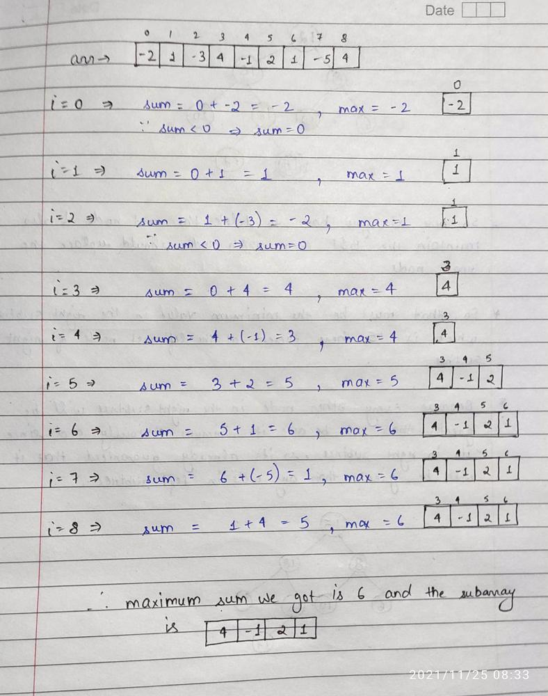

# JAVA | Kadane's Algorithm | Explanation Using Image

**Author:** Chaitanya1706
**Votes:** 971
**Link:** [https://leetcode.com/problems/maximum-subarray/solutions/1595097/](https://leetcode.com/problems/maximum-subarray/solutions/1595097/)

---

**Intution:** Start traversing your array keep each element in the sum and every time keep the max of currSum and prevSum.
**But the catch here is that if at any point sum becomes negative then no point keeping it because 0 is obviously greater than negative, so just make your sum 0.**



Now here in this question you can see that you can also be asked some more things like :
* Length of the max subarray
* Elements of the max subarray
* Start and End index of max subarray
  ##### This is very important concept from interview point so try to get the ans of above mentioned point and have confidence on this algorithm.

**CODE :**
```
class Solution {
    public int maxSubArray(int[] nums) {
        int n = nums.length;
        int max = Integer.MIN_VALUE, sum = 0;
        
        for(int i=0;i<n;i++){
            sum += nums[i];
            max = Math.max(sum,max);
            
            if(sum<0) sum = 0;
        }
        
        return max;
    }
}
```
P.S. : I see a lots of comments saying this algorithm will not work if all the elements are negative....plz analyze it carefully...this is working for every case. 
**if(sum<0) sum = 0;** -> this line is doing some magic. Dry run the algorithm carefully and u will get the answer. 
