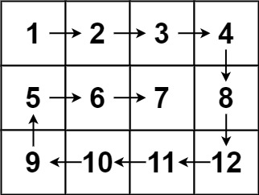

# [54. Spiral Matrix](https://leetcode.com/problems/spiral-matrix/)

| Category | Difficulty | Likes | Dislikes |
| :------: | :--------: | :---: | :------: |
| Algorithms | Medium | 16924 | 1521 |

**Tags:** [`array`](https://leetcode.com/tag/array), [`matrix`](https://leetcode.com/tag/matrix), [`simulation`](https://leetcode.com/tag/simulation)

**Companies:** `google`, `microsoft`, `amazon`, `facebook`, `bloomberg`, `apple`, `josh-technology`, `ebay`, `zoho`, `goldman-sachs`, `oracle`, `visa`, `tcs`, `akamai`, `tiktok`, `cisco`, `uber`, `capital-one`, `epic-systems`, `anduril`, `adobe`, `yahoo`, `paypal`, `roblox`, `morgan-stanley`, `rbc`, `pornhub`, `ibm`, `walmart-labs`, `jpmorgan`, `nutanix`, `nvidia`, `intuit`, `databricks`, `accenture`, `makemytrip`, `netapp`, `nordstrom`, `amd`, `sig`

## Description

Given an `m x n` `matrix`, return *all elements of the* `matrix` *in spiral order*.

 

**Example 1:**


```

Input: matrix = [[1,2,3],[4,5,6],[7,8,9]]
Output: [1,2,3,6,9,8,7,4,5]

```

**Example 2:**


```

Input: matrix = [[1,2,3,4],[5,6,7,8],[9,10,11,12]]
Output: [1,2,3,4,8,12,11,10,9,5,6,7]

```

 

**Constraints:**

	- `m == matrix.length`

	- `n == matrix[i].length`

	- `1 <= m, n <= 10`

	- `-100 <= matrix[i][j] <= 100`

---

**Links:** [Submissions](https://leetcode.com/problems/spiral-matrix/) | [Solutions](https://leetcode.com/problems/spiral-matrix/)
