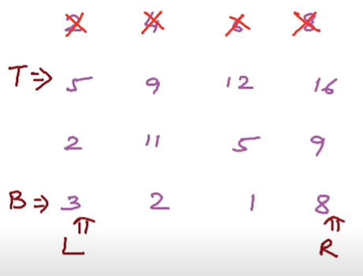

# C++ | 0ms faster than 100% | Easy solution with proper explanation

**Author:** rv237
**Votes:** 445
**Link:** [https://leetcode.com/problems/spiral-matrix/solutions/978853/](https://leetcode.com/problems/spiral-matrix/solutions/978853/)

---

**Algorithm:**
*  First we will iterate in to first row from left to right push back all the elements into a vector. After iterating, we change the top to second row (top++).
*  Then we will iterate from **new top** to bottom and push back only right most elements of each row. After iterating, we change the right to second last column (right--).
*  Then we will iterate in bottom row from **right** to **left** and pushback all the elements from **new right** to left. After iterating, we change the bottom to second last row (bottom--).
*  Then we will iterate from **new bottom** to **new top** and push back only left most element. After iterating, we change the left to second column (left++).
*  Repeat all these steps until left = right **and** top = bottom.



Take look at image for better understanding

```
class Solution {
public:
    vector<int> spiralOrder(vector<vector<int>>& matrix) {
        int n=matrix.size();
        int m=matrix[0].size();
        int left=0,right=m-1,bottom=n-1,top=0;
        int direction=1;
        vector<int> v;
        while(left<=right && top<=bottom)
        {
            if(direction==1)
            {
                for(int i=left;i<=right;i++) v.push_back(matrix[top][i]);
                direction=2;
                top++;
            }
            
            else if(direction==2)
            {
                for(int i=top;i<=bottom;i++) v.push_back(matrix[i][right]);
                direction=3;
                right--;
            }
            
            else if(direction==3)
            {
                for(int i=right;i>=left;i--) v.push_back(matrix[bottom][i]);
                direction=4;
                bottom--;
            }
            
            else if(direction==4)
            {
                for(int i=bottom;i>=top;i--) v.push_back(matrix[i][left]);
                direction=1;
                left++;
            }
        }
        return v;
        
    }
};
```

**Upvote it** if you liked it!