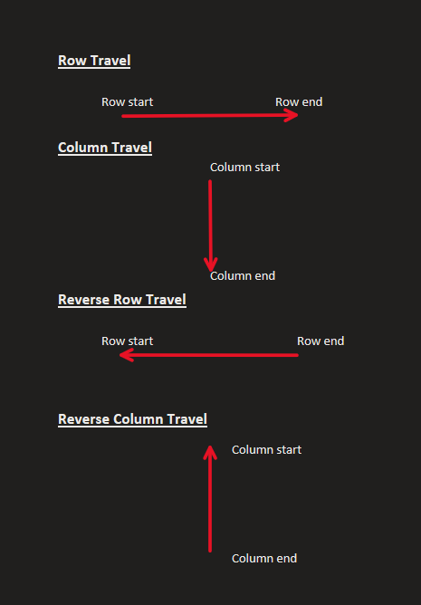

# Simple Solution | Easy to understand | C# | Detailed explanation

**Author:** rahulvc
**Votes:** 8
**Link:** [https://leetcode.com/problems/spiral-matrix/solutions/4290278/](https://leetcode.com/problems/spiral-matrix/solutions/4290278/)

---

# Intuition
using 4 pointers to track the start and ending of row and column traversal
<!-- Describe your first thoughts on how to solve this problem. -->

# Approach


1. In this problem we travel 4 different directions
    - Row travel
    - Column travel
    - Reverse Row travel
    - Reverse Column travel
2. we declare 4 different pointers namely:
    rowstart, rowend, colstart and colend
3. we use required 2 pointers for each travel, its been illustarted in the diagram above.
4. you can see in code we increment **rowstart**,**colstart** and decrement **rowend**, **colend** for each spiral travel so that we can enter into inner circle and it goes on
<!-- Describe your approach to solving the problem. -->

# Complexity
- Time complexity: O(N)
<!-- Add your time complexity here, e.g. $$O(n)$$ -->

- Space complexity: O(N) - it is used to return response otherwise its O(1)
<!-- Add your space complexity here, e.g. $$O(n)$$ -->


If it was helpful then **UPVOTE** my solution !! 

# Code
```
public class Solution {
    public IList<int> SpiralOrder(int[][] matrix) {
        //Time - O(N) Space - O(N)
        IList<int> records = new List<int>();

        //We need 4 pointers and we use 2 pointers each time we traverse a row or column.
        // 1 for starting point and 1 for ending
        int rowStart = 0; // for where the row traversal starts and reverse row traversal ends
        int colStart = 0; // from where the column traversal start and reverse column traversal ends
        int rowEnd = matrix[0].Length-1; // where the row traversal ends and from where reverse row traversal starts
        int colEnd = matrix.Length-1; // where the  column traversal ends and reverse columns traversal starts

        while(colStart <= colEnd && rowStart <= rowEnd){
            //Row traversal
            for(int i=rowStart; i<=rowEnd; i++){
                records.Add(matrix[colStart][i]); 
            }
            colStart++;
            //Column traversal
            if(colStart > colEnd) break;
            for(int j=colStart; j<=colEnd; j++){
                records.Add(matrix[j][rowEnd]);
            }            
            rowEnd--;
            //Reverse row traversal
            if(rowStart > rowEnd) break;
            for(int k=rowEnd; k>=rowStart; k--){
                records.Add(matrix[colEnd][k]);
            }
            colEnd--;
            //Reverse column traversal
            if(colStart > colEnd) break;
            for(int m=colEnd; m>=colStart; m--){
                records.Add(matrix[m][rowStart]);
            }
            rowStart++;
            if(rowStart > rowEnd) break;
        }        
        return records;
    }
}
```