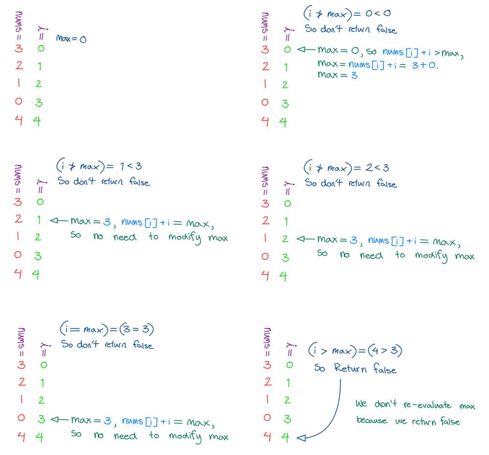

# Golang O(n), O(1) solution with images

**Author:** nathannaveen
**Votes:** 26
**Link:** [https://leetcode.com/problems/jump-game/solutions/1285632/](https://leetcode.com/problems/jump-game/solutions/1285632/)

---

The idea of this solution is pretty simple once you understand it. 

The idea of this solution is:

* We get the maximum index we can go up to by getting the maximum of `i + nums[i]` and `max`.
* Then, if `i` has surpassed the maximum index, we can return `false`.
* Otherwise return `true`.

If you don't understand why this works, look at the following example:

input: `[3, 2, 1, 0, 4]`
expected output: `false`




**The Code:**

``` go
func canJump(nums []int) bool {
    max := 0
    for i := 0; i < len(nums); i++ {
        if i > max {
            return false
        }
        if i + nums[i] > max {
            max = i + nums[i]
        }
    }
    return true
}
```