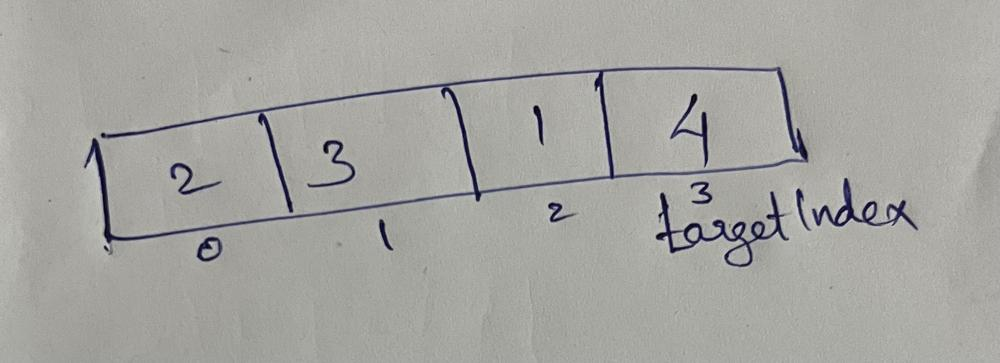
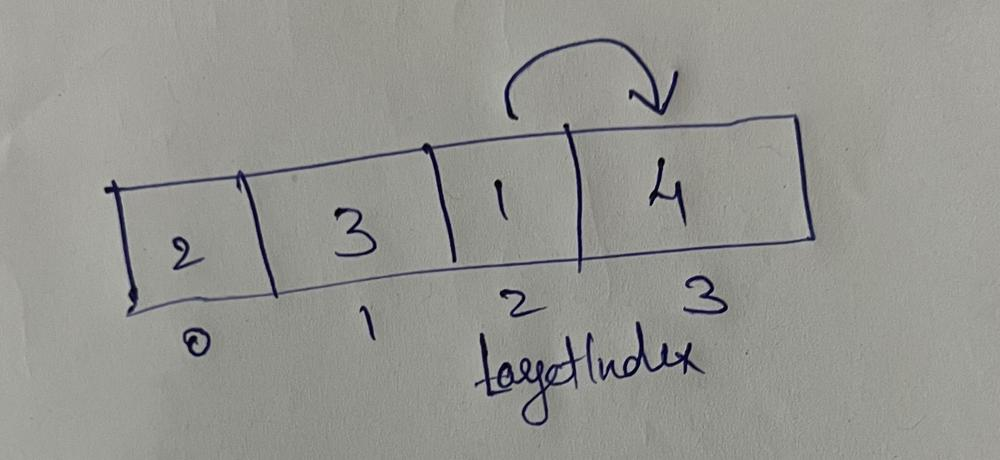
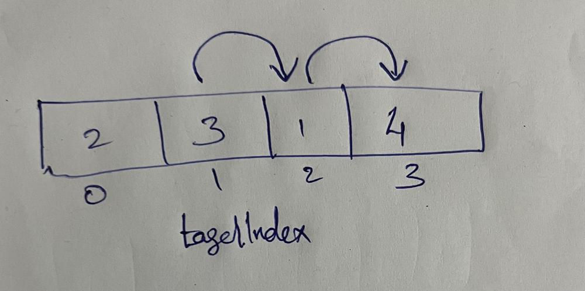
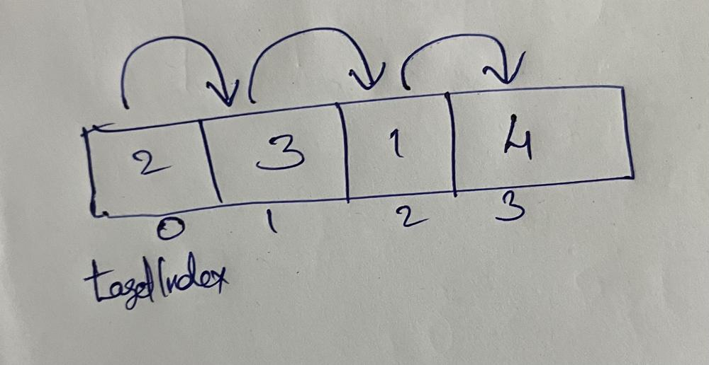

# Kotlin simple O(n) solution with pictorial explanation

**Author:** viswajith_kn
**Votes:** 7
**Link:** [https://leetcode.com/problems/jump-game/solutions/4379592/](https://leetcode.com/problems/jump-game/solutions/4379592/)

---

# Intuition
We can solve this problem using greedy approach. From backwards, We find out in each step whether from which index, the jump has happened.

## **Let us take example ```[2, 3, 1, 4]```**

- First we assume we have reached the last index which is ```3``` here. 
(```targetIndex = numssize - 1```)




- Then on the first iteration, we check whether we jumped from ```index 2``` to reach ```index 3```. If yes, it has already taken ```2 jumps``` + ```1 jump``` from ```index 2```. So we can conclude that we reached ```index 3``` from ```index 2``` only. 




- In the second iteration, we check how we reached ```index 2```. If it was from ```index 1```, the total jump should be greater than or equal to ```2```. Here, the maximum jump is ```4 jump```. ```1``` from ```index 0``` to ```index 1``` and ```3``` from ```index 1``` to ```index 2```. It took only ```1 jump``` from ```index 1``` to reach ```index 2``` as 4 is maximum jumps.




- Finally, in last iteration, we check how we reached ```index 1```. The maximum jump is ```2``` from ```index 0``` which is greater than ```1```. Now we reached the ```0th index``` and hence the result will be true.




# Approach
Greedy algorithm

# Complexity
- Time complexity:
O(n)

- Space complexity:
O(1)

# Code
```
class Solution {
    fun canJump(nums: IntArray): Boolean {
        var targetIndex = nums.size - 1
        for(i in nums.size - 2 downTo 0) {
            if(i + nums[i] >= targetIndex) targetIndex = i
        }
       return targetIndex == 0 
    }
}
```