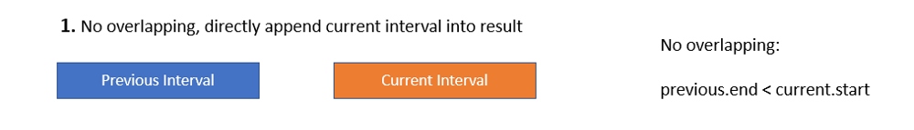
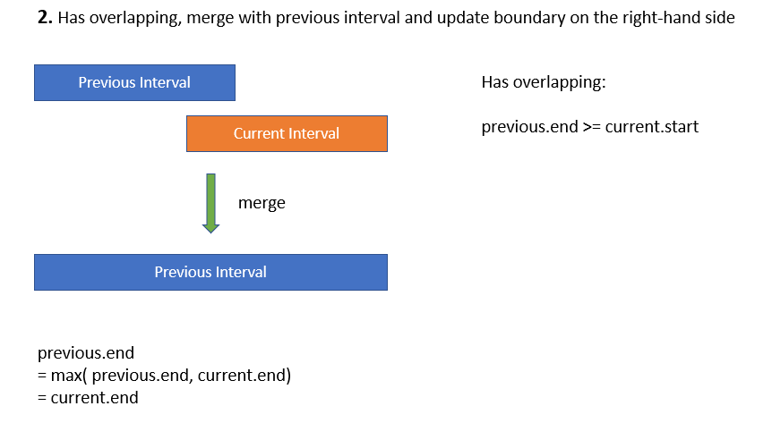
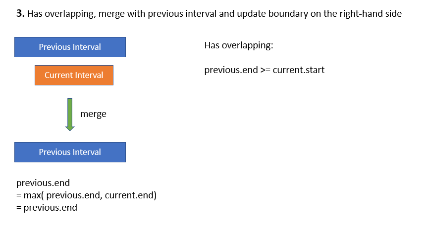

# Python/JS/Go/C++ by sort & merge [w/ Visualization]

**Author:** brianchiang_tw
**Votes:** 35
**Link:** [https://leetcode.com/problems/merge-intervals/solutions/810795/](https://leetcode.com/problems/merge-intervals/solutions/810795/)

---

**Diagram and Visualization**

After soring on endpoint pair, there are 3 possible cases for interval pairs during merging



---



---



---

**Implementation** by sort-and-merge

Python:

```
class Solution:
    def merge(self, intervals: List[List[int]]) -> List[List[int]]:
        
        # predefined constant for start (left endpoint), and end (right endpoint)
        START, END = 0, 1
        
        result = []
        
        # make all intervals sorted on (left endpoint, right endpoint) pair in ascending order
        intervals.sort( key = lambda x: (x[START], x[END] ) ) 
        
        for interval in intervals:
            
            if not result or ( result[-1][END] < interval[START] ):
				# no overlapping
                result.append( interval )
            
            else:
				# has overlapping
				# merge with previous interval
                result[-1][END] = max(result[-1][END], interval[END])
                
        return result
```

---

Javascript:

```
var merge = function(intervals) {
    
    // predefined constant for start (left endpoint), as well as end (right endpoint)
    const [START, END] = [0, 1];
    
    let result = [];
    
    // make all intervals sorted on (left endpoint, right endpoint) pair in ascending order
    intervals.sort( (a, b) => a[START] != b[START] ? a[START] - b[START] : a[END] - b[END] );
    
    for( const curInterval of intervals){
        
        if( (result.length == 0) || ( result[result.length-1][END] < curInterval[START]) ){
            // no overlapping
            result.push( curInterval );

            
        
        }else{
            // has overlapping
            // merge with previous interval
            result[result.length-1][END] = Math.max( result[result.length-1][END], curInterval[END] );

        }
    }
    
    return result;
};
```

---

Go:

```
func max(x, y int) int {
    
    if x >= y {
        return x
    }else{
        return y
    }
    
}

//---------------------


func merge(intervals [][]int) [][]int {

    // predefined constant for start (left endpoint), as well as end (right endpoint)
    const START, END = 0, 1
    
    result := make( [][]int, 0);
    
    sort.Slice(intervals, func(a, b int) bool {
        return (intervals[a][0] < intervals[b][0]) || ( (intervals[a][0] == intervals[b][0]) && (intervals[a][1] < intervals[b][1]) )
    })
    
    for _, curInterval := range intervals{
        
        if ( len(result) == 0 ) || ( result[len(result)-1][END] < curInterval[START] ){
            
            // no overlapping
            result = append(result, curInterval)
            
        }else{
            
            // has overlapping
            // merge with previous interval
            result[len(result)-1][END] = max( result[len(result)-1][END], curInterval[END] )
        }
        
    }
    
    return result
}
```

---

C++

```
class Solution {
public:
    vector<vector<int>> merge(vector<vector<int>>& intervals) {
        
        // predefined constant for start (left endpoint), as well as end ( right endpoint)
        const int START=0, END=1;   
        
        vector< vector<int> > result;
    
        // make all intervals sorted on (left endpoint, right endpoint) pair in ascending order
        sort( intervals.begin(), intervals.end() );
        
        for( auto const &curInterval : intervals ){
            
            if ( (result.size() == 0 ) || (result.back()[END] < curInterval[START] ) ){
                // no overlapping
                result.push_back( curInterval );
                
            }else{
                // has overlapping
                // merge with previous interval
                result.back()[END] = max( result.back()[END], curInterval[END] );
                
            }
        }
        
        return result;
    }
};

```