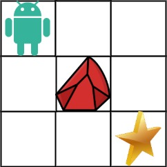

# [63. Unique Paths II](https://leetcode.com/problems/unique-paths-ii/)

| Category | Difficulty | Likes | Dislikes |
| :------: | :--------: | :---: | :------: |
| Algorithms | Medium | 9538 | 555 |

**Tags:** [`array`](https://leetcode.com/tag/array), [`dynamic-programming`](https://leetcode.com/tag/dynamic-programming), [`matrix`](https://leetcode.com/tag/matrix)

**Companies:** `bloomberg`, `google`, `amazon`, `nvidia`, `facebook`, `tiktok`, `agoda`, `microsoft`, `pinterest`, `coupang`, `tcs`

## Description

You are given an `m x n` integer array `grid`. There is a robot initially located at the top-left corner (i.e., `grid[0][0]`). The robot tries to move to the **bottom-right corner** (i.e., `grid[m - 1][n - 1]`). The robot can only move either down or right at any point in time.

An obstacle and space are marked as `1` or `0` respectively in `grid`. A path that the robot takes cannot include **any** square that is an obstacle.

Return *the number of possible unique paths that the robot can take to reach the bottom-right corner*.

The testcases are generated so that the answer will be less than or equal to `2 * 10^9`.

 

**Example 1:**


```

Input: obstacleGrid = [[0,0,0],[0,1,0],[0,0,0]]
Output: 2
Explanation: There is one obstacle in the middle of the 3x3 grid above.
There are two ways to reach the bottom-right corner:
1. Right -&gt; Right -&gt; Down -&gt; Down
2. Down -&gt; Down -&gt; Right -&gt; Right

```

**Example 2:**


```

Input: obstacleGrid = [[0,1],[0,0]]
Output: 1

```

 

**Constraints:**

	- `m == obstacleGrid.length`

	- `n == obstacleGrid[i].length`

	- `1 <= m, n <= 100`

	- `obstacleGrid[i][j]` is `0` or `1`.

---

**Links:** [Submissions](https://leetcode.com/problems/unique-paths-ii/) | [Solutions](https://leetcode.com/problems/unique-paths-ii/)
