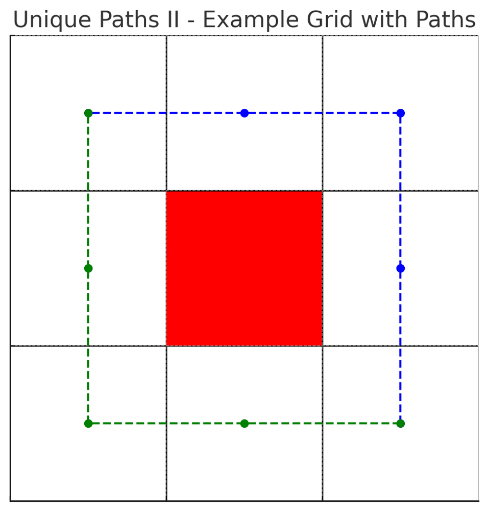

# ✅ 100% Dynamic Programming [VIDEO] - Optimal Solution

**Author:** vanAmsen
**Votes:** 72
**Link:** [https://leetcode.com/problems/unique-paths-ii/solutions/3896905/](https://leetcode.com/problems/unique-paths-ii/solutions/3896905/)

---

# Problem Understanding

In the "Unique Paths II" problem, we are presented with a grid filled with obstacles and open paths. Starting from the top-left corner, the goal is to find the number of unique paths that lead to the bottom-right corner. We can only move right or down at any point in time. If a cell has an obstacle, we cannot pass through it.

For example, consider the following grid:

$$
\\begin{array}{ccc}
0 & 0 & 0 \\\\
0 & 1 & 0 \\\\
0 & 0 & 0 \\\\
\\end{array}
$$




- The grid cells with obstacles are colored in red.
- The two unique paths from the top-left to the bottom-right corner are represented by the blue and green dashed lines.

From the plot, you can see the two possible routes:

- The blue path goes Right -> Right -> Down -> Down.
- The green path goes Down -> Down -> Right -> Right.

---

# Live Coding
https://youtu.be/pJ40_FmXAfo

- [in Python \uD83D\uDC0D](https://youtu.be/pJ40_FmXAfo)
- [in Rust \uD83E\uDD80](https://youtu.be/xt_1OzCH_NA)

# Approach

## The Basic Idea

The underlying concept is rooted in dynamic programming. Essentially, for any cell `(i, j)`, the number of ways you can reach it is the sum of the ways you can reach the cell directly above it `(i-1, j)` and the cell directly to its left `(i, j-1)`. However, this is only true if the cell `(i, j)` does not have an obstacle. If it does, then the number of ways to reach this cell is 0 because it's inaccessible.

### 2D Transition:
In a 2D dynamic programming approach, you would have a `dp` array of size `m x n`, where ` dp[i][j] ` represents the number of ways to reach cell ` (i, j) `.

The transition formula would be:
$$ dp[i][j] = 
\\begin{cases} 
0 & \	ext{if } obstacleGrid[i][j] = 1 \\\\
dp[i-1][j] + dp[i][j-1] & \	ext{otherwise}
\\end{cases}
$$

So, for each cell ` (i, j) `, if there's no obstacle, its value would be the sum of the cell above it and the cell to its left.

### Translation to 1D:

Now, given the 2D transition, notice how for any cell \\( (i, j) \\), we only need values from the current row and the previous row. This observation allows us to reduce our 2D `dp` array to two 1D arrays, `previous` and `current`.

The transition formula in 1D would be analogous to the 2D version but slightly adjusted:

For the first column (`j = 0`):
$$ current[0] = 
\\begin{cases} 
0 & \	ext{if } obstacleGrid[i][0] = 1 \\\\
previous[0] & \	ext{otherwise}
\\end{cases}
$$

For other columns:
$$ current[j] = 
\\begin{cases} 
0 & \	ext{if } obstacleGrid[i][j] = 1 \\\\
previous[j] + current[j-1] & \	ext{otherwise}
\\end{cases}
$$

Here, `previous` is analogous to `dp[i-1]` and `current` is analogous to `dp[i]` from our 2D approach. After processing each row, we'll swap `previous` and `current` to roll over to the next iteration.

The transition remains conceptually the same between the 2D and 1D versions. The 1D optimization simply leverages the observation that for each cell, we only need data from the current and previous rows. This reduces space complexity from $$ O(m \	imes n) $$ to $$ O(n) $$.

This rolling array technique is a common optimization strategy in dynamic programming problems involving grids.

### Step-by-step Breakdown:

1. **Initialization**:
   - We initialize the `previous` array with zeros. This array represents the number of ways to reach each cell in the previous row.
   - We set `previous[0]` to 1 because there's only one way to get to the starting cell (by starting there!).
   
2. **Iterate through the Grid**:
   - For each row, we consider each cell:
     - If the cell has an obstacle, it's unreachable, so the number of ways to get there (`current[j]`) is 0.
     - Otherwise, the number of ways to reach the cell is the sum of the ways to reach the cell above and the cell to the left. This translates to `current[j-1] + previous[j]`.
   - Once we've processed a row, we set `previous` to `current`, preparing for the next iteration.

3. **Result**:
   - Once we've processed all rows, `previous[n-1]` gives us the number of unique paths to the bottom-right corner of the grid.

## Example

Using the earlier example:

$$
\\begin{array}{ccc}
0 & 0 & 0 \\\\
0 & 1 & 0 \\\\
0 & 0 & 0 \\\\
\\end{array}
$$

Here's how the `previous` and `current` arrays evolve:

The function's output matches the example description:

**Initial State**:
- `previous`: $$[1, 0, 0]$$
- `current`: $$[0, 0, 0]$$

**After processing row 0**:
- `previous`: $$[1, 0, 0]$$
- `current`: $$[1, 1, 1]$$

**After processing row 1**:
- `previous`: $$[1, 1, 1]$$
- `current`: $$[1, 0, 1]$$

**After processing row 2**:
- `previous`: $$[1, 0, 1]$$
- `current`: $$[1, 1, 2]$$

From the final state of the `previous` array, we can infer that there are 2 unique paths from the top-left to the bottom-right corner, avoiding obstacles. This matches the expected result.

# Complexity

**Time Complexity:** $$O(m \	imes n)$$
**Space Complexity:** $$O(n)$$

This solution is optimal in terms of both time and space complexity. It efficiently computes the number of unique paths by building upon previous calculations.

# Performance

| Language    | Runtime (ms) | Runtime Beat (%) | Memory (MB) | Memory Beat (%) |
|-------------|--------------|------------------|-------------|-----------------|
| Go          | 0            | 100%             | 2.4         | 71.38%          |
| C++         | 0            | 100%             | 7.6         | 81.25%          |
| Java        | 0            | 100%             | 40.5        | 72.53%          |
| Rust        | 1            | 85%              | 2           | 87.50%          |
| Python3     | 38           | 99.30%           | 16.3        | 82.98%          |
| JavaScript  | 47           | 97.40%           | 41.6        | 97.86%          |
| C#          | 81           | 80.72%           | 38.7        | 63.25%          |


---

# Code

``` Python []
class Solution:
    def uniquePathsWithObstacles(self, obstacleGrid: List[List[int]]) -> int:
        if not obstacleGrid or not obstacleGrid[0] or obstacleGrid[0][0] == 1:
            return 0
        
        m, n = len(obstacleGrid), len(obstacleGrid[0])
        
        previous = [0] * n
        current = [0] * n
        previous[0] = 1
        
        for i in range(m):
            current[0] = 0 if obstacleGrid[i][0] == 1 else previous[0]
            for j in range(1, n):
                current[j] = 0 if obstacleGrid[i][j] == 1 else current[j-1] + previous[j]
            previous[:] = current
        
        return previous[n-1]
```
``` C++ []
class Solution {
public:
    int uniquePathsWithObstacles(std::vector<std::vector<int>>& obstacleGrid) {
        if (obstacleGrid.empty() || obstacleGrid[0].empty() || obstacleGrid[0][0] == 1) {
            return 0;
        }
        
        int m = obstacleGrid.size();
        int n = obstacleGrid[0].size();
        
        std::vector<int> previous(n, 0);
        std::vector<int> current(n, 0);
        previous[0] = 1;
        
        for (int i = 0; i < m; i++) {
            current[0] = obstacleGrid[i][0] == 1 ? 0 : previous[0];
            for (int j = 1; j < n; j++) {
                current[j] = obstacleGrid[i][j] == 1 ? 0 : current[j-1] + previous[j];
            }
            previous = current;
        }
        
        return previous[n-1];
    }
};
```
``` Go []
func uniquePathsWithObstacles(obstacleGrid [][]int) int {
    if len(obstacleGrid) == 0 || len(obstacleGrid[0]) == 0 || obstacleGrid[0][0] == 1 {
        return 0
    }

    m := len(obstacleGrid)
    n := len(obstacleGrid[0])

    previous := make([]int, n)
    current := make([]int, n)
    previous[0] = 1

    for i := 0; i < m; i++ {
        if obstacleGrid[i][0] == 1 {
            current[0] = 0
        } else {
            current[0] = previous[0]
        }
        
        for j := 1; j < n; j++ {
            if obstacleGrid[i][j] == 1 {
                current[j] = 0
            } else {
                current[j] = current[j-1] + previous[j]
            }
        }
        previous, current = current, previous
    }
    return previous[n-1]
}
```
``` Rust []
impl Solution {
    pub fn unique_paths_with_obstacles(obstacleGrid: Vec<Vec<i32>>) -> i32 {
        if obstacleGrid.is_empty() || obstacleGrid[0].is_empty() || obstacleGrid[0][0] == 1 {
            return 0;
        }
        
        let m = obstacleGrid.len();
        let n = obstacleGrid[0].len();
        
        let mut previous = vec![0; n];
        let mut current = vec![0; n];
        previous[0] = 1;
        
        for row in &obstacleGrid {
            current[0] = if row[0] == 1 { 0 } else { previous[0] };
            for j in 1..n {
                if row[j] == 1 {
                    current[j] = 0;
                } else {
                    current[j] = current[j-1] + previous[j];
                }
            }
            std::mem::swap(&mut previous, &mut current);
        }
        
        previous[n-1]
    }
}
```
``` Java []
public class Solution {
    public int uniquePathsWithObstacles(int[][] obstacleGrid) {
        if (obstacleGrid == null || obstacleGrid.length == 0 || obstacleGrid[0].length == 0 || obstacleGrid[0][0] == 1) {
            return 0;
        }

        int m = obstacleGrid.length;
        int n = obstacleGrid[0].length;

        int[] previous = new int[n];
        int[] current = new int[n];
        previous[0] = 1;

        for (int i = 0; i < m; i++) {
            current[0] = obstacleGrid[i][0] == 1 ? 0 : previous[0];
            for (int j = 1; j < n; j++) {
                current[j] = obstacleGrid[i][j] == 1 ? 0 : current[j-1] + previous[j];
            }
            System.arraycopy(current, 0, previous, 0, n);
        }

        return previous[n-1];
    }
}
```
``` JavaScript []
/**
 * @param {number[][]} obstacleGrid
 * @return {number}
 */
var uniquePathsWithObstacles = function(obstacleGrid) {
    if (!obstacleGrid.length || !obstacleGrid[0].length || obstacleGrid[0][0] === 1) {
        return 0;
    }

    let m = obstacleGrid.length;
    let n = obstacleGrid[0].length;

    let previous = new Array(n).fill(0);
    let current = new Array(n).fill(0);
    previous[0] = 1;

    for (let i = 0; i < m; i++) {
        current[0] = obstacleGrid[i][0] === 1 ? 0 : previous[0];
        for (let j = 1; j < n; j++) {
            current[j] = obstacleGrid[i][j] === 1 ? 0 : current[j-1] + previous[j];
        }
        previous = [...current];
    }

    return previous[n-1];
};
```
``` C# []
public class Solution {
    public int UniquePathsWithObstacles(int[][] obstacleGrid) {
        if (obstacleGrid == null || obstacleGrid.Length == 0 || obstacleGrid[0].Length == 0 || obstacleGrid[0][0] == 1) {
            return 0;
        }

        int m = obstacleGrid.Length;
        int n = obstacleGrid[0].Length;

        int[] previous = new int[n];
        int[] current = new int[n];
        previous[0] = 1;

        for (int i = 0; i < m; i++) {
            current[0] = obstacleGrid[i][0] == 1 ? 0 : previous[0];
            for (int j = 1; j < n; j++) {
                current[j] = obstacleGrid[i][j] == 1 ? 0 : current[j-1] + previous[j];
            }
            Array.Copy(current, previous, n);
        }

        return previous[n-1];
    }
}
```

# Conclusion

The "Unique Paths II" problem showcases how dynamic programming can help find solutions to combinatorial problems in a structured and efficient manner. By understanding the relationship between subproblems, we can incrementally build the solution and avoid redundant computations. 

As with any algorithmic challenge, practice and understanding the underlying principles are key. Don't hesitate to tweak, optimize, and experiment with the solution to deepen your understanding!

# Live Coding in Rust
https://youtu.be/xt_1OzCH_NA