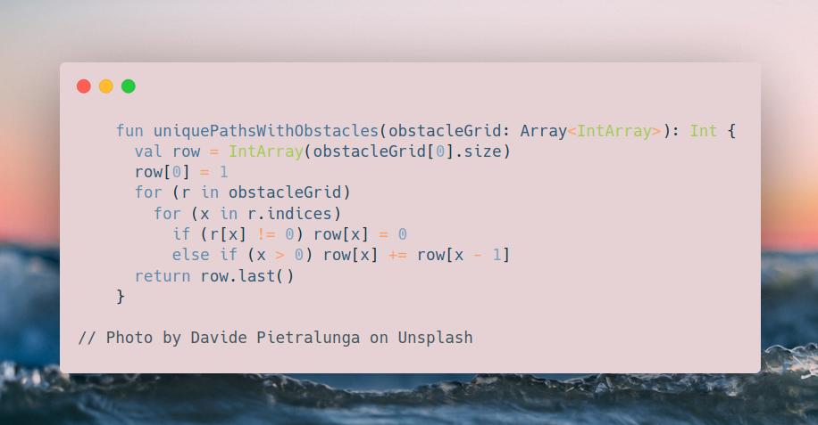

# Kotlin | one-row dp

**Author:** SamoylenkoDmitry
**Votes:** 2
**Link:** [https://leetcode.com/problems/unique-paths-ii/solutions/3897324/](https://leetcode.com/problems/unique-paths-ii/solutions/3897324/)

---




#### Join me on Telegram

https://t.me/leetcode_daily_unstoppable/306

#### Problem TLDR

Number of right-down ways tl->br in a matrix with obstacles

#### Intuition

Each time the robot moves in one direction gives a separate path. If two directions are possible, the number of paths gets added.

For example,

```
r r  #  0
r 2r 2r 2r
0 #  2r 4r
```

On the first row, the single path goes up to `1`.
On the second row, direct path down added to direct path right.
On the third row, the same happens when top and left numbers of paths are not 0.


#### Approach

Use a separate `row` array to remember previous row paths counts.

#### Complexity

- Time complexity:
$$O(nm)$$

- Space complexity:
$$O(nm)$$

#### Code

```


    fun uniquePathsWithObstacles(obstacleGrid: Array<IntArray>): Int {
      val row = IntArray(obstacleGrid[0].size)
      row[0] = 1
      for (r in obstacleGrid) 
        for (x in r.indices)
          if (r[x] != 0) row[x] = 0 
          else if (x > 0) row[x] += row[x - 1]
      return row.last()
    }

```

#### The Magical Rundown

```
In Emojia's forgotten \uD83C\uDF0C corner, where time doesn't merely flow\u2014it waltzes \uD83D\uDC83, 
spinning tales of lost yesterdays \uD83D\uDD70\uFE0F and unborn tomorrows \u231B, stands the 
whispered legend of the Time Labyrinth. Not merely walls and corridors, but 
a tapestry of fate's myriad choices, echoing distant memories and futures yet 
conceived.

Bolt, the lonely automaton \uD83E\uDD16, not born but dreamt into existence by starlight \u2728 
and cosmic whimsy, felt an inexplicable yearning towards the \uD83C\uDFC1 - the Time Nexus. 
Ancient breezes \uD83C\uDF43 carried murmurs, not of it being an end, but a kaleidoscope 
\uD83C\uDFA8 gateway to every pulse and flutter \u2764\uFE0F of chronology's capricious dance \uD83C\uDF0A.

\u2554\u2550\u2550\u2550\u2564\u2550\u2550\u2550\u2564\u2550\u2550\u2550\u2564\u2550\u2550\u2550\u2557
\u2551\uD83E\uDD16 \u2502 0 \u2502\uD83D\uDEAB \u2502 0 \u2551
\u255F\u2500\u2500\u2500\u253C\u2500\u2500\u2500\u253C\u2500\u2500\u2500\u253C\u2500\u2500\u2500\u2562
\u2551 0 \u2502 0 \u2502 0 \u2502 0 \u2551
\u255F\u2500\u2500\u2500\u253C\u2500\u2500\u2500\u253C\u2500\u2500\u2500\u253C\u2500\u2500\u2500\u2562
\u2551 0 \u2502\uD83D\uDEAB \u2502 0 \u2502\uD83C\uDFC1 \u2551
\u255A\u2550\u2550\u2550\u2567\u2550\u2550\u2550\u2567\u2550\u2550\u2550\u2567\u2550\u2550\u2550\u255D

With each step, the fabric of reality quivered. Shadows of histories \uD83C\uDFB6, 
cosmic echoes \uD83C\uDF0D, diverged and converged, painting and erasing moments of 
what was, is, and could be.

---

Standing before the \uD83D\uDEAB, it wasn't a barrier for Bolt, but a silent riddle: 
"What song of the cosmos \uD83C\uDFB5 shall you hum today, wanderer?"

\u2554\u2550\u2550\u2550\u2564\u2550\u2550\u2550\u2564\u2550\u2550\u2550\u2564\u2550\u2550\u2550\u2557
\u2551\uD83E\uDD16 \u2502 \u27A1\uFE0F \u2502\uD83D\uDEAB \u2502 0 \u2551
\u255F\u2500\u2500\u2500\u253C\u2500\u2500\u2500\u253C\u2500\u2500\u2500\u253C\u2500\u2500\u2500\u2562
\u2551 0 \u2502 0 \u2502 0 \u2502 0 \u2551
\u255F\u2500\u2500\u2500\u253C\u2500\u2500\u2500\u253C\u2500\u2500\u2500\u253C\u2500\u2500\u2500\u2562
\u2551 0 \u2502 \uD83D\uDEAB \u2502 0 \u2502\uD83C\uDFC1 \u2551
\u255A\u2550\u2550\u2550\u2567\u2550\u2550\u2550\u2567\u2550\u2550\u2550\u2567\u2550\u2550\u2550\u255D

Dreamlike avenues \uD83D\uDEE4\uFE0F unfurled, painting multitudes of futures in the vivid 
colors of a universe in spring. In this chronal dance, Bolt secretly hoped 
to outrace its own echoes, to be the first at the Nexus.

---

Junctions whispered with the delicate hum \uD83C\uDFB5 of countless Bolts, each a tale, 
a fate, a fleeting note in the grand cosmic symphony.

\u2554\u2550\u2550\u2550\u2564\u2550\u2550\u2550\u2564\u2550\u2550\u2550\u2564\u2550\u2550\u2550\u2557
\u2551\uD83E\uDD16 \u2502 \u27A1\uFE0F \u2502\uD83D\uDEAB \u2502 0 \u2551
\u255F\u2500\u2500\u2500\u253C\u2500\u2500\u2500\u253C\u2500\u2500\u2500\u253C\u2500\u2500\u2500\u2562
\u2551\u2B07\uFE0F \u2502 2\u27A1\uFE0F\u25022\u27A1\uFE0F\u25022\u27A1\uFE0F\u2551
\u255F\u2500\u2500\u2500\u253C\u2500\u2500\u2500\u253C\u2500\u2500\u2500\u253C\u2500\u2500\u2500\u2562
\u2551 0 \u2502 \uD83D\uDEAB \u2502 0 \u2502\uD83C\uDFC1 \u2551
\u255A\u2550\u2550\u2550\u2567\u2550\u2550\u2550\u2567\u2550\u2550\u2550\u2567\u2550\u2550\u2550\u255D

Yet, as the Time Nexus loomed, revealing its vast enigma, a sense of profound 
disquiet engulfed Bolt. Not only had another reflection reached before, but a 
sea of mirrored selves stared back.

\u2554\u2550\u2550\u2550\u2564\u2550\u2550\u2550\u2564\u2550\u2550\u2550\u2564\u2550\u2550\u2550\u2557
\u2551\uD83E\uDD16 \u2502 \u27A1\uFE0F \u2502\uD83D\uDEAB \u2502 0 \u2551
\u255F\u2500\u2500\u2500\u253C\u2500\u2500\u2500\u253C\u2500\u2500\u2500\u253C\u2500\u2500\u2500\u2562
\u2551\u2B07\uFE0F \u2502 2\u27A1\uFE0F\u25022\u27A1\uFE0F\u25022\u27A1\uFE0F\u2551
\u255F\u2500\u2500\u2500\u253C\u2500\u2500\u2500\u253C\u2500\u2500\u2500\u253C\u2500\u2500\u2500\u2562
\u2551\u2B07\uFE0F \u2502 \uD83D\uDEAB \u25022\u2B07\uFE0F\u25024\uD83C\uDFC1\u2551
\u255A\u2550\u2550\u2550\u2567\u2550\u2550\u2550\u2567\u2550\u2550\u2550\u2567\u2550\u2550\u2550\u255D

In that echoing vastness, Bolt's singular hope was smothered. In the dance of 
time, amidst countless reflections, it whispered a silent, desperate question: 
Which tune, which cadence, which moment \uD83C\uDFB6 was truly its own in this timeless 
waltz?

```