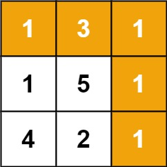

# [64. Minimum Path Sum](https://leetcode.com/problems/minimum-path-sum/)

| Category | Difficulty | Likes | Dislikes |
| :------: | :--------: | :---: | :------: |
| Algorithms | Medium | 13451 | 192 |

**Tags:** [`array`](https://leetcode.com/tag/array), [`dynamic-programming`](https://leetcode.com/tag/dynamic-programming), [`matrix`](https://leetcode.com/tag/matrix)

**Companies:** `goldman-sachs`, `amazon`, `google`, `microsoft`, `facebook`, `texas-instruments`, `tiktok`, `bloomberg`, `uber`, `general-motors`, `palo-alto-networks`, `nvidia`, `makemytrip`, `flipkart`, `squarepoint-capital`

## Description

Given a `m x n` `grid` filled with non-negative numbers, find a path from top left to bottom right, which minimizes the sum of all numbers along its path.

**Note:** You can only move either down or right at any point in time.

 

**Example 1:**


```

Input: grid = [[1,3,1],[1,5,1],[4,2,1]]
Output: 7
Explanation: Because the path 1 &rarr; 3 &rarr; 1 &rarr; 1 &rarr; 1 minimizes the sum.

```

**Example 2:**

```

Input: grid = [[1,2,3],[4,5,6]]
Output: 12

```

 

**Constraints:**

	- `m == grid.length`

	- `n == grid[i].length`

	- `1 <= m, n <= 200`

	- `0 <= grid[i][j] <= 200`

---

**Links:** [Submissions](https://leetcode.com/problems/minimum-path-sum/) | [Solutions](https://leetcode.com/problems/minimum-path-sum/)
