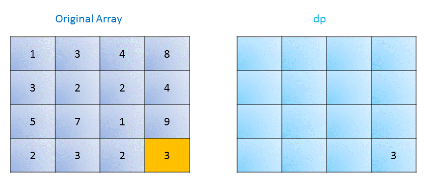

# Official Solution

**Link:** [https://leetcode.com/problems/minimum-path-sum/solution/](https://leetcode.com/problems/minimum-path-sum/solution/)

---

[TOC]

## Summary

We have to find the minimum sum of numbers over a path from the top left to the bottom right of the given matrix .

## Solution

---
### Approach 1: Brute Force

The Brute Force approach involves recursion. For each element, we consider two paths, rightwards and downwards and find the minimum sum out of those two. It specifies whether we need to take a right step or downward step to minimize the sum.

$$
\mathrm{cost}(i, j)=\mathrm{grid}[i][j] + \min \big(\mathrm{cost}(i+1, j), \mathrm{cost}(i, j+1) \big)
$$

<iframe src="https://leetcode.com/playground/dHk5aANZ/shared" frameBorder="0" width="100%" height="395" name="dHk5aANZ"></iframe>

**Complexity Analysis**

* Time complexity : $$O\big(2^{m+n}\big)$$. For every move, we have at most 2 options.
* Space complexity : $$O(m+n)$$. Recursion of depth $$m+n$$.

---

### Approach 2: Dynamic Programming 2D

**Algorithm**

We use an extra matrix $$dp$$ of the same size as the original matrix. In this matrix, $$dp(i, j)$$ represents the minimum sum of the path from the index $$(i, j)$$ to
the bottom rightmost element. We start by initializing the bottom rightmost element
of $$dp$$ as the last element of the given matrix. Then for each element starting from
the bottom right, we traverse backwards and fill in the matrix with the required
minimum sums. Now, we need to note that at every element, we can move either
rightwards or downwards. Therefore, for filling in the minimum sum, we use the
equation:

$$
dp(i, j)= \mathrm{grid}(i,j)+\min\big(dp(i+1,j),dp(i,j+1)\big)
$$

taking care of the boundary conditions.

The following figure illustrates the process:
<!---->
!?!../Documents/64_Minimum_Path_Sum.json:859,390!?!

<iframe src="https://leetcode.com/playground/VxMRDsWz/shared" frameBorder="0" width="100%" height="500" name="VxMRDsWz"></iframe>

**Complexity Analysis**

* Time complexity : $$O(mn)$$. We traverse the entire matrix once.

* Space complexity : $$O(mn)$$. Another matrix of the same size is used.

---

### Approach 3: Dynamic Programming 1D

**Algorithm**

In the previous case, instead of using a 2D matrix for dp, we can do the same
work using a $$dp$$ array of the row size, since for making the current entry all we need is the dp entry for the bottom and
 the right element. Thus,
we start by initializing only the last element of the array as the last element of the given matrix.
The last entry is the bottom rightmost element of the given matrix. Then, we start
moving towards the left and update the entry $$dp(j)$$ as:

$$
dp(j)=\mathrm{grid}(i,j)+\min\big(dp(j),dp(j+1)\big)
$$

We repeat the same process for every row as we move upwards. At the end $$dp(0)$$ gives the
 required minimum sum.

<iframe src="https://leetcode.com/playground/djmJmvGB/shared" frameBorder="0" width="100%" height="463" name="djmJmvGB"></iframe>

**Complexity Analysis**

* Time complexity : $$O(mn)$$. We traverse the entire matrix once.

* Space complexity : $$O(n)$$. Another array of row size is used.

---

### Approach 4: Dynamic Programming (Without Extra Space)

**Algorithm**

This approach is same as [Approach 2](#approach-2-dynamic-programming-2d), with a slight difference. Instead of using
another $$dp$$ matrix. We can store the minimum sums in the original matrix itself,
since we need not retain the original matrix here. Thus, the governing equation
now becomes:

$$
\mathrm{grid}(i, j)=\mathrm{grid}(i,j)+\min \big(\mathrm{grid}(i+1,j), \mathrm{grid}(i,j+1)\big)
$$

<iframe src="https://leetcode.com/playground/4TFmmxpp/shared" frameBorder="0" width="100%" height="429" name="4TFmmxpp"></iframe>

**Complexity Analysis**

* Time complexity : $$O(mn)$$. We traverse the entire matrix once.

* Space complexity : $$O(1)$$. No extra space is used.