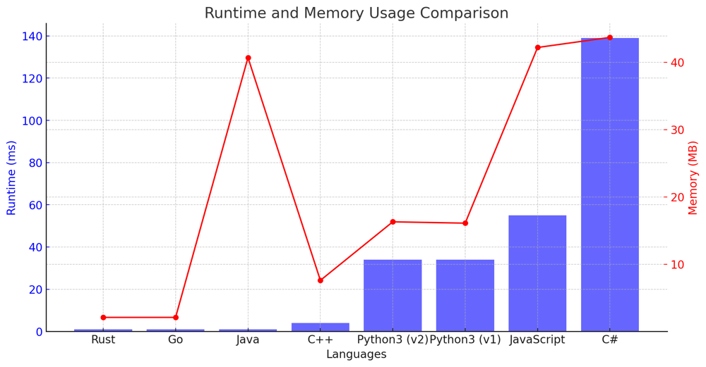

# ✅ 94.14% 2-Approaches Greedy

**Author:** vanAmsen
**Votes:** 113
**Link:** [https://leetcode.com/problems/text-justification/solutions/3952119/](https://leetcode.com/problems/text-justification/solutions/3952119/)

---

# Interview Problem Understanding

In interviews, understanding the problem at hand is half the battle. Let's break down the "Text Justification" challenge:

**The Scenario**: Imagine you're building a word processor, and you need to implement the "Justify" alignment feature. This means that when a user selects a group of words and chooses the "Justify" option, the text is adjusted so that each line spans the entire width of the available space. Words are spaced out, and additional spaces are added between them to achieve this uniform width.

**The Challenge**: Given an array of strings (or words) and a defined maximum width for each line:
- Your task is to format the text such that each line is exactly the specified maximum width.
- Each line should be both left and right justified. This means the words on each line are separated by one or more spaces to ensure the line extends from the very left to the very right.
- There's a catch, though. For lines that aren't the last, if the spaces don't divide evenly, the leftmost gaps get more spaces. For the very last line or a line with a single word, it should be left-justified, and the extra spaces are added to the end.

**Example**:
Suppose you're given the words `["This", "is", "an", "example", "of", "text", "justification."]` and a `maxWidth` of 16. This means each line of the output can only be 16 characters wide. Your output should resemble:

```
[
  "This    is    an",
  "example  of text",
  "justification.  "
]
```

**Input/Output**:
- **Input**: You're provided with an array of words and a maximum width for each line.
- **Output**: Your goal is to return a list of strings, where each string is a line of text that adheres to the justification rules.

---

# Live Coding + Explenation Modulo-based
https://youtu.be/KGfXrj7G0W0?si=VmyOm2RqX6yfMm9w

---

## Approach 1: Modulo-based Space Distribution

To solve the "Text Justification" problem using this approach, we pack words into each line using a greedy strategy. We then distribute spaces among the words on each line, using modulo arithmetic to decide where to place the extra spaces.

### Key Data Structures:
- **List**: To store the current words for a line and the result.

### Enhanced Breakdown:

1. **Initialization**:
   - We start by initializing empty lists for the result and the current line words.
   - A counter is also initialized to keep track of the total length of words in the current line.
   
2. **Processing Each Word**:
   - For each word, we check if adding the next word to the current line would make it exceed the maximum width.
   - If it does, we proceed to justify the current line. This involves distributing spaces among the words. The modulo arithmetic is handy here, ensuring that extra spaces are evenly spread among the words.
   - Once the line is justified, we reset the lists and counter for the next line.
   - A special case is the last line, where we simply left-justify the words.

3. **Wrap-up**:
   - Once all the words are processed and lines are justified, we return the result list.

## Example:

Given the `words = ["This", "is", "an", "example"]` and `maxWidth = 16`:

- The word "This" is added to the current line.
- The word "is" is added to the current line.
- The word "an" is added to the current line, completing it with the string "This    is    an".
- The word "example" starts a new line.

---

## Approach 2: Gap-based Space Distribution

In this method, the way we pack words into each line remains similar to the first approach. However, when it comes to distributing spaces, the logic is a tad different. Instead of using modulo arithmetic directly, we compute the number of gaps between words and then decide how many spaces to put in each gap. This makes the logic more intuitive.

### Key Data Structures:
- **List**: To store the current words for a line and the result.

### Enhanced Breakdown:

1. **Initialization**:
   - As before, we initialize empty lists for the result and the current line words.
   - A counter keeps track of the total length of words in the current line.
   
2. **Processing Each Word**:
   - For every word, we check if adding it to the current line would cross the maximum width.
   - If yes, we justify the current line. This time, we compute the total number of spaces required for the current line. This is based on the maximum width and the length of words on the line.
   - We then determine how many gaps exist between the words and compute the number of spaces that can be evenly distributed across these gaps.
   - Any extra spaces that can't be evenly distributed are then added to the gaps from left to right.
   - The last line is handled specially, where we left-justify the words.

3. **Wrap-up**:
   - After processing all the words and justifying the lines, we return the result list.

---

# Complexity:

**Time Complexity:** Both approaches process each word once and have a time complexity of $$O(n)$$, where $$n$$ is the number of words.

**Space Complexity:** The space complexity for both methods is $$O(n \	imes m)$$, where $$n$$ is the number of words and $$m$$ is the average length of the words.

---

# Performance:

| Language    | Runtime (ms) | Memory (MB) |
|-------------|--------------|-------------|
| Rust        | 1 ms         | 2.1 MB      |
| Go          | 1 ms         | 2.1 MB      |
| Java        | 1 ms         | 40.7 MB     |
| C++         | 4 ms         | 7.6 MB      |
| Python3 (v2)| 34 ms        | 16.3 MB     |
| Python3 (v1)| 34 ms        | 16.1 MB     |
| JavaScript  | 55 ms        | 42.2 MB     |
| C#          | 139 ms       | 43.7 MB     |



# Code Modulo-based
``` Python []
class Solution:
    def fullJustify(self, words: List[str], maxWidth: int) -> List[str]:
        res, line, width = [], [], 0

        for w in words:
            if width + len(w) + len(line) > maxWidth:
                for i in range(maxWidth - width): line[i % (len(line) - 1 or 1)] += ' '
                res, line, width = res + [''.join(line)], [], 0
            line += [w]
            width += len(w)

        return res + [' '.join(line).ljust(maxWidth)]
```
``` C++ []
class Solution {
public:
    std::vector<std::string> fullJustify(std::vector<std::string>& words, int maxWidth) {
        std::vector<std::string> res;
        std::vector<std::string> cur;
        int num_of_letters = 0;

        for (std::string word : words) {
            if (word.size() + cur.size() + num_of_letters > maxWidth) {
                for (int i = 0; i < maxWidth - num_of_letters; i++) {
                    cur[i % (cur.size() - 1 ? cur.size() - 1 : 1)] += ' ';
                }
                res.push_back("");
                for (std::string s : cur) res.back() += s;
                cur.clear();
                num_of_letters = 0;
            }
            cur.push_back(word);
            num_of_letters += word.size();
        }

        std::string last_line = "";
        for (std::string s : cur) last_line += s + ' ';
        last_line = last_line.substr(0, last_line.size()-1);  // remove trailing space
        while (last_line.size() < maxWidth) last_line += ' ';
        res.push_back(last_line);

        return res;
    }
};
```
``` Java []
public class Solution {
    public List<String> fullJustify(String[] words, int maxWidth) {
        List<String> res = new ArrayList<>();
        List<String> cur = new ArrayList<>();
        int num_of_letters = 0;

        for (String word : words) {
            if (word.length() + cur.size() + num_of_letters > maxWidth) {
                for (int i = 0; i < maxWidth - num_of_letters; i++) {
                    cur.set(i % (cur.size() - 1 > 0 ? cur.size() - 1 : 1), cur.get(i % (cur.size() - 1 > 0 ? cur.size() - 1 : 1)) + " ");
                }
                StringBuilder sb = new StringBuilder();
                for (String s : cur) sb.append(s);
                res.add(sb.toString());
                cur.clear();
                num_of_letters = 0;
            }
            cur.add(word);
            num_of_letters += word.length();
        }

        StringBuilder lastLine = new StringBuilder();
        for (int i = 0; i < cur.size(); i++) {
            lastLine.append(cur.get(i));
            if (i != cur.size() - 1) lastLine.append(" ");
        }
        while (lastLine.length() < maxWidth) lastLine.append(" ");
        res.add(lastLine.toString());

        return res;
    }
}
```
``` JavaScript []
/**
 * @param {string[]} words
 * @param {number} maxWidth
 * @return {string[]}
 */
var fullJustify = function(words, maxWidth) {
        let res = [];
        let cur = [];
        let num_of_letters = 0;

        for (let word of words) {
            if (word.length + cur.length + num_of_letters > maxWidth) {
                for (let i = 0; i < maxWidth - num_of_letters; i++) {
                    cur[i % (cur.length - 1 || 1)] += ' ';
                }
                res.push(cur.join(''));
                cur = [];
                num_of_letters = 0;
            }
            cur.push(word);
            num_of_letters += word.length;
        }

        let lastLine = cur.join(' ');
        while (lastLine.length < maxWidth) lastLine += ' ';
        res.push(lastLine);

        return res;
    }
```
``` C# []
public class Solution {
    public IList<string> FullJustify(string[] words, int maxWidth) {
        var res = new List<string>();
        var cur = new List<string>();
        int num_of_letters = 0;

        foreach (var word in words) {
            if (word.Length + cur.Count + num_of_letters > maxWidth) {
                for (int i = 0; i < maxWidth - num_of_letters; i++) {
                    cur[i % (cur.Count - 1 > 0 ? cur.Count - 1 : 1)] += " ";
                }
                res.Add(string.Join("", cur));
                cur.Clear();
                num_of_letters = 0;
            }
            cur.Add(word);
            num_of_letters += word.Length;
        }

        string lastLine = string.Join(" ", cur);
        while (lastLine.Length < maxWidth) lastLine += " ";
        res.Add(lastLine);

        return res;
    }
}
```
``` Go []
func fullJustify(words []string, maxWidth int) []string {
    var res []string
    var cur []string
    num_of_letters := 0

    for _, word := range words {
        if len(word) + len(cur) + num_of_letters > maxWidth {
            for i := 0; i < maxWidth - num_of_letters; i++ {
                cur[i % max(1, len(cur) - 1)] += " "
            }
            res = append(res, strings.Join(cur, ""))
            cur = cur[:0]
            num_of_letters = 0
        }
        cur = append(cur, word)
        num_of_letters += len(word)
    }

    lastLine := strings.Join(cur, " ")
    for len(lastLine) < maxWidth {
        lastLine += " "
    }
    res = append(res, lastLine)

    return res
}

// Helper function to get the maximum of two integers
func max(a, b int) int {
    if a > b {
        return a
    }
    return b
}
```
``` Rust []
impl Solution {
    pub fn full_justify(words: Vec<String>, max_width: i32) -> Vec<String> {
        let mut res = Vec::new();
        let mut cur = Vec::new();
        let mut num_of_letters: i32 = 0;

        for word in &words {
            if word.len() as i32 + cur.len() as i32 + num_of_letters > max_width {
                for i in 0..(max_width - num_of_letters) {
                    let idx = i as usize % (if cur.len() > 1 { cur.len() - 1 } else { cur.len() });
                    cur[idx] = format!("{} ", cur[idx]);
                }
                res.push(cur.join(""));
                cur.clear();
                num_of_letters = 0;
            }
            cur.push(word.clone());
            num_of_letters += word.len() as i32;
        }

        let last_line = cur.join(" ");
        res.push(format!("{:<width$}", last_line, width=max_width as usize));

        res
    }
}
```

# Code Gap-based
``` Python []
class Solution:
    def fullJustify(self, words: List[str], maxWidth: int) -> List[str]:
        res, cur_words, cur_len = [], [], 0

        for word in words:
            if cur_len + len(word) + len(cur_words) > maxWidth:
                total_spaces = maxWidth - cur_len
                gaps = len(cur_words) - 1
                if gaps == 0:
                    res.append(cur_words[0] + ' ' * total_spaces)
                else:
                    space_per_gap = total_spaces // gaps
                    extra_spaces = total_spaces % gaps
                    line = ''
                    for i, w in enumerate(cur_words):
                        line += w
                        if i < gaps:
                            line += ' ' * space_per_gap
                            if i < extra_spaces:
                                line += ' '
                    res.append(line)
                cur_words, cur_len = [], 0
            cur_words.append(word)
            cur_len += len(word)

        last_line = ' '.join(cur_words)
        remaining_spaces = maxWidth - len(last_line)
        res.append(last_line + ' ' * remaining_spaces)

        return res

```
``` C++ []
class Solution {
public:
    std::vector<std::string> fullJustify(std::vector<std::string>& words, int maxWidth) {
        std::vector<std::string> res, cur_words;
        int cur_len = 0;

        for (const std::string& word : words) {
            if (cur_len + word.length() + cur_words.size() > maxWidth) {
                int total_spaces = maxWidth - cur_len;
                int gaps = cur_words.size() - 1;
                if (gaps == 0) {
                    res.push_back(cur_words[0] + std::string(total_spaces, ' '));
                } else {
                    int space_per_gap = total_spaces / gaps;
                    int extra_spaces = total_spaces % gaps;
                    std::string line = "";
                    for (int i = 0; i < cur_words.size(); ++i) {
                        line += cur_words[i];
                        if (i < gaps) {
                            line += std::string(space_per_gap, ' ');
                            if (i < extra_spaces) {
                                line += ' ';
                            }
                        }
                    }
                    res.push_back(line);
                }
                cur_words.clear();
                cur_len = 0;
            }
            cur_words.push_back(word);
            cur_len += word.length();
        }

        std::string last_line = "";
        for (const std::string& word : cur_words) {
            if (!last_line.empty()) {
                last_line += ' ';
            }
            last_line += word;
        }
        last_line += std::string(maxWidth - last_line.length(), ' ');
        res.push_back(last_line);

        return res;
    }
};
```
``` Java []
public class Solution {
    public List<String> fullJustify(String[] words, int maxWidth) {
        List<String> res = new ArrayList<>();
        List<String> curWords = new ArrayList<>();
        int curLen = 0;

        for (String word : words) {
            if (curLen + word.length() + curWords.size() > maxWidth) {
                int totalSpaces = maxWidth - curLen;
                int gaps = curWords.size() - 1;
                if (gaps == 0) {
                    res.add(curWords.get(0) + " ".repeat(totalSpaces));
                } else {
                    int spacePerGap = totalSpaces / gaps;
                    int extraSpaces = totalSpaces % gaps;
                    StringBuilder line = new StringBuilder();
                    for (int i = 0; i < curWords.size(); i++) {
                        line.append(curWords.get(i));
                        if (i < gaps) {
                            line.append(" ".repeat(spacePerGap));
                            if (i < extraSpaces) {
                                line.append(' ');
                            }
                        }
                    }
                    res.add(line.toString());
                }
                curWords.clear();
                curLen = 0;
            }
            curWords.add(word);
            curLen += word.length();
        }

        StringBuilder lastLine = new StringBuilder(String.join(" ", curWords));
        while (lastLine.length() < maxWidth) {
            lastLine.append(' ');
        }
        res.add(lastLine.toString());

        return res;
    }
}
```
``` C# []
public class Solution {
    public IList<string> FullJustify(string[] words, int maxWidth) {
        List<string> res = new List<string>();
        List<string> curWords = new List<string>();
        int curLen = 0;

        foreach (string word in words) {
            if (curLen + word.Length + curWords.Count > maxWidth) {
                int totalSpaces = maxWidth - curLen;
                int gaps = curWords.Count - 1;
                if (gaps == 0) {
                    res.Add(curWords[0] + new string(' ', totalSpaces));
                } else {
                    int spacePerGap = totalSpaces / gaps;
                    int extraSpaces = totalSpaces % gaps;
                    StringBuilder line = new StringBuilder();
                    for (int i = 0; i < curWords.Count; i++) {
                        line.Append(curWords[i]);
                        if (i < gaps) {
                            line.Append(new string(' ', spacePerGap));
                            if (i < extraSpaces) {
                                line.Append(' ');
                            }
                        }
                    }
                    res.Add(line.ToString());
                }
                curWords.Clear();
                curLen = 0;
            }
            curWords.Add(word);
            curLen += word.Length;
        }

        string lastLine = string.Join(" ", curWords);
        while (lastLine.Length < maxWidth) {
            lastLine += ' ';
        }
        res.Add(lastLine);

        return res;
    }
}
```
``` JavaScript []
/**
 * @param {string[]} words
 * @param {number} maxWidth
 * @return {string[]}
 */
var fullJustify = function(words, maxWidth) {
        let res = [];
        let curWords = [];
        let curLen = 0;

        for (let word of words) {
            if (curLen + word.length + curWords.length > maxWidth) {
                let totalSpaces = maxWidth - curLen;
                let gaps = curWords.length - 1;
                if (gaps === 0) {
                    res.push(curWords[0] + ' '.repeat(totalSpaces));
                } else {
                    let spacePerGap = Math.floor(totalSpaces / gaps);
                    let extraSpaces = totalSpaces % gaps;
                    let line = '';
                    for (let i = 0; i < curWords.length; i++) {
                        line += curWords[i];
                        if (i < gaps) {
                            line += ' '.repeat(spacePerGap);
                            if (i < extraSpaces) {
                                line += ' ';
                            }
                        }
                    }
                    res.push(line);
                }
                curWords = [];
                curLen = 0;
            }
            curWords.push(word);
            curLen += word.length;
        }

        let lastLine = curWords.join(' ');
        while (lastLine.length < maxWidth) {
            lastLine += ' ';
        }
        res.push(lastLine);

        return res;
    }
```

The choice between the two methods will depend on the specific use-case and the preference for clarity vs. conciseness. Both approaches offer an efficient way to tackle the problem of text justification. \uD83D\uDCA1\uD83C\uDF20\uD83D\uDC69\u200D\uD83D\uDCBB\uD83D\uDC68\u200D\uD83D\uDCBB