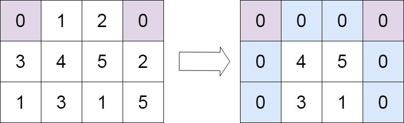

# [73. Set Matrix Zeroes](https://leetcode.com/problems/set-matrix-zeroes/)

| Category | Difficulty | Likes | Dislikes |
| :------: | :--------: | :---: | :------: |
| Algorithms | Medium | 16705 | 842 |

**Tags:** [`array`](https://leetcode.com/tag/array), [`hash-table`](https://leetcode.com/tag/hash-table), [`matrix`](https://leetcode.com/tag/matrix)

**Companies:** `google`, `facebook`, `amazon`, `microsoft`, `bloomberg`, `walmart-labs`, `ebay`, `nutanix`, `oracle`, `apple`, `infosys`, `autodesk`, `jpmorgan`, `goldman-sachs`, `adobe`, `expedia`, `uber`, `servicenow`, `nvidia`, `zoho`, `tcs`

## Description

Given an `m x n` integer matrix `matrix`, if an element is `0`, set its entire row and column to `0`'s.

You must do it in place.

 

**Example 1:**


```

Input: matrix = [[1,1,1],[1,0,1],[1,1,1]]
Output: [[1,0,1],[0,0,0],[1,0,1]]

```

**Example 2:**


```

Input: matrix = [[0,1,2,0],[3,4,5,2],[1,3,1,5]]
Output: [[0,0,0,0],[0,4,5,0],[0,3,1,0]]

```

 

**Constraints:**

	- `m == matrix.length`

	- `n == matrix[0].length`

	- `1 <= m, n <= 200`

	- `-2^31 <= matrix[i][j] <= 2^31 - 1`

 

**Follow up:**

	- A straightforward solution using `O(mn)` space is probably a bad idea.

	- A simple improvement uses `O(m + n)` space, but still not the best solution.

	- Could you devise a constant space solution?

---

**Links:** [Submissions](https://leetcode.com/problems/set-matrix-zeroes/) | [Solutions](https://leetcode.com/problems/set-matrix-zeroes/)
