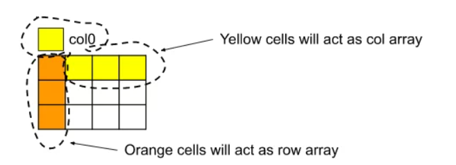

# Full Explanation || Super easy || constant space

**Author:** raunakkodwani
**Votes:** 456
**Link:** [https://leetcode.com/problems/set-matrix-zeroes/solutions/3472518/](https://leetcode.com/problems/set-matrix-zeroes/solutions/3472518/)

---

# Intuition
In this approach, we can just improve the space complexity. So, instead of using two extra matrices row and col, we will use the 1st row and 1st column of the given matrix to keep a track of the cells that need to be marked with 0. But here comes a problem. If we try to use the 1st row and 1st column to serve the purpose, the cell matrix[0][0] is taken twice. To solve this problem we will take an extra variable col0 initialized with 1. Now the entire 1st row of the matrix will serve the purpose of the row array. And the 1st column from (0,1) to (0,m-1) with the col0 variable will serve the purpose of the col array



<!-- Describe your first thoughts on how to solve this problem. -->

# Approach
The steps are as follows:

First, we will traverse the matrix and mark the proper cells of 1st row and 1st column with 0 accordingly. The marking will be like this: if cell(i, j) contains 0, we will mark the i-th row i.e. matrix[i][0] with 0 and we will mark j-th column i.e. matrix[0][j] with 0.
If i is 0, we will mark matrix[0][0] with 0 but if j is 0, we will mark the col0 variable with 0 instead of marking matrix[0][0] again.

After step 1 is completed, we will modify the cells from (1,1) to (n-1, m-1) using the values from the 1st row, 1st column, and col0 variable.

We will not modify the 1st row and 1st column of the matrix here as the modification of the rest of the matrix(i.e. From (1,1) to (n-1, m-1)) is dependent on that row and column.

Finally, we will change the 1st row and column using the values from matrix[0][0] and col0 variable. Here also we will change the row first and then the column.

If matrix[0][0] = 0, we will change all the elements from the cell (0,1) to (0, m-1), to 0.
If col0 = 0, we will change all the elements from the cell (0,0) to (n-1, 0), to 0. Note that the above approach is provided by Striver on youtube.
<!-- Describe your approach to solving the problem. -->


# Complexity
- Time complexity:O(n^2)
<!-- Add your time complexity here, e.g. $$O(n)$$ -->

- Space complexity:O(1)
<!-- Add your space complexity here, e.g. $$O(n)$$ -->

# Code
```
public class Solution {
public void setZeroes(int[][] matrix) {
    boolean fr = false,fc = false;
    for(int i = 0; i < matrix.length; i++) {
        for(int j = 0; j < matrix[0].length; j++) {
            if(matrix[i][j] == 0) {
                if(i == 0) fr = true;
                if(j == 0) fc = true;
                matrix[0][j] = 0;
                matrix[i][0] = 0;
            }
        }
    }
    for(int i = 1; i < matrix.length; i++) {
        for(int j = 1; j < matrix[0].length; j++) {
            if(matrix[i][0] == 0 || matrix[0][j] == 0) {
                matrix[i][j] = 0;
        }}
    }
    if(fr) {
        for(int j = 0; j < matrix[0].length; j++) {
            matrix[0][j] = 0;
        }
    }
    if(fc) {
        for(int i = 0; i < matrix.length; i++) {
            matrix[i][0] = 0;
        }
    }
}}  

```


