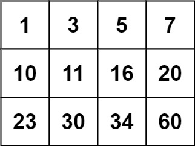

# [74. Search a 2D Matrix](https://leetcode.com/problems/search-a-2d-matrix/)

| Category | Difficulty | Likes | Dislikes |
| :------: | :--------: | :---: | :------: |
| Algorithms | Medium | 17502 | 470 |

**Tags:** [`array`](https://leetcode.com/tag/array), [`binary-search`](https://leetcode.com/tag/binary-search), [`matrix`](https://leetcode.com/tag/matrix)

**Companies:** `amazon`, `google`, `bloomberg`, `facebook`, `microsoft`, `adobe`, `oracle`, `goldman-sachs`, `tiktok`, `apple`, `nutanix`, `yahoo`, `walmart-labs`, `snapchat`, `tinkoff`

## Description

You are given an `m x n` integer matrix `matrix` with the following two properties:

	- Each row is sorted in non-decreasing order.

	- The first integer of each row is greater than the last integer of the previous row.

Given an integer `target`, return `true` *if* `target` *is in* `matrix` *or* `false` *otherwise*.

You must write a solution in `O(log(m * n))` time complexity.

 

**Example 1:**


```

Input: matrix = [[1,3,5,7],[10,11,16,20],[23,30,34,60]], target = 3
Output: true

```

**Example 2:**


```

Input: matrix = [[1,3,5,7],[10,11,16,20],[23,30,34,60]], target = 13
Output: false

```

 

**Constraints:**

	- `m == matrix.length`

	- `n == matrix[i].length`

	- `1 <= m, n <= 100`

	- `-10^4 <= matrix[i][j], target <= 10^4`

---

**Links:** [Submissions](https://leetcode.com/problems/search-a-2d-matrix/) | [Solutions](https://leetcode.com/problems/search-a-2d-matrix/)
