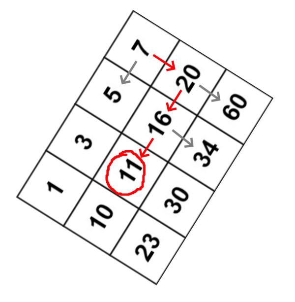

# ✔️ [C++] BINARY SEARCH TREE ٩(•̤̀ᵕ•̤́๑)૭✧, Explained with IMG

**Author:** artod
**Votes:** 1134
**Link:** [https://leetcode.com/problems/search-a-2d-matrix/solutions/1895837/](https://leetcode.com/problems/search-a-2d-matrix/solutions/1895837/)

---

**UPVOTE if you like (\uD83C\uDF38\u25E0\u203F\u25E0), If you have any question, feel free to ask.**

If closely analyze the given matrix, we can notice one interesting property (\u256D\u0CB0_\u2022\u0301): elements on the left are always smaller than the current element, and elements on the bottom are always greater. It reminds us of the Binary Search Tree, doesn't it (\u0E4F\u0E47\u0A9F\u0AC4\u25DF\u0E4F\u0E47 )? Just look at this matrix from this angle  and everything will become clear to you (our target, say, is 11):


Woooooow!!! \u0669(\u02CA\u15DC\u02CB*)\u0648

Time: **O(n)** - in the case we have just one row
Space: **O(1)** - nothing stored

Runtime: 3 ms, faster than **88.01%** of C++ online submissions for Search a 2D Matrix.
Memory Usage: 9.6 MB, less than **52.00%** of C++ online submissions for Search a 2D Matrix.

```
class Solution {
public:
    bool searchMatrix(vector<vector<int>>& matrix, int target) {
        int rows = matrix.size(),
			cols = matrix[0].size(),
            row = 0, col = cols - 1;
			
        while (row < rows && col > -1) {
            int cur = matrix[row][col];
            if (cur == target) return true;
            if (target > cur) row++;
            else col--;
        }
        
        return false;
    }
};
```

**UPVOTE if you like (\uD83C\uDF38\u25E0\u203F\u25E0), If you have any question, feel free to ask.**