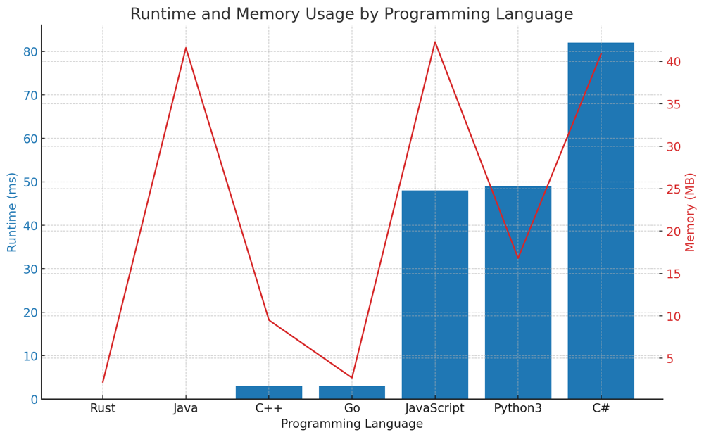

# ✅ 100% Binary Search [VIDEO] - Simple Solution

**Author:** vanAmsen
**Votes:** 162
**Link:** [https://leetcode.com/problems/search-a-2d-matrix/solutions/3874071/](https://leetcode.com/problems/search-a-2d-matrix/solutions/3874071/)

---

# Problem Understanding
The task is to find a target integer in a 2D matrix with the following properties: 
1. Each row is sorted in non-decreasing order.
2. The first integer of each row is greater than the last integer of the previous row.

The challenge is to determine if the target integer exists within the matrix.

# Approach
Given the problem, it may be tempting to perform a linear search through the entire matrix, but this would result in a time complexity of $$O(m \	imes n)$$, which is not acceptable given the problem's constraint of $$O(\\log(m \	imes n))$$.

Instead, we can leverage the fact that the matrix is sorted both row-wise and column-wise, and apply a binary search to find the target.

# Live Coding & Explenation
https://youtu.be/ePF8QegEy-8

## Treating the Matrix as a 1-Dimensional Array
To apply binary search, we need a one-dimensional array. We can treat our 2-D matrix as a one-dimensional array because of the matrix's sorted property. The first integer of each row is greater than the last integer of the previous row, so we can think of the rows as being appended one after the other to form a single sorted array.

## Binary Search
Binary search is a search algorithm that finds the position of a target value within a sorted array. It compares the target value to the middle element of the array. If they are not equal, the half in which the target cannot lie is eliminated, and the search continues on the remaining half until it is successful or the remaining half is empty.

## Initialization
Before we start the binary search, we need to initialize two pointers:

1. `left` - This represents the start of the array. We set this to 0 (the index of the first element).
2. `right` - This represents the end of the array. We set this to `m * n - 1` (the index of the last element), where `m` and `n` are the number of rows and columns in the matrix, respectively.

## Iterative Binary Search
We perform a binary search iteratively within a while loop until `left` exceeds `right`. In each iteration, we calculate the midpoint between `left` and `right`.

To get the row and column of the midpoint in the matrix, we use the `divmod` function with `mid` and `n`. The `divmod` function takes two numbers and returns a pair of numbers (a tuple) consisting of their quotient and remainder.

We then compare the value at the midpoint with the target:

1. If the midpoint value is equal to the target, we have found the target in the matrix, and we return `True`.
2. If the midpoint value is less than the target, this means the target must be in the right half of the array. So, we adjust `left` to be `mid + 1`.
3. If the midpoint value is greater than the target, this means the target must be in the left half of the array. So, we adjust `right` to be `mid - 1`.

If we exit the while loop, that means we did not find the target in the matrix, so we return `False`.

# Complexity
## Time Complexity
The time complexity is $$O(\\log(m \	imes n))$$, since we're effectively performing a binary search over the $$m \	imes n$$ elements of the matrix.

## Space Complexity
The space complexity is $$O(1)$$ because we only use a constant amount of space to store our variables (`left`, `right`, `mid`, `mid_value`), regardless of the size of the input matrix.

# Performance
The performance of this solution is optimal given the problem constraints. Since the matrix is sorted and the problem requires us to find an element, binary search is the best possible approach.

Certainly, here's the table sorted by runtime (ms) and then by memory usage (MB):

| Programming Language | Runtime (ms) | Beats (%) | Memory (MB) | Beats (%) |
|---|---|---|---|---|
| Rust | 0 | 100 | 2.2 | 28.37 |
| Java | 0 | 100 | 41.6 | 9.3 |
| C++ | 3 | 82.89 | 9.5 | 19.73 |
| Go | 3 | 58.16 | 2.7 | 98.33 |
| JavaScript | 48 | 92.89 | 42.3 | 28.19 |
| Python3 | 49 | 90.75 | 16.8 | 64.57 |
| C# | 82 | 99.1 | 40.9 | 35.48 |




# Code
```Python []
class Solution:
    def searchMatrix(self, matrix: List[List[int]], target: int) -> bool:
        if not matrix:
            return False
        m, n = len(matrix), len(matrix[0])
        left, right = 0, m * n - 1

        while left <= right:
            mid = (left + right) // 2
            mid_row, mid_col = divmod(mid, n)

            if matrix[mid_row][mid_col] == target:
                return True
            elif matrix[mid_row][mid_col] < target:
                left = mid + 1
            else:
                right = mid - 1

        return False
```
``` C++ []
class Solution {
public:
    bool searchMatrix(vector<vector<int>>& matrix, int target) {
        int m = matrix.size();
        int n = matrix[0].size();
        int left = 0, right = m * n - 1;

        while (left <= right) {
            int mid = left + (right - left) / 2;
            int mid_val = matrix[mid / n][mid % n];

            if (mid_val == target)
                return true;
            else if (mid_val < target)
                left = mid + 1;
            else
                right = mid - 1;
        }
        return false;
    }
};
```
``` Java []
class Solution {
    public boolean searchMatrix(int[][] matrix, int target) {
        int m = matrix.length;
        int n = matrix[0].length;
        int left = 0, right = m * n - 1;

        while (left <= right) {
            int mid = left + (right - left) / 2;
            int mid_val = matrix[mid / n][mid % n];

            if (mid_val == target)
                return true;
            else if (mid_val < target)
                left = mid + 1;
            else
                right = mid - 1;
        }
        return false;
    }
}
```
``` JavaScript []
/**
 * @param {number[][]} matrix
 * @param {number} target
 * @return {boolean}
 */
var searchMatrix = function(matrix, target) {
    let m = matrix.length;
    let n = matrix[0].length;
    let left = 0, right = m * n - 1;

    while (left <= right) {
        let mid = Math.floor((left + right) / 2);
        let mid_val = matrix[Math.floor(mid / n)][mid % n];

        if (mid_val === target)
            return true;
        else if (mid_val < target)
            left = mid + 1;
        else
            right = mid - 1;
    }
    return false;
};
```
``` C# []
public class Solution {
    public bool SearchMatrix(int[][] matrix, int target) {
        int m = matrix.Length;
        int n = matrix[0].Length;
        int left = 0, right = m * n - 1;

        while (left <= right) {
            int mid = left + (right - left) / 2;
            int mid_val = matrix[mid / n][mid % n];

            if (mid_val == target)
                return true;
            else if (mid_val < target)
                left = mid + 1;
            else
                right = mid - 1;
        }
        return false;
    }
}
```
``` Go []
func searchMatrix(matrix [][]int, target int) bool {
    m := len(matrix)
    n := len(matrix[0])
    left, right := 0, m*n-1

    for left <= right {
        mid := left + (right-left)/2
        mid_val := matrix[mid/n][mid%n]

        if mid_val == target {
            return true
        } else if mid_val < target {
            left = mid + 1
        } else {
            right = mid - 1
        }
    }
    return false
}
```
``` Rust []
impl Solution {
    pub fn search_matrix(matrix: Vec<Vec<i32>>, target: i32) -> bool {
        let rows = matrix.len() as i32;
        let cols = matrix[0].len() as i32;

        let mut start = 0;
        let mut end = rows * cols - 1;

        while start <= end {
            let mid = start + (end - start) / 2;
            let mid_value = matrix[(mid / cols) as usize][(mid % cols) as usize];

            if mid_value == target {
                return true;
            } else if mid_value < target {
                start = mid + 1;
            } else {
                end = mid - 1;
            }
        }

        false
    }
}
```

# Live Coding + Explenation in Go
https://youtu.be/edGrFBOtnc4

I hope you find this solution helpful in understanding how to solve the "Search a 2D Matrix" problem. If you have any further questions or need additional clarifications, please don't hesitate to ask. If you understood the solution and found it beneficial, please consider giving it an upvote. Happy coding, and may your coding journey be filled with success and satisfaction! \uD83D\uDE80\uD83D\uDC68\u200D\uD83D\uDCBB\uD83D\uDC69\u200D\uD83D\uDCBB