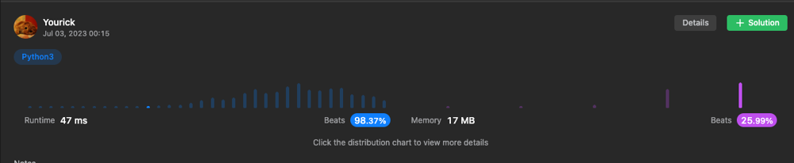

# [Python 3] 2 Approaches ||  beats 98% || 47ms

**Author:** yourick
**Votes:** 19
**Link:** [https://leetcode.com/problems/search-a-2d-matrix/solutions/3516367/](https://leetcode.com/problems/search-a-2d-matrix/solutions/3516367/)

---

```python3 []
class Solution:
    def searchMatrix(self, matrix: List[List[int]], target: int) -> bool:
        r, c = 0, len(matrix[0]) - 1

        while r < len(matrix) and c >= 0:
            if matrix[r][c] < target: r += 1
            elif matrix[r][c] > target: c -= 1
            else: return True
        
        return False
```
```python3 []
class Solution:
    def searchMatrix(self, matrix: List[List[int]], target: int) -> bool:
        R, C = len(matrix), len(matrix[0])
        l, r = 0, R*C-1

        while l <= r:
            mid = l + (r-l)//2
            row, col = mid // C, mid % C
            if matrix[row][col] < target:
                l = mid + 1
            elif matrix[row][col] > target:
                r = mid - 1
            else:
                return True

        return False
```
```php []
class Solution {

    /**
     * @param Integer[][] $matrix
     * @param Integer $target
     * @return Boolean
     */
    function searchMatrix($matrix, $target) {
        if(count($matrix) == 0) {
            return false;
        }
        
        $height = count($matrix);
        $width = count($matrix[0]);
        $start = 0;
        $end = $width * $height - 1;

        while($start <= $end) {
            $midIndex = $start + floor(($end-$start)/2);
            $midValue = $matrix[floor($midIndex/$width)][$midIndex%$width];
            
            if($target == $midValue) {
                return true;
            } else if($target > $midValue) {
                $start = $midIndex+1;
            } else {
                $end = $midIndex-1;
            }
        }
        
        return false;
    }
}
```


