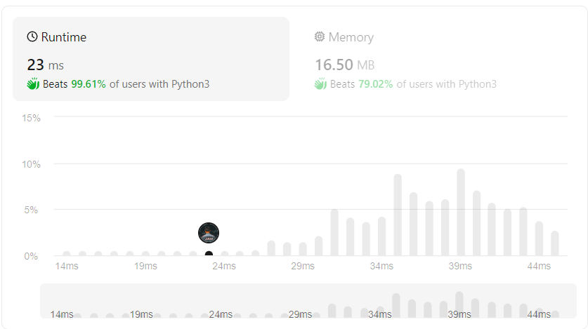

# Beats 99.61% Solutions

**Author:** deleted_user
**Votes:** 14
**Link:** [https://leetcode.com/problems/sort-colors/solutions/5299067/](https://leetcode.com/problems/sort-colors/solutions/5299067/)

---

### [Best Solution for Beginners] Beats 100% solutions\uD83E\uDD2F Very Easy to understand.


*while traversing if you find the left element > right element swap them and you are good to go.*

# Code
```C []
void sortColors(int* nums, int numsSize)
{
    for(int i=0;i<numsSize;i++)
    { 
       int min=i;
       for(int j=i+1;j<numsSize;j++)
       {
           if(nums[min]>nums[j])
               min=j;
       }
        int temp=nums[i];
        nums[i]=nums[min];
        nums[min]=temp;
    }   
}
```
```C++ []
class Solution {
public:
    void sortColors(vector<int>& nums) {
        int n = nums.size();
        for (int i = 0; i < n - 1; ++i) {
            for (int j = i + 1; j < n; ++j) {
                if (nums[i] > nums[j]) {
                    std::swap(nums[i], nums[j]);
                }
            }
        }
    }
};
```
```Java []
class Solution {
    public void sortColors(int[] nums) {
        int zeros = 0, ones = 0, n = nums.length;
        for(int num : nums) {
            if(num == 0) zeros++;
            else if(num == 1) ones++;
        }  

        for(int i = 0; i < zeros; ++i) {
            nums[i] = 0;
        }

        for(int i = zeros; i < zeros + ones; ++i) {
            nums[i] = 1;
        }

        for(int i = zeros + ones; i < n; ++i) {
            nums[i] = 2;
        }
    }
}
```

```Python []
class Solution:
    def sortColors(self, l: List[int]) -> None:
        n=len(l)
        for i in range(n-1):
            for j in range(i+1,n):
                if(l[i]>l[j]):
                    l[i],l[j]=l[j],l[i]
```
```C# []
public class Solution {
    public void SortColors(int[] nums) {
        // Initialize frequency Array.
        int[] freq = new int[3];

        // Counting Frequencies of Colors.
        foreach (int color in nums) freq[color]++;

        // Soring numbers based on their frequiencies.
        int i = 0, j = 0;
        while (i < freq.Length) {
            int len = freq[i] + j;
            while (j < len) nums[j++] = i;
            i++;
        }
    }
}
```
```JavaScript []
/**
 * @param {number[]} nums
 * @return {void} Do not return anything, modify nums in-place instead.
 */
var sortColors = function(nums) {
    let n = nums.length;
        for (let i = 0; i < n - 1; ++i) {
            for (let j = i + 1; j < n; ++j) {
                if (nums[i] > nums[j]) {
                    // Swap nums[i] and nums[j]
                    let temp = nums[i];
                    nums[i] = nums[j];
                    nums[j] = temp;
                }
            }
        }
};
```
```PHP []
class Solution {

    /**
     * @param Integer[] $nums
     * @return NULL
     */
    function sortColors(&$nums) {
        $colors = [
            0 => 0,
            1 => 0,
            2 => 0,
        ];

        foreach($nums as $num) {
            $colors[$num]++;
        }

        $nums = [];
        foreach($colors as $val => $count){
            while($count > 0) {
                $nums[] = $val;
                $count--;
            }
        }
    }
}
```
```Kotlin []
class Solution {
    fun sortColors(nums: IntArray): Unit {
        var k1=-1
        var k2=0
        val n = nums.size
        for(i in 0..n-1){
            if(nums[i]==0){
                if(k1!=-1 && k1<n){
                    val temp = nums[k1]
                    nums[k1] = nums[i]
                    nums[i] = temp
                    k1++
                }
                if(k2<n){
                    val temp = nums[k2]
                    nums[k2] = nums[i]
                    nums[i] = temp
                    k2++
                }
            }
            else if(nums[i]==1){
                if(k1==-1) k1=k2;
                if(k2<n){
                    val temp = nums[k2]
                    nums[k2] = nums[i]
                    nums[i] = temp
                    k2++
                }
            }
        }
    }
}
```

